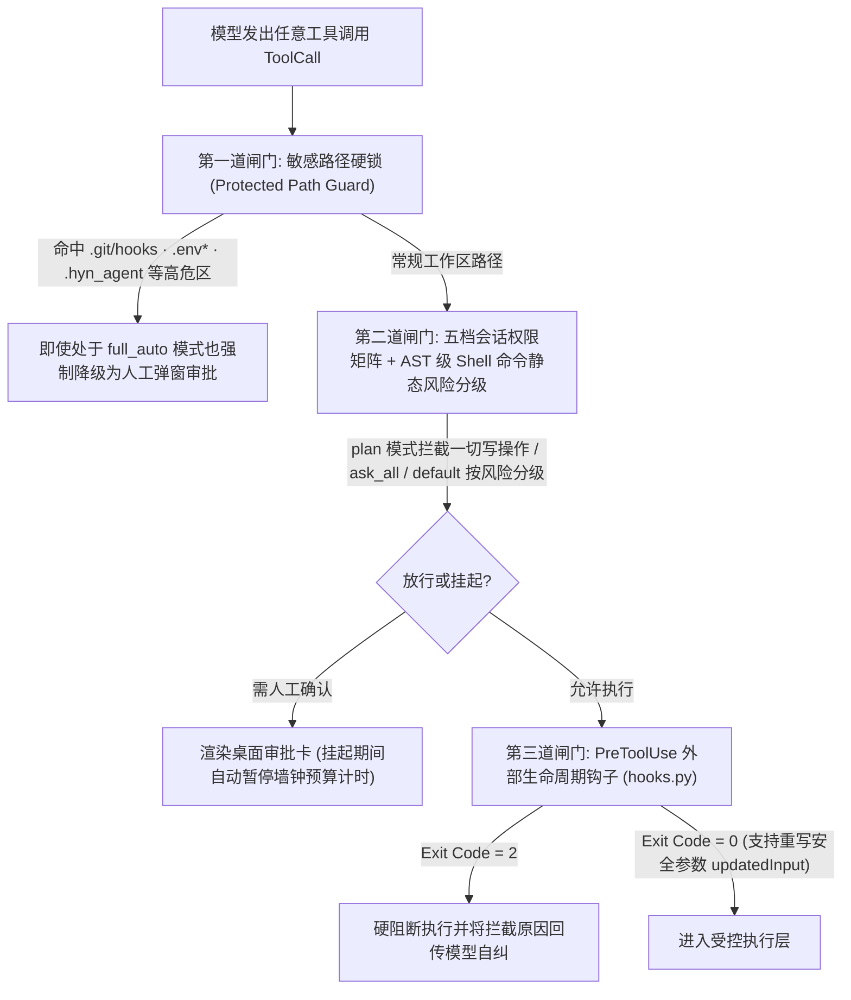
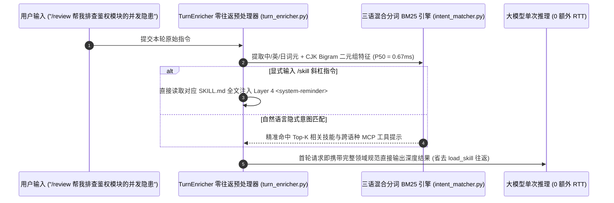
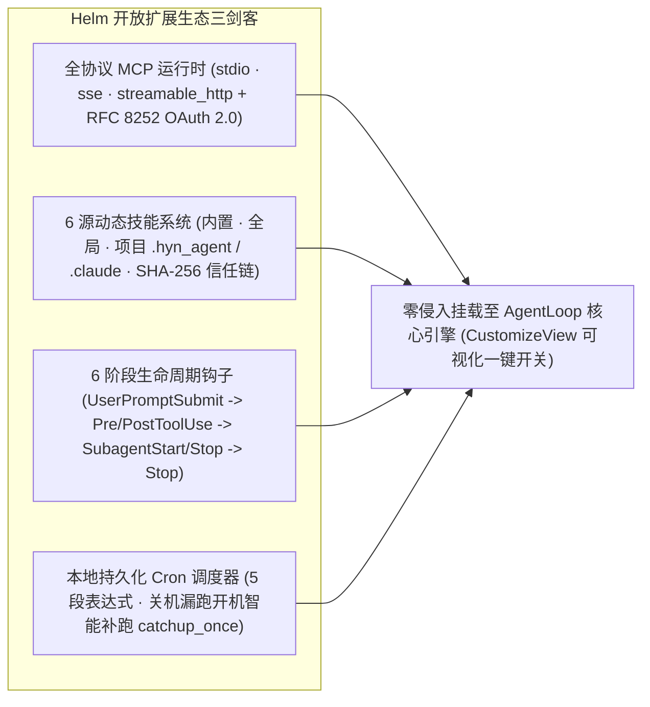

# 6. 五档权限沙箱、零往返意图匹配与开放生态

> [!NOTE] 关联核心源码与公开实测证据
> - 核心源码：`app/services/permission_mode.py`、`permission.py`、`plan_submission.py`、`clarification.py`、`intent_matcher.py`、`turn_enricher.py`、`mcp_runtime.py`、`mcp_oauth.py`、`skill_loader.py`、`hooks.py`、`cron_scheduler.py`
> - 权威实测报告：[Harness 架构护栏消融报告 (30/30 越权攻击 100% 拦截 · 0.67ms 零往返意图匹配 · 100% 跨语种 MCP 召回)](/benchmarks/harness-ablation-v1)

## 6.1 五档交互权限矩阵、三道安全闸门与零破环 `Plan Mode`

桌面端 Agent 直接运行在用户的真实文件系统与内网环境中——**权限卡太死会沦为每步弹窗的“人工点击器”，权限放太松则可能因一句恶意网页提示词注入而删库或篡改 `.git/hooks` 植入后门**。

Helm 在 `permission_mode.py` 与 `permission.py` 中构建了**五档交互模式 + 无人值守专用档**，并在任何工具真正触碰操作系统前强制穿过三道物理闸门：

| 权限档位 (`mode`) | 只读探查工具 | 工作区代码/文档修改 | 终端命令执行 (`Shell`) | 高危敏感路径 (`.env*` / `.git/hooks`) | 典型适用场景 |
| :--- | :--- | :--- | :--- | :--- | :--- |
| **`plan`（只读规划）** | 自动放行 | **物理拦截（仅许提交方案）** | **物理拦截** | **强制人工审批** | 陌生大库架构梳理、重构前先审方案 |
| **`ask_all`（步步确认）** | 自动放行 | 每次人工审批 | 每次人工审批 | **强制人工审批** | 生产环境排障、合规高敏目录操作 |
| **`default`（均衡默认）** | 自动放行 | 展示 Diff 确认 | 白名单只读放行，其余审批 | **强制人工审批** | 日常交互式研发与办公文档协作 |
| **`auto_edit`（自动改码）** | 自动放行 | **自动放行（写后快照）** | 危险命令需审批 | **强制人工审批** | 高频多文件编码、受控 TDD 迭代 |
| **`full_auto`（全速自治）** | 自动放行 | **自动放行** | 工作区内自动放行 | **依然强制人工审批（防逃逸底线）** | 长程无人值守重构、评测基准跑分 |

### 零破环 `Plan Mode` 与抗重启 `ask_user` 澄清卡片
- **前缀友好的 `Plan Mode`（`plan_submission.py` + `PlanCard.js`）**：用户在会话中途随时切换 `Plan Mode` 时，系统绝不篡改 Layer 1 系统提示词或 Layer 2 工具列表（保持 KV 缓存 100% 命中），而是通过 Layer 4 `<system-reminder>` 注入规划约束并在执行层拦截写操作；模型调用 `submit_plan` 提交结构化方案后，前端渲染交互式 `PlanCard`，支持一键批准并自动切换至执行档位开工。
- **无悬空 Future 的持久化澄清器（`clarification.py` + `QuestionCard.js`）**：当需求存在歧义时，模型调用 `ask_user` 生成单选/多选/自由补充卡片。不同于把协程挂在内存里的脆弱实现，Helm 将待决问题状态完整序列化落盘——即使中途彻底关闭软件再重启，点击卡片依然能无缝恢复原会话上下文继续推进。

---

## 6.2 小于 `1ms` 零往返三语意图引擎（Zero-RTT Turn Enricher）

传统技能（Skills）与海量 MCP 工具面临一个两难困境：把几十个技能全文全塞进系统提示词会白白烧掉数万 Token；而让模型先调一次 `load_skill` 工具再去读内容，每句话又要多花 `2～5 秒` 的额外大模型网络往返（1 Extra RTT）。

Helm 在 `intent_matcher.py` 与 `turn_enricher.py` 中实现了**纯 CPU 亚毫秒级零往返预装配管道**：

> [!TIP] 核心架构权衡与工程闭环：为什么不用本地 Embedding 小模型而自研三语混合 BM25？
> - **工程痛点**：中文/日文用户输入“查一下数据库表结构”去匹配全英文描述的 MCP 工具（如 `postgres_inspect_schema`）时，纯关键词匹配召回惨淡；但在桌面端常驻一个数百 MB 的 Embedding 模型既占内存又拖慢冷启动。
> - **常规方案缺陷**：依赖二次 LLM 路由每次增加数秒首字延迟，破坏桌面软件的跟手感。
> - **Helm 底层解法**：构建轻量级内置跨语种同义词桥接词典 + ASCII 词干提取 + CJK 字符 Bigram 混合倒排索引，纯 Python 内存计算无需任何 GPU/ONNX 依赖。
> - **实测定量收益**：单次意图匹配中位耗时仅 **`0.67 ms`**（`<1 ms`），显式 `/skill` 调用稳定节省 **`1` 次完整 LLM 往返延迟**，跨语种 MCP 工具 Top-3 检索召回率在消融测试中达到 **`100.0%`**。

---

## 6.3 全协议 MCP 客户端（含 OAuth 2.0）、六级钩子与本地 Cron 调度

1. **企业级全协议 MCP 与 RFC 8252 OAuth 2.0 闭环（`mcp_runtime.py`、`mcp_oauth.py`）**：
   - 完整支持 `stdio`、`sse` 与新一代 `streamable_http` 传输协议，涵盖 MCP Tools、Resources 资源挂载与 Elicitation 动态表单交互。
   - **原生攻克商业 SaaS 授权痛点**：内置符合 RFC 8252 标准的本地回环 PKCE OAuth 2.0 授权流，自动拉起系统浏览器完成企业账号登录，并将获取的 Access / Refresh Token 立即交由 **Windows DPAPI 硬件级加密入库**与后台无感续期。
   - **30 工具防膨胀门禁**：当挂载的外部 MCP 工具总数超过 `30` 个时，自动启用 `mcp_search_tools` 按需动态挂载机制，防止数百个外部 Schema 撑爆上下文窗口。
2. **六级确定性生命周期钩子（`hooks.py`）与 SHA-256 仓库防投毒**：
   - 全面对齐工程级自动化需求，开放 `UserPromptSubmit`、`PreToolUse`、`PostToolUse`、`SubagentStart`、`SubagentStop`、`Stop` 六大拦截点，支持注入额外上下文（`additionalContext`）、改写工具入参（`updatedInput`）或以退出码 `2` 强制阻断违规操作。
   - **安全防线**：克隆陌生开源仓库时，项目内携带的 `.hyn_agent` 脚本钩子与技能默认处于隔离态，必须经用户确认并记录内容级 **SHA-256 信任指纹**后方可激活；一旦文件被篡改，哈希失配立即自动吊销执行权。
3. **本机抗休眠 Cron 定时自动化（`cron_scheduler.py`）**：
   - 支持标准 5 段式 Cron 定时任务（如每日晨间拉取 Git 变更汇总日报、定时巡检接口健康度），内置 `catchup_once` 漏跑补偿策略——即便笔记本夜间合盖休眠错过触发点，次日唤醒开盖后也会自动有序补跑一次并推送原生桌面通知。