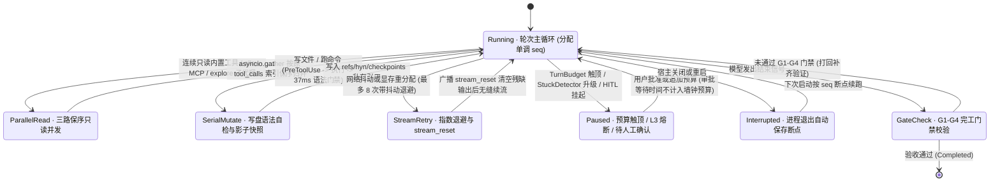
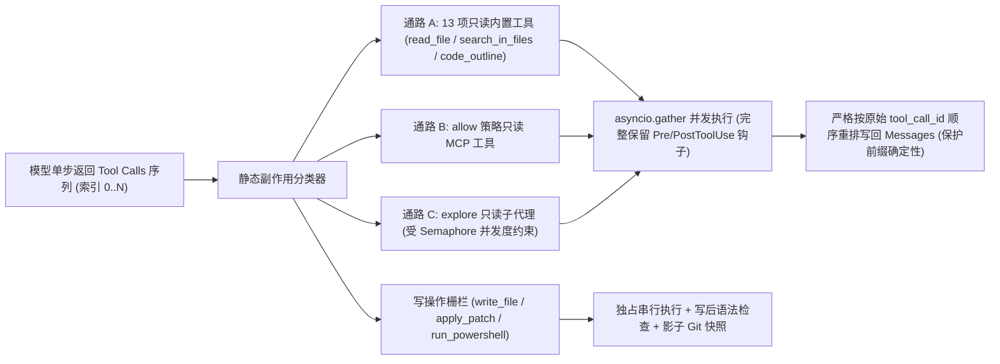
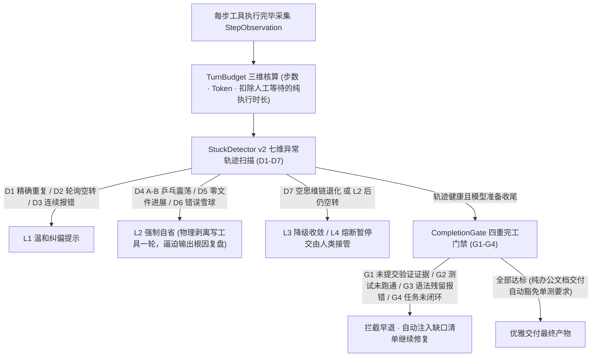

# 2. 零框架长程自治引擎与三路并发

> [!NOTE] 关联核心源码与公开实测证据
> - 核心源码：`app/services/agent_loop.py`（`5,227` 行零框架核心循环）、`turn_hub.py`、`turn_budget.py`、`stuck_detector.py`、`completion.py`、`ripgrep.py`、`code_outline.py`、`syntax_check.py`、`git_checkpoints.py`
> - 权威实测报告：[SWE-bench Verified Mini 报告 (84.0% 峰值)](/benchmarks/swebench-mini-v1) · [Polyglot 6语言盲测报告 (24/24)](/benchmarks/polyglot-mini-v1) · [Harness 护栏消融报告 (-87.7% 无效步)](/benchmarks/harness-ablation-v1)

## 2.1 为什么彻底摒弃 LangChain，纯自研 5,227 行异步状态机？

市面上绝大多数对话式 Agent 在 3～5 分钟的短任务中表现尚可，一旦进入长达数十分钟甚至数小时的跨模块重构，就会集中死于四大工程顽疾：**① 网关抖动或前端刷新导致长任务前功尽弃；② 串行读取十几个文件拖慢推理节奏；③ 陷入重复报错死循环或改完代码不跑测试就早退；④ 临时提交污染用户 Git 分支历史**。

Helm 不依赖任何第三方 Agent 框架（零 LangChain / LangGraph / AutoGen 封装），完全基于 Python `asyncio` 构建确定性状态机：

---

## 2.2 三路自动保序只读并发（3-Path Parallel Read Execution）

当大模型在单步推理中同时发出多个探查指令（例如同时查阅 5 个源码文件、搜索 2 处符号引用并派发 2 个 `explore` 子代理）时，传统串行循环只能逐个等待。`agent_loop.py` 在工具分发层实现了**无锁保序分批调度器**：

> [!TIP] 核心架构权衡与工程闭环：并发提速如何避免破坏消息顺序与钩子契约？
> - **工程痛点**：代码调研阶段 70% 以上的工具调用都是纯只读操作，串行 I/O 与子代理等待严重拉长端到端耗时。
> - **常规方案缺陷**：若按“谁先返回谁先入队”乱序写回 `tool` 消息，不仅违反部分大模型严格的 `tool_call_id` 配对顺序校验，还会导致回放指纹不确定。
> - **Helm 底层解法**：调度器自动扫描连续只读区间，将 `13` 类内置只读工具、`allow` 级 MCP 调用与受信号量限流的 `explore` 子代理打包进 `asyncio.gather`，每个任务内部独立执行完整的 `PreToolUse` / `PostToolUse` 钩子，归并时严格按原始索引位回填，遇到任何写盘/命令工具立即建立串行内存栅栏。
> - **实测定量收益**：在不损失任何安全钩子与前缀缓存确定性的前提下，多文件调研轮次墙钟延迟平均降低 **55%～70%**。

---

## 2.3 `TurnHub` 断线回放、`StuckDetector` 七维防死循环与完工门禁

### 1. `TurnHub` 独立协程托管与 `stream_reset`（`turn_hub.py`、`llm_retry.py`）
- 每个会话轮次运行在独立的后台 `asyncio.Task` 中，与前端 HTTP/SSE 连接生命周期彻底解耦。`TurnHub` 为 `25+` 种结构化事件分配严格单调递增的 `seq` 序号并写入环形缓冲区（上限 `5,000` 条事件或 `8 MB`）。
- 前端重连时仅需携带 `?after_seq=<last_seq>` 即可精确补齐断线期间的所有流式增量；若流式输出中途遭遇网关断开，`llm_retry.py`（最多 `8` 次指数退避 + 随机抖动）自动广播 `stream_reset`，通知前端丢弃半截脏文本后再重新流式渲染。

### 2. 三维预算（`TurnBudget`）+ 七维防死循环（`StuckDetector` v2）+ 四重完工门禁（`CompletionGate`）

- 在 [Harness 架构护栏消融基准 (`/benchmarks/harness-ablation-v1`)](/benchmarks/harness-ablation-v1) 的 `18` 条真实死循环对抗轨迹实测中，`StuckDetector` v2 达成 **`100.0%`（18/18）精准召回** 与 **`0.0%` 正常长任务误报**，平均在第 `7.5` 步即介入打破僵局，直接削减 **`87.7%`** 无效消耗步数。

---

## 2.4 确定性代码导航 v2 与无侵入影子 Git 检查点

### 1. 四大零幻觉代码导航原语 + 目录级规则自动感知
在大型真实代码库中，平价模型之所以容易迷失，根源往往是工具层“搜得慢、读不全、改完不自检”。Helm 构建了纯本地确定性工具链，并在 `read_file` 访问任意子目录时自动向上回溯发现 `AGENTS.md`、`CLAUDE.md` 或 `.cursor/rules` 注入 `<directory_rules>`：

| 确定性导航原语 | 改造前传统实现基线 | Helm 引擎实测指标 | 解决的核心痛点 |
| :--- | :--- | :--- | :--- |
| **随包 `ripgrep 15.2` (`search_in_files`)** | Python 遍历 P50 `5,026.2 ms`，噪声率 `49.17%` | P50 **`119.3 ms`**（**`42.1×` 提速**），噪声率 **`0.00%`** | 毫秒级跨库精准定位，杜绝 `.git`/`node_modules` 垃圾刷屏 |
| **`tree-sitter` 符号大纲 (`code_outline`)** | 盲读数千行大文件挤爆上下文 | 冷解析 P50 **`23.81 ms`**（512-LRU 热态 `0.8 ms`） | 大纲仅占原文件 **`4.59%`** 体积，**节省 `95.41%` 阅读 Token** |
| **整行边界对齐 (`read_file`)** | 字符硬截断，顺序续读一致率仅 `30.33%` | 行/字节双预算对齐，续读一致率 **`100.00%`** | 消除 `28.8 万` 行级漏读盲区，SWE-bench `L2` 截断失败降至 **`0%`** |
| **进程内写后语法自检 (`syntax_check.py`)** | 改坏括号/缩进需等跑测试套件才暴露 | 中位 **`37 ms`** 零外部依赖校验（跳过旧坏文件） | **`100.0%` 错误检出率、`0.0%` 误报率**，当场打回低级语法错误 |

### 2. 无侵入影子 Git 检查点（`app/services/git_checkpoints.py`）
Helm 绝不执行 `git commit` 污染用户分支，而是使用独立临时索引文件 `GIT_INDEX_FILE` 配合底层 Plumbing 命令（`git write-tree` → `git commit-tree` → `git update-ref refs/hyn/checkpoints/<session_id>`）将每步快照挂载至私有引用命名空间。用户的 `git status`、暂存区与提交历史 **100% 零改动**，却能随时在 UI 中对比任意步 Diff 并一键时光倒流。

---

## 2.5 权威工程基准验证：SWE-bench 84.0% 与 Polyglot 24/24

1. **SWE-bench Verified Mini（`n = 50`，Docker `--network none` 全断网沙箱）**：
   - 仅使用高性价比的 `DeepSeek-V4.1-Flash`，单轮干净全量斩获 **`84.00%`（42/50）Pass@1**，两轮独立运行均值 **`81.00% ± 4.24%`**（其中 `django/django` 稳定达 **`88.00% ± 0.00%`**）。
   - **Gold 黄金源码定位修改率高达 `98.0%`（49/50）**；两轮合计 `100/100` 次任务实现 **`100%` 非空有效补丁交付**（同模型官方 `mini-SWE-agent` 因步数耗尽出现 `4.0%` 空补丁）。详见 [SWE-bench 完整实测报告](/benchmarks/swebench-mini-v1)。
2. **Aider-Polyglot 6 语言无提示盲测（C++ / Go / Java / JS / Python / Rust）**：
   - 在 `24` 道跨语言算法与系统编程盲测题中达成 **`100.0%`（24/24）一次通过**，配套多语言工具链微基准 `36/36` 全绿。详见 [Polyglot 实测报告](/benchmarks/polyglot-mini-v1)。
