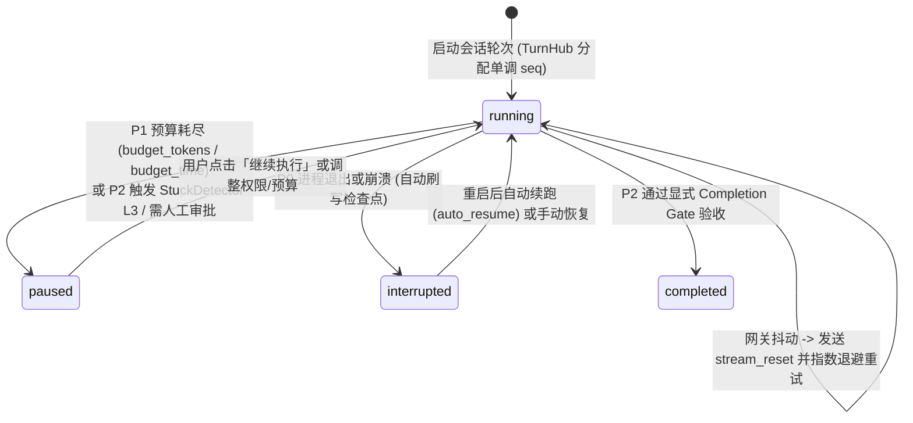

# 2. 长程自治 Agent 引擎 (P0–P3)

> [!IMPORTANT] 核心工程命题
> 市面上大多数开源 Agent 只能完成 3~5 分钟的短对话，一旦进入长达数小时的复杂重构任务，就会死于以下四大顽疾：**① 网关抖动断流丢进度、② 上下文爆炸、③ 陷入重复报错死循环或没做完就早退、④ 改坏代码无法干净回滚**。
> HYN Agent 通过 **P0 → P1 → P2 → P3 四阶段架构改造**（详见仓库 `docs/long_running/` 与 `app/services/`）系统性攻克了这四个问题。



---

## 2.1 P0 可靠性基座：`TurnHub` 单调序号回放与 `stream_reset`

**对应源码**：`app/services/turn_hub.py`、`app/services/llm_retry.py`

1. **单调递增 `seq` 与断线无缝重连**：
   - 后端不再把 SSE 绑死在单次 HTTP 请求生命周期上，而是由 `TurnHub` 统一托管活动轮次。每个流式事件均分配单调递增的 `seq` 序号并写入环形缓冲区。
   - 当渲染进程刷新页面或短暂断线重连时，携带上次收到的 `last_seq` 即可从缓冲区精确回放增量事件；若落后过多则收到 `resync` 事件拉取完整快照，**几小时的任务绝不会因为一次窗口刷新而白跑**。
2. **重试流清洗协议（`stream_reset`）**：
   - 当大模型流式输出到一半遭遇网络抖动或本地 Ollama 显存重分配报错时，`llm_retry.py` 触发指数退避重试，同时向前端广播 `retry`（显示重试次数与倒计时）与 `stream_reset` 事件。
   - 前端收到 `stream_reset` 后立即丢弃当前步半截作废的正文与思考块，避免重试前后的残缺文本拼接污染界面。

---

## 2.2 P1 预算管理与三级上下文压缩

**对应源码**：`app/services/turn_budget.py`、`app/services/context_budget.py`、`app/services/context_compact.py`

1. **去步数硬顶，改用 Token / 时长双维预算**：
   - 摒弃僵化的“最多 20 步停止”，改为可配置的会话级 `token_budget` 与 `time_budget_s`，实时通过 `budget` 事件推送给前端底部圆环（`ContextRing.js`）。
2. **三级渐进式上下文压缩（`ContextCompactor`）**：
   - **压缩前记忆抢救**：在丢弃早期历史消息前，先将待裁剪区间送入异步记忆提取队列（`memory_queue.py`），确保关键结论不随压缩丢失。
   - **主动压缩（`compact_history`）** 与 **响应式压缩（`reactive_compact`）**：将早期多轮工具交互浓缩为高密度结构化摘要。
   - **极值裁剪（`snip_compact`）**：当超长任务消息数突破 400 条时，安全剪除中间冗余工具输出并保留首尾锚点。

---

## 2.3 P2 收敛控制：反死循环检测 v2 与显式完成门禁

**对应源码**：`app/services/stuck_detector.py`、`app/services/completion.py`

1. **卡死检测器（`StuckDetector`）与 L1/L2 自省提示注入**：
   - `ProgressTracker` 实时观测每一步的 `StepObservation`（工具名、参数指纹、是否报错、文件是否有实质变更）。
   - 当检测到模型连续调用同一报错命令或陷入 A↔B 震荡修改时：
     - **L1 轻度提醒**：注入运行时提示，要求模型检查报错根因；
     - **L2 强制自省（`L2_RETROSPECTIVE_NOTICE`）**：禁止模型在本轮继续盲目调工具，强制其先输出复盘分析并更换排查路径；
     - **L3 熔断暂停**：若自省后仍空转，自动将轮次置为 `paused (pause_reason="stuck")` 并通知用户接管。
2. **显式完成协议（Explicit Completion Gate）**：
   - 针对模型“改完代码不跑测试就早退”的问题，引入完成校验门禁（`completion` 事件：包含 `summary`、`verification`、`remaining`、`gate_passed`），确保满足 DoD（Definition of Done）后才优雅停机。

---

## 2.4 P3 长程无人值守：无侵入影子 Git 检查点与 4 档实时权限

**对应源码**：`app/services/git_checkpoints.py`、`app/services/permission_mode.py`、`app/services/progress_notes.py`

### 1. 影子 Git 检查点（Shadow Git Checkpoints）—— 零工作区污染的时光机
常规 Agent 做检查点往往直接执行 `git commit`，这会严重污染用户的分支提交历史与 `git status` 暂存区。`git_checkpoints.py` 采用了极其精巧的 **Git 底层 Plumbing 命令方案**：

```bash
# 核心原理示意（源码见 app/services/git_checkpoints.py）
# 1. 使用独立临时索引文件，绝不触碰用户真实的 .git/index 暂存区
GIT_INDEX_FILE=<temp_index> git add -A
# 2. 将工作区树对象写入 Git 对象库
tree=$(GIT_INDEX_FILE=<temp_index> git write-tree)
# 3. 构造独立 commit 对象，父节点指向前一个影子检查点或当前 HEAD
commit=$(git commit-tree $tree -p $parent -m "hyn checkpoint: step N")
# 4. 挂载到私有命名空间 refs/hyn/checkpoints/<session_id>，不改动用户分支与 HEAD
git update-ref refs/hyn/checkpoints/<session_id> $commit
```

- **优势**：用户的 `git status`、`git branch` 和暂存区 **100% 保持原样**；但用户在 UI 上可以随时查看任意检查点的文件 Diff，并点击「恢复到此检查点」（回滚前还会自动为当前状态再拍一张保护快照，且回滚权限仅向人类 UI 开放，禁止模型自行回滚）。

### 2. 抗压缩常驻进度笔记（`progress_notes.py`）
- 存储在 `DATA_DIR/session_state/<session_id>/progress.md`（不污染用户代码仓库），每次请求时自动注入到系统提示词末尾的 `<progress_notes>` 段。无论上下文经历多少次压缩，Agent 始终记得「总体目标、已完成里程碑、当前步骤与已知坑点」。

### 3. 运行中实时生效的 4 档权限模式（`permission_mode.py`）
- 通过 `bind_mode_getter` 动态读取活动会话字典中的实时值，用户在 UI 上按 `Shift+Tab` 或点击 `PermissionModeButton.js` 切换档位（`ask_all` / `auto_edit` / `default` / `full_auto`）时，**无需中断当前任务，下一次工具调用即刻按新档位执行**。
- 即使在 `full_auto`（完全放行）档位下，`permission.py` 中的 `command_hard_deny_reason` 与路径越界检查（`paths.py`）始终拥有最高否决权，从物理边界上杜绝删库、格式化或越出工作区读写。
