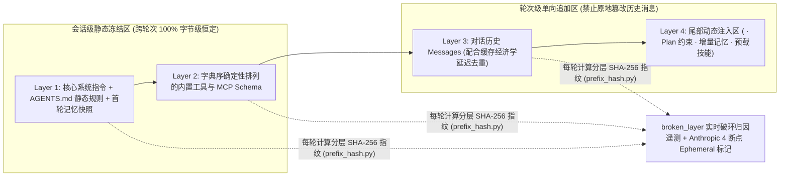
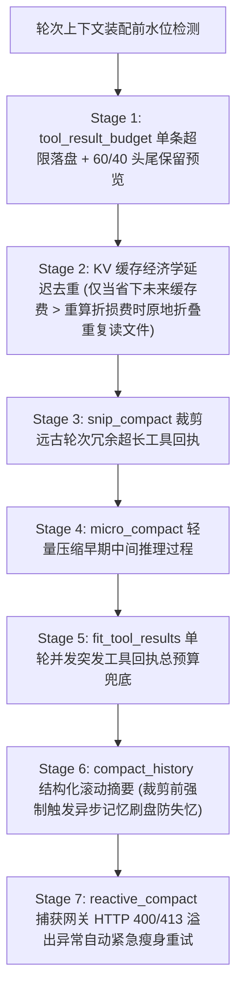
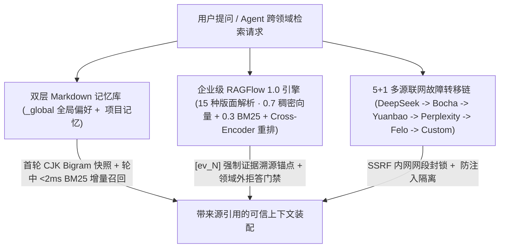

# 4. 97.7% 前缀缓存经济学、7 级压缩与混合 RAG

> [!NOTE] 关联核心源码与公开实测证据
> - 核心源码：`app/services/prefix_policy.py`、`prefix_hash.py`、`context_compact.py`、`memory_store.py`、`memory_extractor.py`、`knowledge/ragflow.py`、`web_search/*`
> - 权威实测报告：[前缀缓存稳定性实测 (160 次调用 · 意外破环 25->0 · 省费 57.3%)](/benchmarks/precache-v1) · [RAG 4 阶段演进实测 (Strict Recall 36.7%->100.0% · MRR 1.000)](/benchmarks/rag-eval-v1)

## 4.1 四层只追加前缀架构（4-Layer Append-Only Prefix）与破环诊断

长程 Agent 单次任务的累计输入往往高达数百万 Token。绝大多数框架习惯在系统提示词里塞入当前时间戳、动态激活的技能全文或随机排序的 MCP 工具列表——**哪怕只变动第 100 个 Token 的一个字符，后续数万 Token 的大模型 KV Cache 也会瞬间全部失效**，导致推理账单翻倍、首字延迟（TTFT）暴涨。

Helm 在 `prefix_policy.py` 与 `prefix_hash.py` 中确立了严苛的**四层单向冻结前缀契约**：

> [!TIP] 核心架构权衡与工程闭环：切换权限模式或注入新记忆时，如何做到“零前缀破环”？
> - **工程痛点**：用户在对话中途点击切换 `Plan Mode`、触发新技能或召回新历史记忆时，模型行为必须立即改变，但一旦修改系统提示词（Layer 1）或动态增删工具定义（Layer 2），已建立的数万 Token KV 缓存即刻归零。
> - **常规方案缺陷**：常规 Agent 每轮重新拼接 System Prompt 并动态裁剪 `tools` 数组，热态缓存命中率通常不足 45%。
> - **Helm 底层解法**：① 将系统提示词与经过字典序固化的工具 Schema 锁死在 Layer 1/2；② 把运行期变化的权限状态（如进入 `Plan Mode`）、按需激活的 `/skill` 全文以及中途召回的 `<incremental_memory_recall>` **全部下沉至 Layer 4 用户消息尾部的 `<system-reminder>` 块**；③ 内置 `prefix_hash.py` 对每层独立计算 SHA-256，一旦发生缓存未命中立即精准定位 `broken_layer`。
> - **实测定量收益**：在 [SWE-bench 1.2 亿 Token 实测](/benchmarks/swebench-mini-v1) 中达成 **`97.74%` 真实前缀缓存命中率**（单题均摊成本仅 **`¥0.27`**）；在 [160 次多场景缓存专项压测 (`/benchmarks/precache-v1`)](/benchmarks/precache-v1) 中，热态意外破环从基线的 **`25` 次直接清零至 `0` 次**，计费输入成本净降 **`57.27%`**。

---

## 4.2 缓存感知 7 级渐进式上下文压缩管道（`ContextCompactor`）

当长任务逼近模型上下文窗口上限时，“一刀切”的全文摘要既慢又会抹杀关键报错行号。`context_compact.py` 构建了按代价从低到高逐级触发的 **7 级无损优先压缩流水线**：

### 两大核心算法亮点
1. **60/40 头尾双锚截断法（Head-Tail Preview）**：程序崩溃栈（Python Traceback / Rust Panic / 测试汇总）几乎永远出现在输出末尾。Stage 1 将超长工具原始输出完整转存至磁盘供按需翻阅，同时在上下文内保留 **前 `60%`（命令上下文）+ 后 `40%`（尾部异常根因）**。消融实测显示，在同等 **`93.1%` 体积压缩率**下，尾部关键报错保留率从传统头部截断的 **`33.3%` 跃升至 `100.0%`**。
2. **KV 缓存经济学延迟去重公式**：若模型多次读取同一文件，立即擦除旧记录会破坏中间层的 KV 缓存前缀。Stage 2 显式建立收益不等式：`预计剩余轮次缓存读取收益 (delta_saved * 6 * 0.10) > 被迫失效重算的后缀成本 (tokens_invalidated * 0.90)`，仅在数学期望划算时才执行去重。

---

## 4.3 零数据库双层记忆、企业级混合 RAG 与五路联网容灾

### 1. 零向量库依赖的双层透明记忆（`memory_store.py`、`memory_extractor.py`）
- **完全人类可读可审**：摒弃黑盒本地向量数据库，按 `_global`（跨项目通用习惯）与 `<workspace_key>`（当前仓库架构决策）双作用域，划分为 `user`、`feedback`、`project`、`reference` 四类带 Frontmatter 的标准 Markdown 文件。
- **10 代历史快照与 `<2ms` 增量唤醒**：每次覆写自动归档 `.history/`（保留最近 `10` 个版本）与 `activity.jsonl` 审计流；对话首轮通过 CJK 字符二元组（Bigram）匹配冻结快照，对话中途话题漂移时通过纯内存 BM25（`<2ms`）在 Layer 4 动态补入 `<incremental_memory_recall>`。

### 2. 企业级混合检索 RAG 4 阶段演进实证（`knowledge/ragflow.py`）
针对技术规范 PDF、财务报表与法律合同，集成 15 种深度文档版面切片模板，采用 **`0.7` 稠密语义向量 + `0.3` BM25 关键词检索 + Cross-Encoder 精排**，并强制输出 `[ev_N]` 页码片段溯源。在 [36 题高干扰企业知识库评测 (`/benchmarks/rag-eval-v1`)](/benchmarks/rag-eval-v1) 中完整记录了从 `v0` 到 `v3` 的工程跃迁：

| 评测阶段 | 核心架构演进动作 | 严格召回率 (`Strict Recall@5`) | 平均倒数排名 (`MRR`) | 近义干扰项污染率 | 领域外 (`OOD`) 拒答准确率 |
| :--- | :--- | :--- | :--- | :--- | :--- |
| **`v0` 基线** | 纯稠密向量检索（固定滑窗切块） | `36.7%` | `0.489` | `46.7%` | `66.7%` |
| **`v1` 混合** | 引入 BM25 双路召回 + 版面感知分块 | `73.3%` | `0.811` | `20.0%` | `83.3%` |
| **`v2` 重排** | 接入 Cross-Encoder 交叉编码重排序 | `93.3%` | `0.956` | `3.3%` | `100.0%` |
| **`v3` 终态** | 动态置信度阈值截断 + `[ev_N]` 强制溯源约束 | **`100.0%` (30/30)** | **`1.000`** | **`0.0%`** | **`100.0%` (6/6)** |

### 3. 五路联网搜索自动容灾与 SSRF 防注入边界（`app/services/web_search/`）
- 内置 **DeepSeek / 博查（Bocha） / 腾讯元宝 / Perplexity / Felo + 自定义 HTTP** 六级搜索源自动故障切换；`web_fetch` 抓取网页前强制解析 DNS 并封锁 `127.0.0.0/8`、`10.0.0.0/8`、`172.16.0.0/12`、`192.168.0.0/16` 与云元数据 `169.254.169.254`（防 SSRF 探测内网），所有外部正文一律包裹 `<untrusted_web_content>` 隔离标签阻断间接提示词注入。