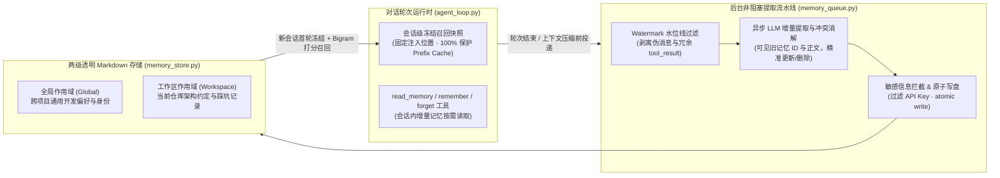

# 4. Prefix-Cache 友好的异步双层记忆与本地知识库

> [!NOTE] 对应源码与设计文档
> - 源码：`app/services/memory.py`、`app/services/memory_queue.py`、`app/services/memory_store.py`、`app/services/knowledge/*`
> - 设计文档：`docs/memory_upgrade_plan.md`

## 4.1 传统 Agent 记忆系统的三大工程痛点

在早期的 Agent 记忆实现中，业界普遍存在三个严重影响生产可用性的问题：
1. **击穿大模型 Prefix Cache（前缀缓存）**：如果每一轮对话都根据当前用户输入动态重算相关记忆并改写 System Prompt，会导致大模型 KV Cache 前缀全部失效，长对话的首字延迟（TTFT）与 Token 成本成倍飙升。
2. **同步提取拖慢响应**：每轮回复结束前同步调用一次 LLM 提取记忆，用户哪怕只回复一句“谢谢”也要多等数秒。
3. **工具刷屏挤出用户原话 & 中文正则失效**：在工具密集型 Coding 会话中，最后 12 条消息几乎全是冗长的 `tool_result`，导致真正包含用户偏好的原话被挤出提取窗口；同时，简单的 `[\u4e00-\u9fff]{2,}` 正则会将整句中文/日文汉字当成一个词，导致无向量库时的关键词降级检索命中率趋近于零。

---

## 4.2 HYN Agent 的双层异步记忆架构

### 五大核心工程优化：

1. **会话级冻结召回快照 + `read_memory` 工具（保护 Prefix Cache）**：
   - 每个会话在建立时冻结一份召回记忆快照，固定拼装在 System Prompt 的静态前缀区，**在整个会话生命周期内绝不随轮次抖动改写前缀**，使本地 Ollama 与云端 API 的 Prefix Cache 命中率稳定保持在 90% 以上。
   - 若会话中途新增了记忆或需要检索冷门记忆，模型可通过 `read_memory` 工具在对话流中按需拉取。
2. **后台异步提取队列（`memory_queue.py`）+ 压缩前兜底提取**：
   - 轮次结束时立即向前端返回完成事件，记忆提取交由后台队列异步执行（应用退出时由 `_lifespan` 最多等待 10 秒排空队列）。
   - 在 `context_compact.py` 裁剪丢弃旧历史消息前，强制将被裁剪区间的未提取消息送入提取队列，确保长程任务“压缩不失忆”。
3. **Watermark 水位线与消息清洗（`memory_text.py`）**：
   - 为每个会话维护已提取消息水位线（Watermark），避免滑动窗口重叠导致重复提取；同时自动过滤定时任务伪消息（`[Scheduled]`）、团队事件（`[Team events]`）与大体积工具输出，精准保留人类原话与核心结论。
4. **中日文友好的两字相邻切分（CJK Bigram Scoring）**：
   - 在零外部向量数据库依赖的轻量模式下，针对中文与日文汉字采用相邻双字切分（Bigram）计算重合度打分，彻底解决整句连写无法分词匹配的难题。
5. **两级作用域（Global + Workspace）与安全防线**：
   - 区分「跨项目全局偏好（Global）」与「当前仓库专属约定（Workspace）」；写盘采用临时文件原子替换（Atomic Write），并在写入前拦截疑似密钥字符串，注入提示词时对特殊标签做安全转义。

---

## 4.3 本地知识库（RAGFlow）与结构化证据链

对于动辄数百兆的企业内部规章、API 字典与历史 PDF/Word 设计书，HYN Agent 通过 `app/services/knowledge/` 模块对接本地或内网部署的 **RAGFlow** 引擎：
- **门面解耦（`knowledge/service.py`）**：统一封装连接探测（`probe`）、数据集增删改、文档上传与解析状态跟踪，底层客户端（`ragflow.py`）与上层路由及 Agent 工具完全解耦。
- **可溯源证据链打包（`knowledge/evidence.py`）**：检索结果通过 `pack_evidence` 格式化为包含 `document_name`、`dataset_id`、相似度得分与原文切片的结构化证据块，支持前端界面直接展示引用来源，满足日本企业严苛的合规可解释性要求。
