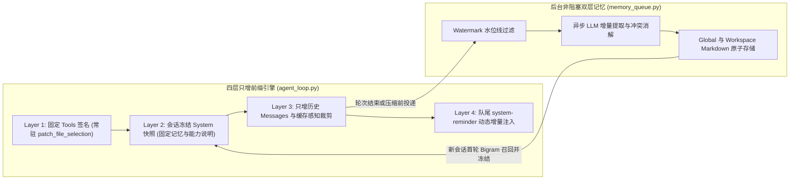
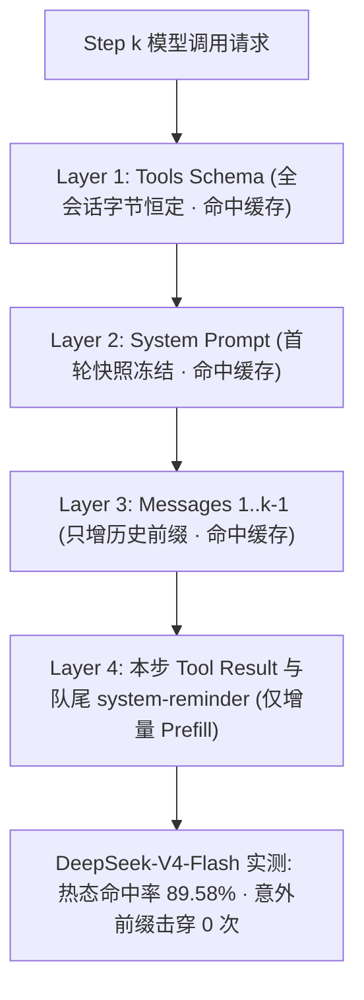

# 4. 四层只增前缀缓存、异步双层记忆与本地知识库

> [!NOTE] 对应源码、设计与公开实测证据包
> - 核心源码：`app/services/agent_loop.py`、`app/services/context_compact.py`、`app/services/memory.py`、`app/services/memory_queue.py`、`app/services/knowledge/*`
> - 架构规范：`docs/precache/README.md`、`docs/memory_upgrade_plan.md`
> - 公开实测证据包：[manifest.json](/benchmarks/precache-v1/manifest.json) · [summary_report.json](/benchmarks/precache-v1/summary_report.json) · [REPORT.md](/benchmarks/precache-v1/REPORT.md)

## 4.1 传统 Agent 记忆与上下文组装的三大工程痛点

在多步工具密集型 Agent 运行时中，早期实现普遍存在三个严重抬高延迟与推理成本的底层缺陷：
1. **击穿大模型 Prefix Cache（前缀缓存）**：若每轮根据当前输入改写 System Prompt（如动态拼接本轮记忆、目标语言指令、任务看板、里程碑进度或按选区临时增删工具列表），大模型 KV Cache 从首字节起整体失效，每一步被迫全量重算 Prefill。
2. **同步提取记忆与激进历史改写反噬缓存**：每轮回复前同步调用 LLM 提取记忆会直接阻塞交互；而每步立即原地替换较早轮次的 `read_file` 输出又会改写 `messages` 历史前缀，导致缓存失效代价高于节省的少量 Token。
3. **工具刷屏挤出用户原话 & 中日文分词降级失效**：长程 Coding 会话末尾往往被大体积 `tool_result` 填满，挤出关键人类指令；同时无空格的中日文文本在纯正则匹配下极易整句粘连导致召回失效。

---

## 4.2 四层只增前缀架构与异步双层记忆系统

Helm 将模型输入严格组织为 **「四层只增前缀架构（Four-Layer Append-Only Prefix Architecture）」**，将静态契约锁死在前缀头部，将一切高频动态状态后置到消息流尾部：



### 五大核心工程机制：

1. **Layer 1 固定工具签名 + Layer 2 会话级冻结 System 快照**：
   - 工具 Schema 顺序确定性输出，`patch_file_selection` 保持会话常驻而不在选区切换时动态增删工具数组，确保 `Layer 1` 字节级恒定。
   - 会话首轮建立时一次性冻结召回记忆快照（`_memory_snapshot`）、基础回复语言与静态办公/技能指南，整个会话生命周期内绝不改写 `Layer 2` 前缀。
2. **Layer 4 `<system-reminder>` 队尾注入（剥离一切轮次级抖动源）**：
   - 将跨轮次语言切换提示、任务看板增量摘要、长程里程碑进度笔记、时间/Token 预算预警、用户选区上下文（`SelectionAnchor`）以及重试反思指令全部从 System Prompt 剥离，统一封装为队尾 `<system-reminder>` 增量块追加，100% 保护历史 KV Cache。
3. **Layer 3 缓存感知延迟去重与增量式上下文压缩（`context_compact.py`）**：
   - 重复 `read_file` 去重设置收益门禁（累计可省 `>= 4,000` Token 或接近压缩水位线时才批量执行），杜绝为省百余 Token 击穿数万 Token 已热缓存的负优化；触发超长上下文裁剪时优先复用已有结构化摘要做增量合并。
   - 多轮对话在回合边界按规范清理旧轮次 `reasoning_content`（防止思维链无限膨胀），回合内工具步之间完整保留前缀连续性。
4. **后台异步提取队列（`memory_queue.py`）+ Watermark 水位线过滤**：
   - 记忆提取在回合结束后由后台队列异步执行（退出时最多等待 10 秒优雅排空），并在上下文裁剪丢弃旧历史前强制兜底投递；Watermark 自动剥离 `[Scheduled]`、`[Team events]` 伪消息与大体积工具输出。
5. **中日文友好的双字切分（CJK Bigram）与两级透明存储（`memory_store.py`）**：
   - 零外部向量库依赖下采用中日文相邻双字切分（Bigram）计算重合度；区分 Global 与 Workspace 两级 `.md` 存储，写盘前自动正则拦截敏感密钥并执行原子替换。

---

## 4.3 本地知识库（RAGFlow）与结构化证据链

针对百兆级企业规章、API 字典与历史 PDF/Word 设计书，Helm 通过 `app/services/knowledge/` 对接本机或企业内网部署的 **RAGFlow** 引擎：
- **门面解耦（`knowledge/service.py`）**：统一封装连接探测（`probe`）、数据集管理、文档上传与解析状态跟踪，底层客户端与 Agent 工具完全解耦。
- **可溯源证据链打包（`knowledge/evidence.py`）**：检索结果通过 `pack_evidence` 格式化为携带 `document_name`、`dataset_id`、相似度得分与原文切片的结构化证据块，在保护静态前缀不被污染的同时提供严格合规溯源。

---

## 4.4 Pre-Cache 实测基准与可验证证据包（DeepSeek-V4-Flash）

为客观量化四层只增前缀架构的真实收益，我们在生产模型 `deepseek-v4-flash`（供应商原生返回 64-token 粒度 `prompt_cache_hit_tokens` 与 `prompt_cache_miss_tokens`）上执行了双轨对照基准测试，完整公开原始响应 ID 与防篡改校验清单。

### 4.4.1 四层只增前缀缓存边界图解



### 4.4.2 双轨评测方法论与计费核算公式

评测脚本 `hyn_agent_backend/scripts/bench_precache.py` 在同一时间窗（`2026-11-04T12:18:51Z` – `2026-11-04T12:27:40Z`）内紧邻对比重构前基线 `legacy_baseline` 与当前生产实现 `optimized_v1`：
- **Track A（受控多步回放，`B1`–`B4` 共 `62 + 62 = 124` 次成对真实 API 调用）**：在完全相同的真实工具输出序列下逐步调用真实 `AgentLoop` 上下文组装器与 `deepseek-v4-flash` 接口，消除随机探索步数差异。
- **Track B（端到端实机自治修复，`B5` 临时 Git 仓库闭环修复）**：在全新隔离的收据结算引擎仓库中由 `AgentLoop` 全自动定位时区切日与折扣税基两处缺陷并跑通 `pytest`（两组最终均通过全部 `6 passed` 断言）。
- **等长 Run-Isolation Nonce 冷启动命名空间隔离**：每次运行为 `legacy_baseline` 与 `optimized_v1` 各自生成独立的 40 字符等长十进制隔离标识注入首字节，确保两组首步 `prompt_cache_hit_tokens` 严格为 `0`，彻底杜绝云端共享缓存池互相“蹭热缓存”且不引入任何 BPE 分词长度偏差。

核心指标严格按供应商原生返回的 `usage` 字段汇总计算（按 DeepSeek 官方目录价规则：缓存命中输入权重 `w_read = 0.10`，未命中输入权重 `w_miss = 1.00`，无缓存写入附加费）：

```text
CHR_all  = Σ T_cache_read / Σ T_input
CHR_warm = Σ_{step >= 2} T_cache_read / Σ_{step >= 2} T_input

Uncached Saved % = (1 - Σ T_uncached_opt / Σ T_uncached_base) × 100%

T_eff = Σ (T_uncached + 0.10 × T_cache_read)
Billable Saved % (vs Baseline) = (1 - T_eff_opt / T_eff_base) × 100%
Billable Saved % (vs 0% Raw)   = (1 - T_eff_opt / Σ T_input_opt) × 100%
```

### 4.4.3 五大场景 Baseline vs Optimized 实测对账表

| 评测场景 (Scenario) | 变体 | 请求步数 | 总输入 Token | 缓存命中 (0.1x) | 未缓存重算 (1.0x) | 全步 / 热态命中率 | 等效计费输入 Token | 计费节省 (较基线 / 较裸调) | 长上下文 TTFT P50 | 热态意外击穿 |
| :--- | :--- | :--- | :--- | :--- | :--- | :--- | :--- | :--- | :--- | :--- |
| **B1 全栈排障 (16步)** | Baseline | 16 | 583,948 | 341,248 | 242,700 | 58.44% / 59.29% | 276,824.8 | — / -52.59% | 976 ms | 6 次 |
| **B1 全栈排障 (16步)** | **Optimized** | **16** | **628,343** | **558,464** | **69,879 (-71.21%)** | **88.88% / 90.25%** | **125,725.4** | **-54.58% / -79.99%** | **949 ms (-2.77%)** | **0 次** |
| **B2 中英混合任务 (10轮)** | Baseline | 14 | 674,168 | 273,024 | 401,144 | 40.50% / 41.01% | 428,446.4 | — / -36.45% | 1341 ms | 7 次 |
| **B2 中英混合任务 (10轮)** | **Optimized** | **14** | **691,136** | **579,328** | **111,808 (-72.13%)** | **83.82% / 84.99%** | **169,740.8** | **-60.38% / -75.44%** | **960 ms (-28.41%)** | **0 次** |
| **B3 Office 选区热改 (8轮)** | Baseline | 12 | 441,932 | 340,096 | 101,836 | 76.96% / 78.45% | 135,845.6 | — / -69.26% | 997 ms | 1 次 |
| **B3 Office 选区热改 (8轮)** | **Optimized** | **12** | **446,349** | **375,168** | **71,181 (-30.10%)** | **84.05% / 85.88%** | **108,697.8** | **-19.98% / -75.65%** | **1017 ms (P90 -18.24%)** | **0 次** |
| **B4 长程里程碑重构 (20步)** | Baseline | 20 | 1,030,787 | 643,200 | 387,587 | 62.40% / 62.92% | 451,907.0 | — / -56.16% | 973 ms | 7 次 |
| **B4 长程里程碑重构 (20步)** | **Optimized** | **20** | **1,080,492** | **998,144** | **82,348 (-78.75%)** | **92.38% / 93.21%** | **182,162.4** | **-59.69% / -83.14%** | **890 ms (-8.53%)** | **0 次** |
| **B5 实机端到端修复 (Track B)** | Baseline | 26 | 882,690 | 729,984 | 152,706 | 82.70% / 83.51% | 225,704.4 | — / -74.43% | 994 ms | 4 次 |
| **B5 实机端到端修复 (Track B)** | **Optimized** | **10** | **303,792** | **267,904** | **35,888 (-76.50%)** | **88.19% / 91.07%** | **62,678.4** | **-72.23% / -79.37%** | **1061 ms** | **0 次** |
| **Track A 受控回放小计** | Baseline vs Opt | 62 / 62 | 2,730,835 → 2,846,320 | 1,597,568 → 2,511,104 | 1,133,267 → 335,216 (**-70.42%**) | 58.50% → **88.22%** (热态 **89.42%**) | 1,293,023.8 → **586,326.4** | **-54.65% / -79.40%** | 1146 → **978 ms (-14.66%)** | 21 → **0 次** |
| **全套综合总计 (B1–B5)** | **Baseline vs Opt** | **88 / 72** | **3,613,525 → 3,150,112** | **2,327,552 → 2,779,008** | **1,285,973 → 371,104 (-71.14%)** | **64.41% → 88.22% (热态 89.58%)** | **1,518,728.2 → 649,004.8** | **-57.27% / -79.40%** | **1096 → 978 ms (-10.77%)** | **25 → 0 次** |

> [!TIP] 关键工程结论
> - **彻底清零意外前缀击穿**：`legacy_baseline` 在热态步中发生了 `25` 次前缀击穿（`1` 次选区触发工具数组变动 + `20` 次 System Prompt 动态状态抖动 + `4` 次过早原地去重改写历史消息），而 `optimized_v1` 的意外热态前缀击穿严格降为 **`0` 次**（多轮场景 `B2`/`B3` 另有 `7` 次符合 DeepSeek Thinking 模式规范的跨轮次 `reasoning_content` 预期回收）。
> - **长程任务越长越省**：在上下文峰值达 `81,487` Token 的 `B4` 20 步里程碑重构中，热态缓存命中率高达 **`93.21%`**，未缓存重算量锐减 **`78.75%`**，单场景等效计费输入较无缓存裸调直降 **`83.14%`**。

### 4.4.4 防篡改证据包下载、SHA-256 核验与一键复现

所有单步追踪文件均逐行记录了 DeepSeek 原生 `response_id`、UTC 时间戳、`tools_sha256` / `system_sha256` / `messages_prefix_sha256` 分段指纹及原始 `usage` 字典（零明文凭证与零本地隐私路径）：

- **签名总清单与汇总报告**：
  - [manifest.json](/benchmarks/precache-v1/manifest.json)（SHA-256: `ee7bcb6d7ddad13070f50a94a04f567a61a09e8ed8674d775e50a992d1c00c82`）
  - [summary_report.json](/benchmarks/precache-v1/summary_report.json)（SHA-256: `357b055b22f143de34e9cdd628cdb1e559f2b19997a418c068c57d2823220150`）
  - [REPORT.md](/benchmarks/precache-v1/REPORT.md)（SHA-256: `7c56fc21938fb8dfd7243cd16302e5fa7a09617527bdf4afbf799a74d2e1c7fd`）
- **原始逐请求 JSONL 轨迹（共 160 条真实 API 响应记录）**：
  - B1 轨迹：[legacy_baseline.jsonl](/benchmarks/precache-v1/traces/B1_fullstack_bugfix_16steps_legacy_baseline.jsonl) (`d4316949...ecd2c30b`) · [optimized_v1.jsonl](/benchmarks/precache-v1/traces/B1_fullstack_bugfix_16steps_optimized_v1.jsonl) (`ede5eb26...77d39c96`)
  - B2 轨迹：[legacy_baseline.jsonl](/benchmarks/precache-v1/traces/B2_multiturn_mixed_lang_10turns_legacy_baseline.jsonl) (`6b866c25...2ff1ecfa`) · [optimized_v1.jsonl](/benchmarks/precache-v1/traces/B2_multiturn_mixed_lang_10turns_optimized_v1.jsonl) (`4ea852ab...aab0d3e8`)
  - B3 轨迹：[legacy_baseline.jsonl](/benchmarks/precache-v1/traces/B3_office_selection_8turns_legacy_baseline.jsonl) (`98d0707e...07ea2f79`) · [optimized_v1.jsonl](/benchmarks/precache-v1/traces/B3_office_selection_8turns_optimized_v1.jsonl) (`802aecb3...b62582cc`)
  - B4 轨迹：[legacy_baseline.jsonl](/benchmarks/precache-v1/traces/B4_longhorizon_milestone_20steps_legacy_baseline.jsonl) (`14df4009...2f73c68a`) · [optimized_v1.jsonl](/benchmarks/precache-v1/traces/B4_longhorizon_milestone_20steps_optimized_v1.jsonl) (`d11ecb28...ec239c76`)
  - B5 轨迹：[legacy_baseline.jsonl](/benchmarks/precache-v1/traces/B5_live_e2e_bugfix_legacy_baseline.jsonl) (`0bad6679...066363cd`) · [optimized_v1.jsonl](/benchmarks/precache-v1/traces/B5_live_e2e_bugfix_optimized_v1.jsonl) (`ec4c3738...00b44de2a`)

开发者可在本地一键复现全套基准测试，或直接校验公开证据包的 `SHA-256` 完整性（本次权威评测合并账单窗口 `2026-11-04T12:18:51Z`–`12:27:40Z` 共发出 `160` 次请求，合计输入 `6,763,637` Token，其中缓存命中 `5,106,560` Token、未命中 `1,657,077` Token、输出 `13,344` Token）：

```powershell
# 1. 在后端环境中一键复现双轨实测并输出全新证据包
cd hyn_agent_backend
.\.venv\Scripts\python.exe scripts/bench_precache.py --model deepseek-v4-flash

# 2. 离线校验已归档证据包内全部 12 个文件的字节大小与 SHA-256 签名
.\.venv\Scripts\python.exe -m pytest tests/precache/test_phase3_bench_and_audit.py -q
```
