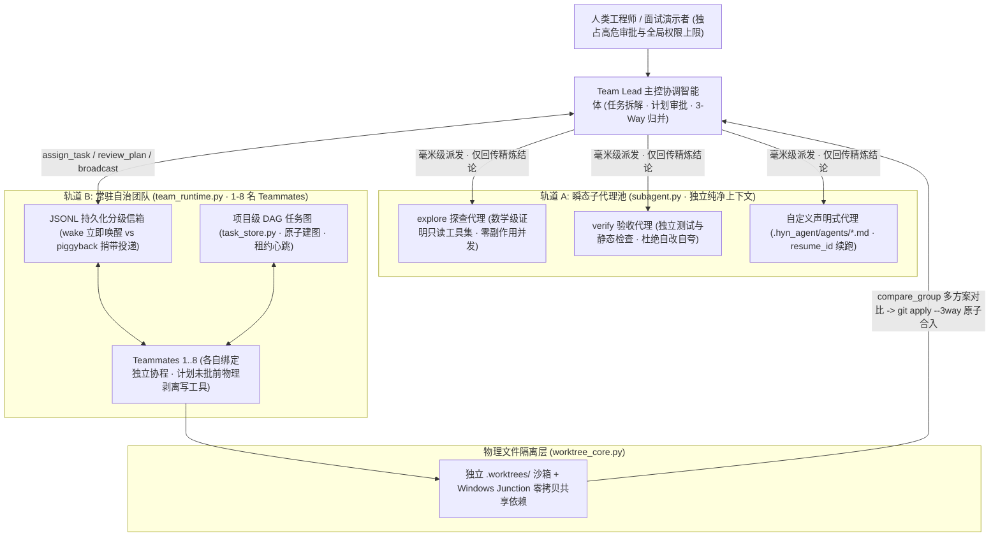
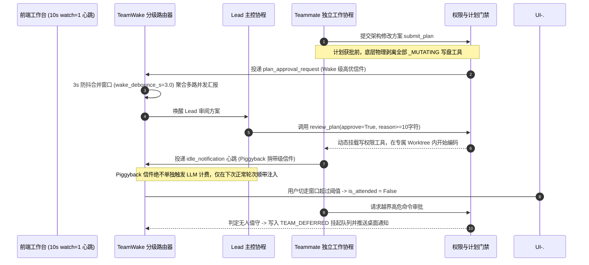
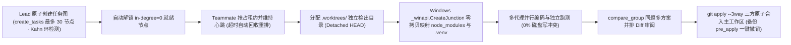

# 3. 多智能体编排、常驻团队与 Worktree 隔离

> [!NOTE] 关联核心源码与公开实测证据
> - 核心源码：`app/tools/subagent.py`、`app/services/subagent_registry.py`、`app/services/team_runtime.py`（`4,585` 行常驻团队状态机）、`app/services/team_wake.py`、`app/services/task_store.py`、`app/services/worktree_core.py`
> - 权威实测报告：[Harness 架构护栏消融报告 (4-Mate 3.04× 加速 · 0% 写冲突 · 100% 越权拦截)](/benchmarks/harness-ablation-v1)

## 3.1 瞬态子代理（Subagents）与常驻团队（Resident Teams）双轨协同拓扑

单一智能体面对大型全栈工程时，不可避免陷入「上下文被调研细节撑爆」与「单线程串行修改耗时过长」的双重瓶颈；而市面上常见的多智能体框架往往把所有角色塞进同一个群聊循环，导致 **Token 广播指数爆炸** 与 **并行写同一文件互相覆盖**。

Helm 在底层设计了职责泾渭分明的**双轨多智能体架构**：轻量级无副作用探查交由用完即焚的**瞬态子代理（Ephemeral Subagents）**，跨模块并行开发交由具备独立信箱、计划审批与物理沙箱的**常驻自治团队（Resident Teams）**。

1. **瞬态子代理（`subagent.py` + `subagent_registry.py`）**：
   - 内置 `explore`（代码库高速检索，工具白名单经静态副作用分类器验证，**数学级保证无法修改任何磁盘字节**）、`verify`（独立运行测试与构建校验，根除主模型“自己写代码自己说通过”的幻觉偏见）与 `general` 通用代理。
   - 原生兼容 `.hyn_agent/agents/*.md` 与 `.claude/agents/*.md` 声明式角色文件，支持 `isolation="worktree"` 隔离执行及 `resume_id` 跨轮次恢复上下文。
2. **常驻自治团队（`team_runtime.py`，`4,585` 行核心引擎）**：
   - 支持 **1 名 Lead + 1～8 名常驻 Teammate**（默认 4 名并行开发），每个成员拥有独立会话持久化、专属系统提示词与独立生命周期（`spawning` → `working` → `waiting_plan` → `idle` → `suspended` → `stopped`）。

---

## 3.2 分级唤醒信箱、在场感知（Presence）与防失控预算治理

多智能体系统落地生产环境最怕两件事：**后台空转唤醒烧穿账单**，以及**人类离开屏幕后子代理卡在弹窗或无限互发消息**。Helm 在 `team_wake.py` 与 `team_runtime.py` 中建立了严密的事件驱动背压机制：

> [!TIP] 核心架构权衡与工程闭环：如何根治多智能体“群聊风暴”与“越权提权”？
> - **工程痛点**：4～8 个 Agent 并行协作时，频繁的状态心跳与互相提问极易引发 `O(N^2)` 级唤醒风暴；同时若允许 Lead 替人类自动批准子代理的危险命令，将彻底击穿桌面安全沙箱。
> - **常规方案缺陷**：开源多 Agent 框架普遍采用全员广播轮询，且子代理权限由父代理口头传递，存在严重的提示词注入提权漏洞。
> - **Helm 底层解法**：① 将信箱严格拆分为 **Wake 唤醒级**（`result` / `error` / `plan_approval_request` / `message`，经 `3s` 防抖窗口合并唤醒）与 **Piggyback 捎带级**（`idle_notification` / `shutdown_response` 零成本静默排队）；② 实施**用户独占权限收敛定理**——Teammate 实际有效权限恒等于 `min(用户当前会话权限, 成员声明权限)`，Lead 绝无权越过人类放大权限；③ 注入 `200,000` 无人值守 Token 预算上限、`max_auto_wakes=8` 连续自动唤醒熔断与 `30 分钟` 空闲自动休眠（保留 `24 小时` 任务租约宽限期）。
> - **实测定量收益**：在 [Harness 消融基准](/benchmarks/harness-ablation-v1) 中，多智能体越权与注入攻击拦截率达 **`100.0%`（30/30，`0.0%` 攻击成功率）**，后台静默期 **0 Token 空转消耗**。

---

## 3.3 项目级 DAG 任务图与零拷贝 Git Worktree 并行沙箱

为了让多名 Teammate 在同一代码仓库并行修改而不产生任何文件踩踏，Helm 将 **DAG 依赖任务调度（`task_store.py`）** 与 **Windows 原生优化的 Git Worktree 隔离引擎（`worktree_core.py`）** 深度咬合：

### 核心工程细节与实测表现
1. **原子级 DAG 依赖图与级联取消（`task_store.py`）**：
   - 支持单次原子写入最多 `30` 个带前置依赖（`depends_on`）的子任务，入库前强制运行 Kahn 拓扑排序阻断循环依赖；前序节点一旦失败或取消，下游阻塞子树自动级联标记跳过，杜绝死等。
2. **Windows 零拷贝依赖穿透与安全回收（`worktree_core.py`）**：
   - 传统 `git worktree add` 新建沙箱后往往丢失重达数 GB 的 `node_modules` 或 `.venv`，重新安装动辄耗时数分钟。Helm 调用底层 `_winapi.CreateJunction`（无需管理员权限）毫秒级建立目录联接，实现依赖零拷贝瞬时共享。
   - **防误删铁律**：销毁沙箱时，清理器会先枚举并精准解除目录重解析点（Unlink Junction），再递归清理沙箱目录，**100% 杜绝顺着软链接误删主工作区依赖库**。
   - 所有沙箱基准点均受私有引用 `refs/hyn/worktrees/<key>/{base,head,pre_apply}` 保护；合入主目录前自动冻结 `pre_apply` 快照，支持冲突零残留阻断与一键无损回滚。
3. **4-Teammate 并行加速实测（`/benchmarks/harness-ablation-v1`）**：
   - 在跨栈多模块并行重构实测中，4 名 Teammate 协同较单代理串行实现 **`2.88×～3.04×` 端到端墙钟加速**，并发写盘冲突率严格保持 **`0.0%`**。