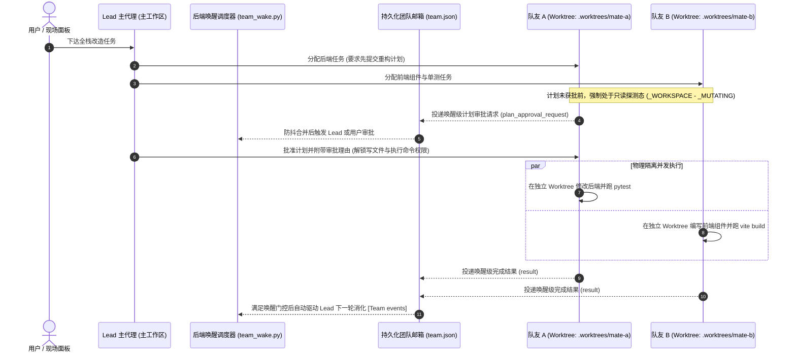

# 3. 多智能体团队与 Git Worktree 物理隔离

> [!NOTE] 对应源码模块
> - 后端：`app/services/team_runtime.py`、`app/services/team_wake.py`、`app/services/team_worktree.py`、`app/services/team_store.py`、`app/services/subagent.py`
> - 前端：`src/views/LiveFloor.js`、`src/views/TeamSettingsPanel.js`、`src/App.js`

## 3.1 为什么“一次性 Subagent”不够用？

在大型全栈工程任务中，单一主代理顺序执行往往耗时过长；而传统一次性子代理（One-shot Subagent）存在两大缺陷：
1. **无常驻上下文**：每次调用都要重新扫描代码库，无法在多轮迭代中保持模块专精记忆；
2. **并发写文件冲突**：当多个子代理在同一工作目录下同时修改代码或运行构建脚本时，极易发生文件互相覆盖与 Git 索引锁冲突（`.git/index.lock`）。

为此，Helm 提供了 **「一次性轻量 Subagent」 + 「常驻多智能体团队（Resident Team）」** 双轨架构。

---

## 3.2 主从常驻队友架构、持久化挂起与分级唤醒邮箱

一个会话可由主代理（**Lead**）招募常驻队友（**Teammates**，人数上限可配置，**默认 4 名，最多 8 名**）。队友在「工作（`working`）」、「等待审批/确认（`waiting_approval` / `waiting_permission`）」、「错误暂停（`error_paused`）」、「空闲待命（`idle`）」与「挂起（`suspended`）」状态间切换，拥有独立的对话上下文、专属 `StuckDetector`、`ContextCompactor` 以及持久化在 `sessions/<sid>/team/teammates/<name>.jsonl` 的完整对话记录：

### 核心工程设计亮点：
1. **邮件分级与零轮询异步收件箱（Classified Inbox & Debounced Wake）**：
   - 队友的中间工具调用绝不混入主对话的 `messages` 列表（防止主代理上下文瞬间爆炸），而是独立保存在 `teammates/<name>.jsonl`，随时可在前端「现场 → 记录」页签检视，并支持用户直接向指定队友发消息。
   - 队友发往 Lead 的邮件分为**唤醒级**（`result`、`error`、`plan_approval_request` 及直接发给 Lead 的 `message`）与**附带级**（`idle_notification`、`shutdown_response`、`stopped`）。仅唤醒级邮件会登记 `lead_pending_since`，经防抖窗口（`wake_debounce_s`，默认 3 秒）合并后触发 Lead 下一轮对话，附带级邮件在消化时一并带出，**禁止模型编写低效的 sleep 轮询循环**。
   - 模型调用遇到网络抖动、限流或超时等可恢复错误时，队友不会直接崩溃丢任务，而是进入 `error_paused` 保留完整上下文并向 Lead 发送唤醒级 `error`，收到新指示后即可原地恢复。
2. **持久化常驻与挂起恢复（Persistence & Suspend/Resume）**：
   - 团队状态（`team.json`）与队友对话记录（`teammates/<name>.jsonl`）实时落盘。当队友空闲超过 `idle_suspend_minutes`（默认 30 分钟）或应用退出时，后台协程干净退出并将队友状态置为 `suspended`（无需常驻占用内存协程）。
   - 挂起期间，队友已认领的项目任务在保留期（`suspended_lease_grace_hours`，默认 24 小时）内继续受保护，不会被其他会话抢占；应用重启或用户返回后，可在现场面板一键**恢复（Resume）**继续工作，或选择**解散（Dismiss）**释放任务。
3. **队友权限直达用户与会话级允许规则（User-Only Permission Gate）**：
   - 队友的实际有效权限严格取 `min(当前会话权限档位, 队友权限覆盖 teammate_permission)`，只允许收紧（如收紧为 `auto_edit` 或 `readonly`），绝不放宽。
   - 当队友触发需要确认的敏感操作（写文件、执行命令、越出工作树等）时，状态转为 `waiting_permission`，直接通过现场面板与桌面通知请求**用户本人**确认（支持「允许」、「拒绝」及「本会话内始终允许此类操作」规则记忆），**主代理 Lead 绝不能代批权限**。连续 3 次被拒绝或确认超时后，队友自动暂停并将任务标为 `blocked`。
4. **计划批准前强制只读门禁与可配置审批人（Plan Approval Gate）**：
   - 在 `team_runtime.py` 中，工具集被严格划分为只读探测集与写盘变更集（`_MUTATING = {"write_file", "edit_file", "apply_patch", "write_docx", "edit_document", "run_powershell"}`）。当队友开启 `require_plan`（或团队设置开启 `force_plan` 强制所有写入型队友先交计划）且计划尚未获批时，运行时从底层物理剥离 `_MUTATING` 权限。
   - 计划审批人（`plan_approver`）支持 `auto`（跟随权限档位：`ask_all` 时由用户审批，其余档位由 Lead 审批）、`lead`（主代理审批，可附加 `plan_criteria` 自定义审批准则，且批准时必须填写不少于 10 字的理由）和 `user`（仅用户审批）。审批记录保留在 `recent_plans` 供随时回溯。
5. **后端唤醒调度器与离场护栏（`team_wake.py` & Guardrails）**：
   - **后端统一驱动与 `/team/stream` 事件流**：`team_wake.py` 运行在 FastAPI 事件循环中，支持三种后台协调模式（`background_wake`: `on` 总是开启 / `active_only` 仅在用户查看该会话时 / `off` 仅手动触发）。即使切到其他会话或最小化窗口，后端也能自动唤醒 Lead 处理队友汇报，并通过 `/api/v1/team/stream`（SSE）实时向前端推送轮次流式事件、统一桌面通知（`team_notice`）与侧栏会话角标摘要（`team_summary`）。
   - **在场检测与离场延后（`TEAM_DEFERRED` & `needs_user`）**：前端查看会话时通过 `watch=1` 维持 10 秒在场心跳（`is_attended`）。当用户离场时，后台唤醒轮次绑定 `_team_unattended` 上下文：若 Lead 尝试调用需要用户确认的操作（如 `spawn_teammate` 或敏感工具），系统不会弹窗阻塞也不会越权执行，而是立即返回 `Deferred:` 提示让 Lead 在回复中写明提议并登记 `needs_user`，在侧栏亮起待处理角标并发送通知，等用户回来拍板。
   - **多重防失控护栏**：
     - **连续自动唤醒上限（`max_auto_wakes`，默认 8 次）**：用户未发言期间达到上限后自动暂停唤醒（`wake_paused_reason = "max_auto_wakes"`）；
     - **离场 Token 预算（`unattended_token_budget`，默认 200,000 tokens）**：累加用户离场期间 Lead 唤醒轮次与队友运行的 token 消耗，超出后立即暂停后台唤醒并通知在跑队友在当前轮结束后停止（`wake_paused_reason = "budget"`，`exit_reason = "team_budget"`）；
     - **队友单任务 Token 预算（`teammate_token_budget`）**：单个任务认领周期内超出预算时自动结束本轮并将任务标为 `blocked`（`exit_reason = "token_budget"`）；
     - **手动停止尊重与单轮互斥**：用户手动点击停止（`run_status == "stopped"`）的会话绝不自动唤醒；同一会话同一时刻通过 `turn_hub` 严格保证只跑一轮。

---

## 3.3 基于 `worktree_core.py` 与 `team_worktree.py` 的 Git Worktree 物理隔离

为了实现真正的无冲突并行编码与方案对比，Helm 通过 `app/services/worktree_core.py`、`app/services/team_worktree.py` 与 `app/services/worktree_records.py` 提供完整的 Git Worktree 生命周期管理：

- **工作区快照起点与 Detached 检出**：创建工作树（`.worktrees/<name>`）时，以当前主工作区完整快照（包含未提交改动与未跟踪文件）作为基准 `baseSha`，并以 `--detach` 模式检出，不污染用户的本地分支列表，同时自动在 `.git/info/exclude` 中忽略 `.worktrees/`。
- **`.hyn/worktree.json` 环境初始化与 Windows Junction 防护**：支持在新工作树中自动 `copy` 配置文件、为 `node_modules` / `.venv` 创建目录联接（Junction），并在移除工作树前先安全卸载联接点，防止误删主工作区依赖。
- **自动提交与隐藏引用（`refs/hyn/worktrees/<key>/{base,head,pre_apply}`）**：队友完成任务或隔离型子代理结束时，自动在工作树内提交改动并写入隐藏 Git 引用，无需用户手动 `git commit`。
- **采纳 / 撤销 / 另存为分支 / 丢弃**：通过 3-way `git apply --3way` 将选定工作树改动一键采纳回主工作区（应用前保存 `pre_apply` 快照支持一键撤销），也可另存为 `wt/<name>` 分支或彻底丢弃，并提供统一的工作树与孤儿引用管理面板。
- **子代理工作树隔离（`isolation: "worktree"`）**：一次性写入型子代理（`general` / `verifier`）支持 `isolation="worktree"`，在 `.worktrees/sub-<run_id>` 中独立运行，记录保存在 `worktree_records.py`，完成后在聊天卡片上直接提供对比、采纳、另存与丢弃操作。
- **多方案对比（`compare_group`）**：同一问题的多种实现方案可共享 `compare_group` 并在各自工作树中并行实现，全部完成后可在任务页打开并排对比视图，查看各方案小结与 Diff 并一键采纳最佳方案。
- **路径与命令越界防护（`bind_tool_root` + W7 门禁）**：运行期间通过 `ContextVar` 将 `active_root` 绑定到工作树目录；若 `run_powershell` 命令试图通过绝对路径、`cd ..`、`git -C` 或 `git checkout/switch/reset/merge` 越出工作树，会触发用户权限确认（队友转为 `waiting_permission` 请用户裁决）。

---

## 3.4 项目任务系统（`task_store.py`）

- **状态流转与级联取消**：支持 `pending`、`in_progress`、`blocked`（记录 `blockedReason`）、`completed`（记录 `result` 小结）与 `cancelled`（支持级联取消未开始的下游依赖任务）。
- **租约心跳、挂起保留期与超时接管（Lease & Grace Period）**：认领任务后维护 `leaseExpiresAt` 租约，队友运行期间每轮自动续租；队友挂起（`suspended`）时在 `suspended_lease_grace_hours` 保护期内保留任务所有权，仅对无挂起记录或超过保留期的失效租约自动释放回 `pending`。
- **批量建图（`create_tasks`）与归档**：支持使用临时 `ref` 一次性创建整张 DAG 依赖图；支持活动审计日志（`activity`）、按 `(mtime_ns, size)` 失效的内存索引缓存，以及已完成任务的自动归档与恢复。
