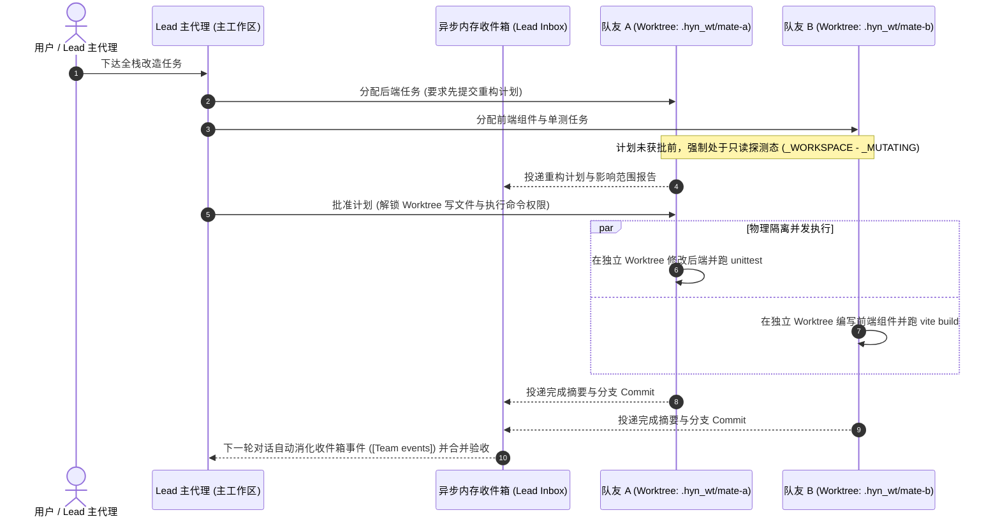

# 3. 多智能体团队与 Git Worktree 物理隔离

> [!NOTE] 对应源码模块
> - 后端：`app/services/team_runtime.py`、`app/services/team_worktree.py`、`app/services/team_store.py`、`app/services/subagent.py`
> - 前端：`src/views/LiveFloor.js`、`src/views/TeamSettingsPanel.js`

## 3.1 为什么“一次性 Subagent”不够用？

在大型全栈工程任务中，单一主代理顺序执行往往耗时过长；而传统一次性子代理（One-shot Subagent）存在两大缺陷：
1. **无常驻上下文**：每次调用都要重新扫描代码库，无法在多轮迭代中保持模块专精记忆；
2. **并发写文件冲突**：当多个子代理在同一工作目录下同时修改代码或运行构建脚本时，极易发生文件互相覆盖与 Git 索引锁冲突（`.git/index.lock`）。

为此，Helm 提供了 **「一次性轻量 Subagent」 + 「常驻多智能体团队（Resident Team）」** 双轨架构。

---

## 3.2 主从常驻队友架构与异步内存邮箱

一个会话可由主代理（**Lead**）招募最多 **4 名常驻队友（Teammates，见 `_MAX_TEAMMATES = 4`）**。队友在「工作（Working）」与「空闲待命（Idle）」状态间切换，拥有独立的对话上下文、专属 `StuckDetector` 与 `ContextCompactor`：

### 核心工程设计亮点：
1. **零轮询异步收件箱（Zero-Polling Inbox）**：
   - 队友的中间工具调用绝不混入主对话的 `messages` 列表（防止主代理上下文瞬间爆炸）。
   - 队友完成阶段任务或需要审批时，由运行时将结构化结果投递至 Lead 的内存收件箱，并在主对话下一轮自动以 `[Team events]` 注入，**禁止模型编写低效的 sleep 轮询循环**。
2. **计划批准前强制只读门禁（Plan Approval Gate）**：
   - 在 `team_runtime.py` 中，工具集被严格划分为只读探测集与写盘变更集（`_MUTATING = {"write_file", "edit_file", "apply_patch", "write_docx", "edit_document", "run_powershell"}`）。
   - 当队友的 `require_plan` 开启且计划尚未获批时，运行时从底层直接剥离 `_MUTATING` 权限，队友只能使用 `read_file / glob / grep` 阅读代码并提交计划，彻底杜绝队友“一上来就乱改代码”。

---

## 3.3 基于 `team_worktree.py` 的 Git Worktree 物理隔离与租约管理

为了实现真正的无冲突并行编码，`app/services/team_worktree.py` 为每位队友动态分配独立的 **Git Worktree（工作树）**：
- **路径与工具根重定向（`bind_tool_root`）**：每位队友线程在执行工具前，通过上下文变量（ContextVar）将 `active_root` 绑定到各自的 Worktree 目录（一切相对路径读写与 PowerShell 命令均被严格限制在该队友的独立工作树内）。
- **租约心跳与异常回收（Lease & Recovery）**：管理队友对工作树的租约检查（`set_lease_check`）。当会话结束或后端重启（`recover_after_restart`）时，自动释放失效租约并将未完结任务安全重置回待处理状态，防止孤儿锁阻塞后续开发。
