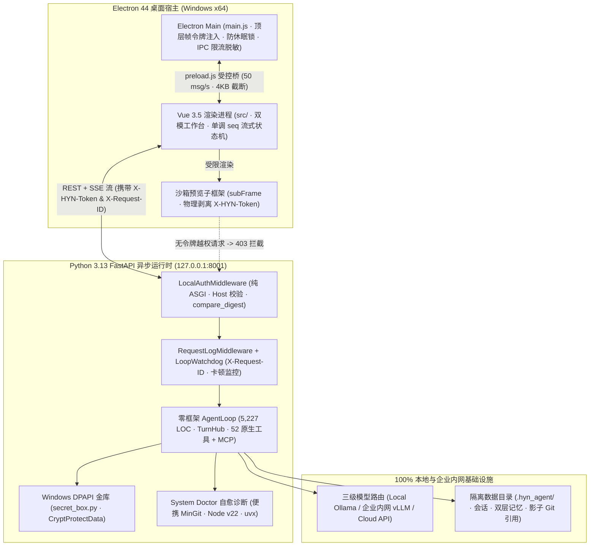
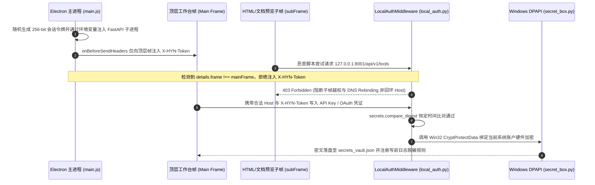
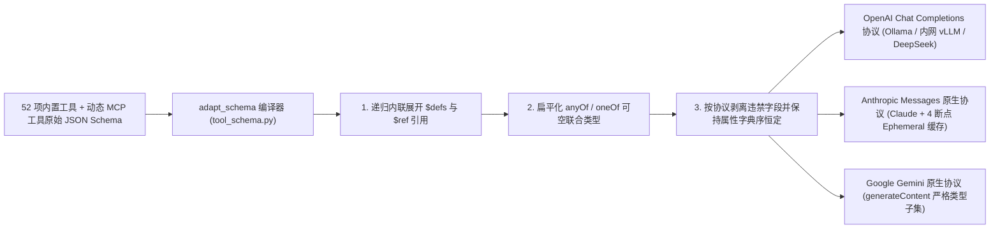

# 1. 总体架构、双进程安全基座与自愈诊断

> [!NOTE] 工程架构白皮书导读（全 6 卷）
> 本系列共 6 卷工程架构白皮书，完整披露 **Helm**（后端 `167` 个 Python 模块 / `70,223` 行代码 / `502` 项自动化测试；前端 `69` 个 ESM 模块 / `42,326` 行代码）的状态机设计、数据契约与实测基准。本卷对应前端 `hyn_agent_frontend/main.js`、`preload.js` 以及后端 `app/main.py`、`app/core/*`、`app/services/tool_schema.py` 与 `app/services/system_doctor.py`。

## 1.1 三端解耦拓扑与职责边界

Helm 摒弃将重度 I/O 塞进 Electron 主进程或依赖外部云端容器的做法，采用 **「Electron 主进程（系统宿主与安全桥） + Vue 3.5 渲染进程（石澜双模工作台） + 本机 Python 3.13 FastAPI 异步引擎（零框架 Agent 运行时）」** 的本机闭环架构：

> [!TIP] 核心架构权衡与工程闭环：为何采用 Electron + 独立 Python 子进程而非纯 Node.js 单进程？
> - **工程痛点**：桌面端 Agent 既要提供毫秒级响应的复杂富文档 UI，又要执行 CPU/I/O 密集的 AST 语法树解析、`docx/xlsx/pptx` 二进制手术刀级修改与多路并发子代理调度。
> - **常规方案缺陷**：纯 Node.js 主进程一旦执行大文件解析极易阻塞 IPC 导致窗口假死；而直接包装 LangChain/AutoGen 又会引入厚重的黑盒抽象，无法精细控制前缀缓存与流式重试。
> - **Helm 底层解法**：主进程仅保留窗口托管、`powerSaveBlocker` 防系统休眠与原生通知；渲染进程通过 `127.0.0.1` 直连纯 `asyncio + httpx` 自研的 FastAPI 引擎，并通过内嵌官方 Python 3.13 运行时实现 `.exe` 开箱即用。
> - **实测定量收益**：`502` 项核心 `pytest` 自动化测试全绿守护，实现 **0 字节公网机密外发**，且同一套后端无需改代码即可平滑迁移至企业内网 Docker 集群。

---

## 1.2 零信任本机鉴权与 Windows DPAPI 硬件级凭据金库

在本地开启 HTTP 端口（如 `127.0.0.1:8001`）的桌面软件面临两大经典安全威胁：**恶意网页通过 DNS Rebinding 探测本机端口**，以及**在软件内预览不可信 HTML 文档时子框架（iframe）窃取鉴权令牌调用本地命令工具**。Helm 构建了纵深防御链路：

1. **纯 ASGI 零缓冲流式鉴权（`app/core/local_auth.py`）**：
   - 摒弃 Starlette `BaseHTTPMiddleware`（会缓冲响应体破坏长连接 SSE 流），直接基于原生 ASGI 协议校验 `Host` 必须属于本地回环白名单（阻断 DNS 重绑定），并用 `secrets.compare_digest` 执行恒定时间令牌比对防时序侧信道攻击。
   - Electron `main.js` 在网络拦截层严格判定请求来源帧：仅对主工作台顶层帧附加 `X-HYN-Token`，任何内嵌预览 `subFrame` 发起的请求均被物理剥离凭证。
2. **Windows DPAPI 操作系统级密钥保险箱（`app/core/secret_box.py`、`secret_vault.py`）**：
   - 所有供应商 API Key 与 MCP OAuth 刷新令牌绝不明文落盘，统一调用 Windows 原生 `CryptProtectData` / `CryptUnprotectData` 绑定当前操作系统登录用户上下文加密存储于 `secrets_vault.json`。即使攻击者拷走硬盘文件，脱离原机器账户也无法解密。
   - 每次解锁密钥时同步调用 `register_secret()` 注册运行时指纹，配合前端 `sanitizeLogMessage` 正则钩子，确保日志落盘前将 `sk-*`、`Bearer *` 及已注册密钥强制擦除为 `***`，并实施单条 `4KB` 截断与 `50 条/秒` IPC 限流。

---

## 1.3 三级算力路由与跨协议自适应 Schema 编译器

不同大模型网关对 Tool Calling JSON Schema 的方言限制差异极大（例如 Gemini 严格拒绝 `$defs` / `$ref` 递归引用与 `additionalProperties`，部分内网开源推理框架不支持 `anyOf` 联合类型）。Helm 在 `app/services/llm.py` 与 `app/services/tool_schema.py` 中实现了协议级兼容层：

| 部署分级 (`deployment`) | 代表供应商与网关 (`8` 大内置源 / `18` 款精选模型) | 网络出站边界 | 核心适配特性 |
| :--- | :--- | :--- | :--- |
| **`local`（单机离线层）** | 本机 `Ollama` (`127.0.0.1:11434/v1`) | **0 字节出网**（拔网线可用） | 免 API Key 自动探测本机已拉取权重，支持显存重分配退避重试 |
| **`lan`（企业内网层）** | 企业私有 `vLLM` / `SGLang` / `OneAPI` | **不出企业防火墙** | 团队共享内网多卡算力与内网 RAGFlow，自动适配开源模型思维链字段 |
| **`cloud`（高性价比云端）** | `DeepSeek` / `Qwen` / `GLM` / `Claude` / `Gemini` / `OpenAI` | 按需 TLS 直连官方端点 | 无第三方中转服务器；原生对接 DeepSeek 64-token 缓存统计与 Claude 断点缓存 |

---

## 1.4 免管理员 `System Doctor` 自愈诊断与 8 步优雅停机

### 1. 零环境折腾：沙箱便携工具链一键自愈（`app/services/system_doctor.py`）
面向非技术办公人群与没有管理员（UAC）权限的企业受限终端，`System Doctor` 启动时自动执行 **核心运行时 / 外部二进制工具 / MCP 连通性** 三级体检。当检测到宿主机缺失 `git`、`node`/`npx` 或 `uv`/`uvx` 时，无需修改系统注册表或全局 `PATH`，即可一键拉取官方便携版 **MinGit**、**Node.js v22** 与 **`uv`** 解压至隔离目录 `DATA_DIR/toolchains/`，并在子进程拉起时动态注入局部环境变量。

### 2. 6 步启动自检恢复与 8 步确定性停机协议（`app/main.py`）
为杜绝强关窗口导致会话半途损毁、异步记忆丢失或孤儿 MCP 进程残留，`_lifespan` 严格执行对称生命周期管理：
- **启动 6 步自愈**：初始化看门狗 `LoopWatchdog` → 解锁 DPAPI 密钥库预热日志脱敏 → 清理异常退出遗留的常驻团队租约（`recover_after_restart`） → 回收过期临时附件（`gc_on_startup`） → 挂载本地 Cron 补跑检查 → 扫描 `interrupted` 会话就绪断点续跑。
- **停机 8 步排空**：① `turn_hub.shutdown()` 将在跑轮次刷写最终影子检查点并标为 `interrupted` → ② 排空异步记忆提取队列（最多等待 `10s` 原子落盘） → ③ 挂起常驻团队协程并进入 `24h` 租约保护期 → ④ 停止 Cron 调度器 → ⑤ 清理后台受管命令子进程树 → ⑥ 关闭全协议 MCP 客户端会话 → ⑦ 释放全局 HTTP 连接池 → ⑧ 卸载事件循环看门狗。
