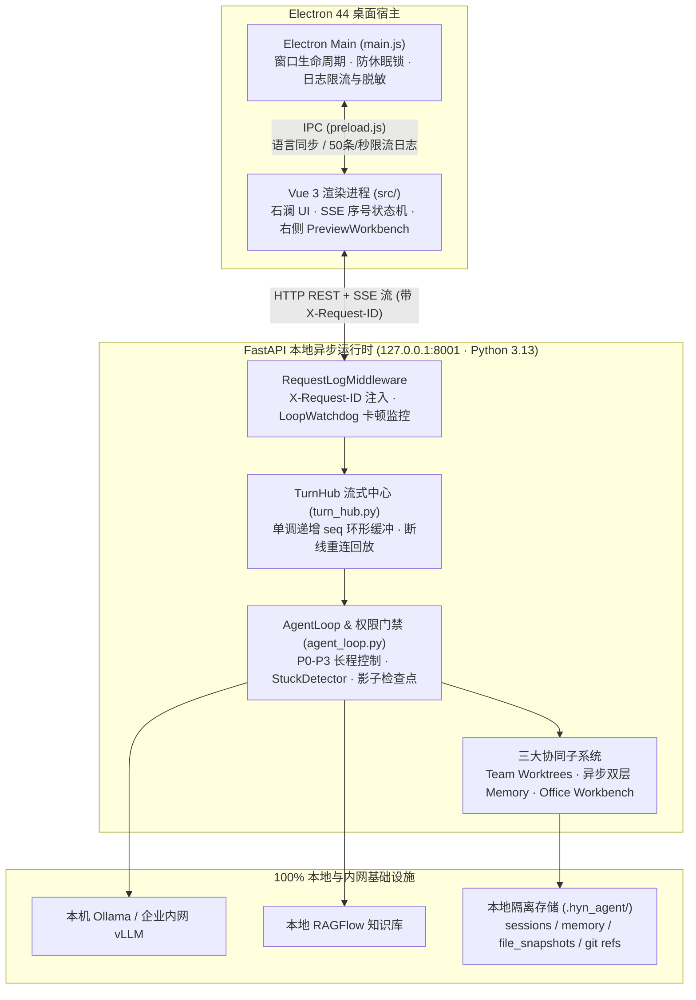

# 1. 总体架构与桌面端双进程设计

> [!NOTE] 工程白皮书导读（致技术面试官）
> 本系列共 5 篇工程架构文档，旨在向技术审阅者完整还原 **HYN Agent** 的源码级模块划分、状态机流转与工程边界处理。本文对应前端 `hyn_agent_frontend/main.js`、`src/i18n.js` 以及后端 `hyn_agent_backend/app/main.py`、`app/core/*`。

## 1.1 系统分层与进程拓扑

HYN Agent 采用 **「Electron 主进程（壳与系统桥） + Vue 3 渲染进程（石澜工作台） + 本机 FastAPI 异步进程（Agent 核心运行时）」** 的三端解耦拓扑：



### 为什么不把业务逻辑塞进 Electron 主进程？
1. **职责纯净与防阻塞**：Electron 主进程（`main.js`）仅负责创建原生窗口、拦截外链跳系统浏览器、在长任务执行时开启 `powerSaveBlocker` 防止操作系统休眠，以及发送系统原生通知（完成 / 待审批）。所有网络请求由渲染进程直连 `127.0.0.1:8001`，避免 IPC 序列化大体积文档流造成主线程卡顿。
2. **原生 Python 生态复用**：Agent 核心工作流深度依赖 `python-docx`、`openpyxl`、`python-pptx`、`pypdfium2` 与 `mcp` 官方 SDK。通过独立 FastAPI 异步进程承载，既保留了完整的 Python 工具生态，又使整套代码天然支持后续一键打包为企业内网 Docker 容器版本。

---

## 1.2 全链路可观测性与安全脱敏设计

### 1. 请求级 `X-Request-ID` 跨端贯通（`app/core/request_log.py`）
- 在 FastAPI 中，中间件遵循 Starlette 洋葱模型：`RequestLogMiddleware` 包裹在 `CORSMiddleware` 外层，并通过 `expose_headers=["X-Request-ID"]` 向 Electron 渲染进程暴露请求编号。
- 即使发生预检异常或未捕获的 500 错误，全局异常处理器（`_unhandled_exception_handler`）也会将 `request_id` 写入结构化日志并返回三语报错提示，前后端日志可通过同一 ID 毫秒级对齐排障。

### 2. 事件循环卡顿看门狗（`app/core/loop_watchdog.py`）
- 桌面端本地工具调用（如大文件解析或同步 I/O 误用）一旦阻塞 Python `asyncio` 事件循环，会导致前端 SSE 流假死。
- 系统在启动时挂载 `start_watchdog(loop)`，并接管 `loop.set_exception_handler`，确保任何未等待后台 Task 的异常均写入结构化日志，杜绝静默吞错。

### 3. 写盘前密钥强制脱敏与 IPC 日志限流（`hyn_agent_frontend/main.js`）
- **正则脱敏钩子（`sanitizeLogMessage`）**：在 `electron-log` 写盘与打印控制台前，自动拦截并擦除所有匹配 `sk-*`、`AIza*`、`Bearer *` 以及 `api_key / authorization / secret / password` 键值对的敏感字符串为 `***`。
- **防日志风暴保护**：主进程接收渲染进程 `hyn-log` IPC 消息时，强制执行**单字段 4KB 截断（`truncate4KB`）**与**每秒最多 50 条限流**，防止长任务高频流式输出撑爆磁盘。

---

## 1.3 确定性优雅停机序列（Graceful Shutdown Sequence）

当用户关闭桌面窗口或重启服务时，若直接强杀进程，极易导致正在运行的轮次丢失进度、异步记忆提取中断或残留孤儿 MCP 子进程。`app/main.py` 的 `_lifespan` 实现了严格的 **6 步有序停机协议**：

```python
# 摘自 hyn_agent_backend/app/main.py (_lifespan finally 块)
# 1. 将正在运行的会话轮次刷写最终检查点并标记为 interrupted，供下次启动一键续跑
await turn_hub.shutdown()
# 2. 排空后台异步记忆提取队列（最多等待 10 秒完成落盘）
await memory_queue.shutdown(timeout=10)
# 3. 停止所有常驻团队队友线程并回收 Git Worktree 租约
await shutdown_teams()
# 4. 停止 Cron 定时任务调度器
await stop_cron_runtime()
# 5. 终止后台命令子进程
shutdown_background_tasks()
# 6. 关闭所有已拉起的 MCP 客户端连接与看门狗
await shutdown_mcp()
stop_watchdog()
```

同时，在下次启动阶段（`_lifespan` 启动流），系统会自动执行：
- `recover_after_restart()`：清理上次异常退出遗留的队友占用状态；
- `gc_on_startup()`：异步清理过期临时附件缓存；
- `auto_resume_interrupted_on_startup()`：扫描处于 `interrupted` 状态的会话并支持自动断点续跑。
