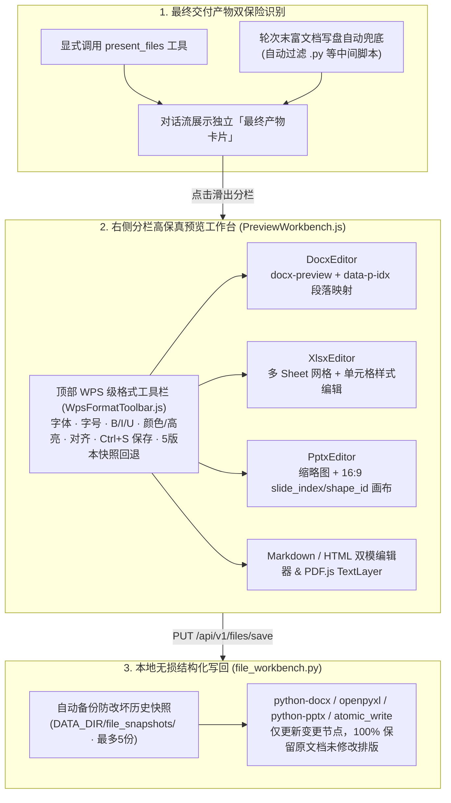
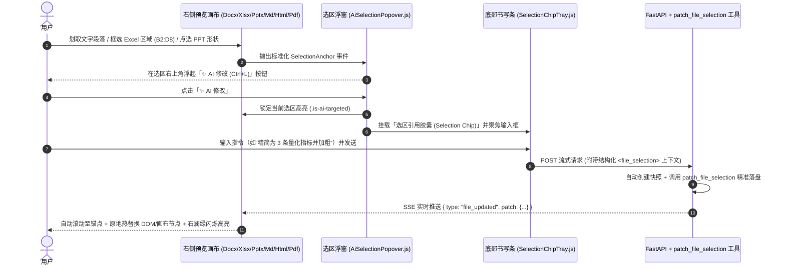

# 5. 高保真文档预览工作台与局部 AI 热补丁

> [!NOTE] 对应源码与设计文档
> - 前端：`src/components/preview/PreviewWorkbench.js`、`WpsFormatToolbar.js`、`AiSelectionPopover.js`、`editors/{DocxEditor,XlsxEditor,PptxEditor,MarkdownEditor,HtmlEditor,PdfViewer,TextEditor}.js`
> - 后端：`app/services/file_workbench.py`、`app/services/tools/selection_patch.py`、`app/services/tools/office.py`
> - 设计文档：`docs/file_preview_phase1_plan.md`、`docs/file_ai_edit_phase2_plan.md`

## 5.1 为什么 Coding Agent 需要内建 Office 高保真工作台？

在真实的研发与企业办公场景中，工程师和架构师不仅要写代码，还需要交付**架构评审 PPT（`.pptx`）、技术规范书（`.docx`）、测试数据表（`.xlsx`）与分析报告（`.pdf` / `.md`）**。
传统 Agent 生成文档存在两大痛点：
1. **中间过程文件刷屏**：模型为了生成一份 PPT 往往会先写好几个临时 Python 脚本（如 `_gen_part1.py`），用户分不清哪个才是最终交付物；
2. **局部修改成本极高**：用户只想把 PPT 第 2 页某个文本框精简成 3 条要点，或者修改 Excel 某几个单元格，传统 Agent 只能把整个文件重新生成一遍，不仅慢，还会破坏用户在其他页面已调好的排版。

---

## 5.2 第一期架构：最终产物识别 + WPS 级原位渲染与编辑

---

## 5.3 第二期架构：鼠标划取「✨ AI 修改」与 SSE 局部热替换

对标 Cursor 的 `Add Selection to Chat` 与 Canvas 局部重绘，HYN Agent 将**「鼠标划选 → 浮起 AI 按钮 → 结构化锚点注入 → 原地无闪烁热替换」**扩展到了全部富文档格式：

### 跨格式统一选区锚点契约（`SelectionContext`）
无论用户在哪种格式的预览器中划选，前端均将其归一化为精确的物理定位锚点（`locator`），使后端 `selection_patch.py` 能做到手术刀级局部写回：

| 文档格式 | `locator.type` | 精准结构化定位坐标 | 后端写回机制 |
| :--- | :--- | :--- | :--- |
| **PPT (`.pptx`)** | `pptx_shape` | `slide_index` + `shape_id` + `paragraph_indices` | `python-pptx` 定位对应幻灯片与 Shape 节点，仅替换目标段落文本与 Run 样式 |
| **Word (`.docx`)** | `docx_paragraphs` | `paragraph_start` ~ `paragraph_end` (`data-p-idx`) | `python-docx` 原位修改目标段落，不破坏文档其余章节、表格与页眉页脚 |
| **Excel (`.xlsx`)** | `xlsx_range` | `sheet_name` + `cell_range` (如 `Sheet1!B2:D8`) | `openpyxl` 批量更新目标矩形区域单元格数值、公式与样式 |
| **代码 / Markdown / HTML** | `text_lines` / `dom_selector` | `line_start` ~ `line_end` 或 CSS 选择器 | 原子行区间替换并返回增量 Patch |
