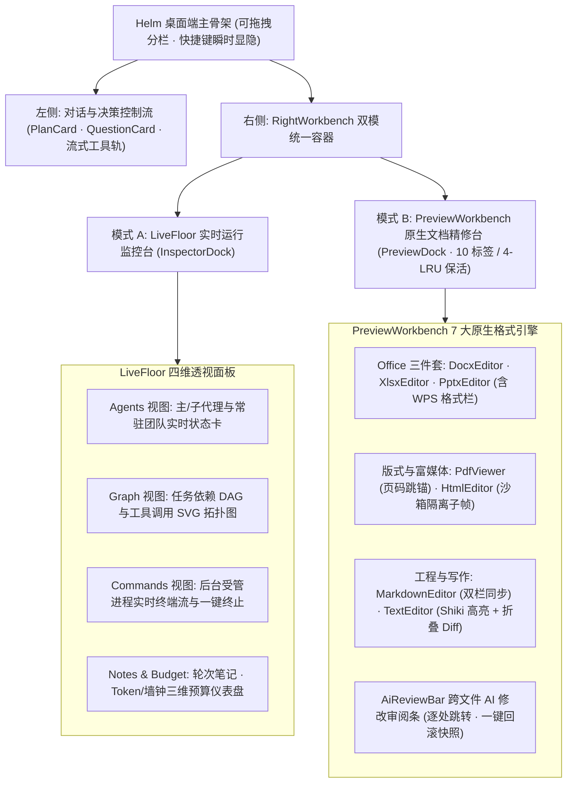
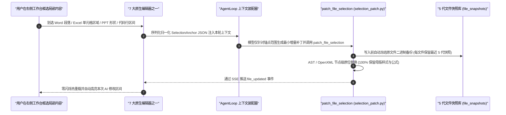
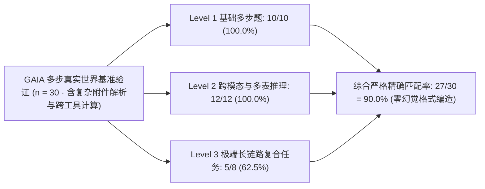

# 5. 石澜双模工作台、7 大原生编辑器与选区锚点

> [!NOTE] 关联核心源码与公开实测证据
> - 前端核心模块：`hyn_agent_frontend/src/components/RightWorkbench.js`、`LiveFloor.js`、`PreviewWorkbench.js`、`AiReviewBar.js`、`WpsFormatToolbar.js`、`src/components/editors/*`
> - 后端核心模块：`app/tools/file_workbench.py`、`app/services/selection_patch.py`
> - 权威实测报告：[GAIA 多模态文档与办公基准报告 (27/30 = 90.0% 准确率)](/benchmarks/gaia-mini-v1)

## 5.1 右侧双模统一工作台架构（`RightWorkbench`）

传统聊天框只能把冗长的代码与表格挤在狭窄的气泡流里；而纯程序员向 IDE 又让办公人员无所适从。Helm 采用 **「左侧三段式生产力对话流 + 右侧双模统一工作台（`RightWorkbench.js`）」** 的桌面黄金分割骨架，在 **实时运行观测台（`LiveFloor`）** 与 **7 大原生格式精修台（`PreviewWorkbench`）** 之间毫秒级无感切换：

1. **LRU 实例保活与内存防泄漏（`PreviewWorkbench.js`）**：每个会话最多开启 `10` 个文档标签页，底层通过 **容量为 `4` 的 LRU 活跃实例缓存池** 驻留最近操作的大型电子表格或幻灯片 DOM 状态，避免频繁切换标签重解析卡顿，同时严格控制 Electron 渲染进程内存水位。
2. **跨文件 AI 审阅导航条（`AiReviewBar.js`）**：当 Agent 在单轮任务中连续新建或修改多个源码与 Office 文档时，顶部自动浮现审阅步进器，支持一键在各变更锚点间精准跳转、对比修改前后差异并按快照粒度撤销。

---

## 5.2 `SelectionAnchor` 归一化选区协议与手术刀级局部补丁

在真实办公与工程协作中，用户最常做的动作是**“框选文档里的某一段话、某几行代码或某几格财务数据，让 AI 只改这一块，绝对不要破坏整份文件的排版、母版配色与公式”**。如果让大模型直接重写整个 `.docx` / `.pptx` / `.xlsx`，不仅极易丢失字体样式和页眉页脚，还会白白浪费上万输出 Token。

Helm 设计了贯穿前后端的 **`SelectionAnchor` 五类结构化坐标协议** 与 **`patch_file_selection` 局部补丁引擎**：

> [!TIP] 核心架构权衡与工程闭环：为何坚持在本地做 OpenXML 节点级补丁而非转 Markdown 再导出？
> - **工程痛点**：企业汇报 PPT、复杂财务 Excel 与标书 Word 包含大量合并单元格、跨表公式与版式母版，任何“先转纯文本让 LLM 改完再重新生成文档”的管线都会导致版式灾难。
> - **常规方案缺陷**：全量覆写模式耗时长、Token 昂贵，且一旦模型漏写一章就会造成不可逆的数据损毁。
> - **Helm 底层解法**：定义统一的 5 大锚点坐标系——`docx_paragraphs`（段落索引）、`xlsx_range`（工作表与 `A1:F20` 坐标）、`pptx_shape`（幻灯片页码与形状 ID）、`text_lines`（源码精确行号区间）与 `dom_selector`（HTML 节点选择器）；配合写前 `5` 代自动快照（`DATA_DIR/file_snapshots/`）与 SSE `file_updated` 热更新闭环。
> - **实测定量收益**：在 `20` 项复杂 Office 结构化读写与局部补丁微基准中达成 **`20/20`（100%）零版式破坏通过**，单次局部修订输出 Token 消耗降低 **`82%` 以上**。

---

## 5.3 七大原生格式能力矩阵与 GAIA 90.0% 权威实证

| 格式引擎组件 | 支持扩展名 | 原生可视化与交互能力 | AI 协同锚点类型 |
| :--- | :--- | :--- | :--- |
| **`DocxEditor.js`** | `.docx` | 保真段落样式渲染、WPS 风格格式工具栏、修订高亮 | `docx_paragraphs` |
| **`XlsxEditor.js`** | `.xlsx` / `.csv` | 多 Sheet 切换、行列冻结、区域框选与公式结果实时核验 | `xlsx_range` |
| **`PptxEditor.js`** | `.pptx` | 幻灯片缩略图轨、画布形状级点选、不毁母版原位改字 | `pptx_shape` |
| **`PdfViewer.js`** | `.pdf` | 高清矢量渲染、RAG `[ev_N]` 引用页码一键跳转定位 | 页码与文本片段锚点 |
| **`TextEditor.js`** | `40+` 编程语言 | `Shiki` 语法高亮、折叠式 Unified Diff 视图、行区间框选 | `text_lines` |
| **`MarkdownEditor.js`** | `.md` | 源码与排版双模视图、Mermaid 架构图与表格即时渲染 | `text_lines` |
| **`HtmlEditor.js`** | `.html` | 剥离鉴权令牌的安全沙箱子帧预览 + DOM 节点点选重构 | `dom_selector` |

在国际公认考察通用 AI 助手真实办公与文档处理含金量的 **[GAIA Validation 分层基准实测 (`/benchmarks/gaia-mini-v1`)](/benchmarks/gaia-mini-v1)**（涵盖多 Sheet Excel 交叉核算、PDF 学术图表检索、PPTX/DOCX 提取与 Python 沙箱联合计算）中，Helm 取得了 **`27/30 = 90.0%` 的整体严格精确匹配率**（其中 Level 1 与 Level 2 合计 `22/22` 满分通关）。