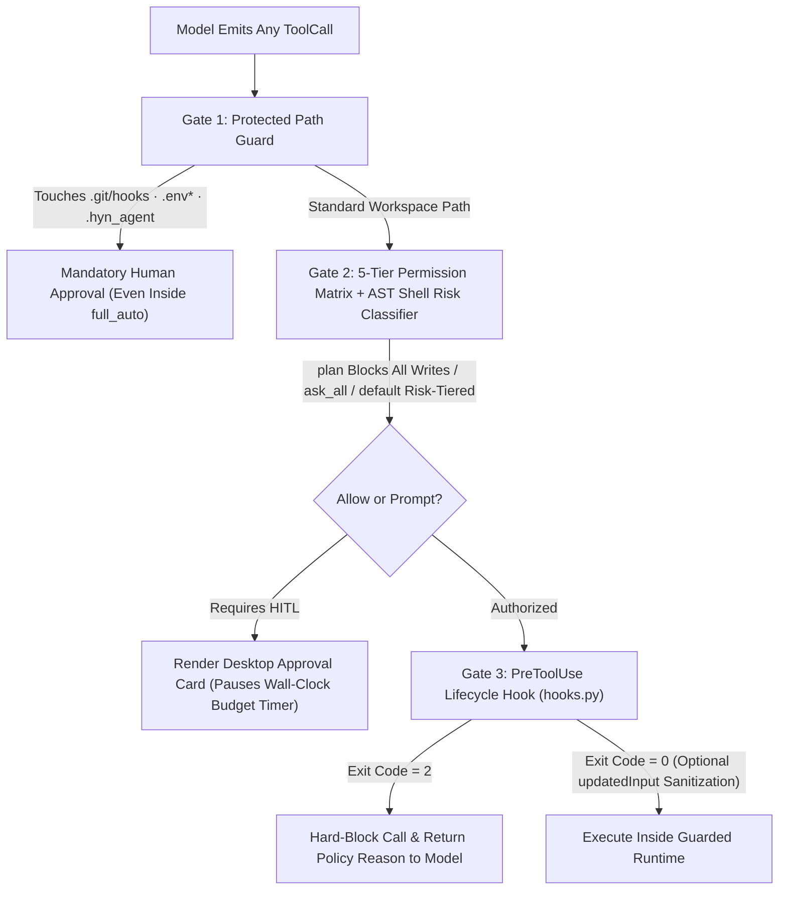
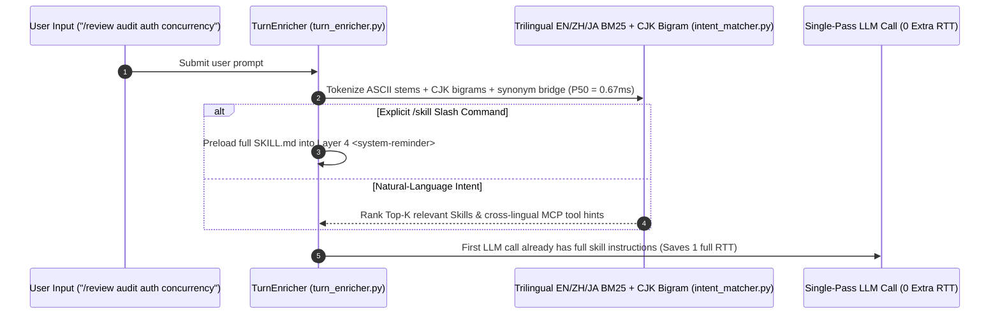
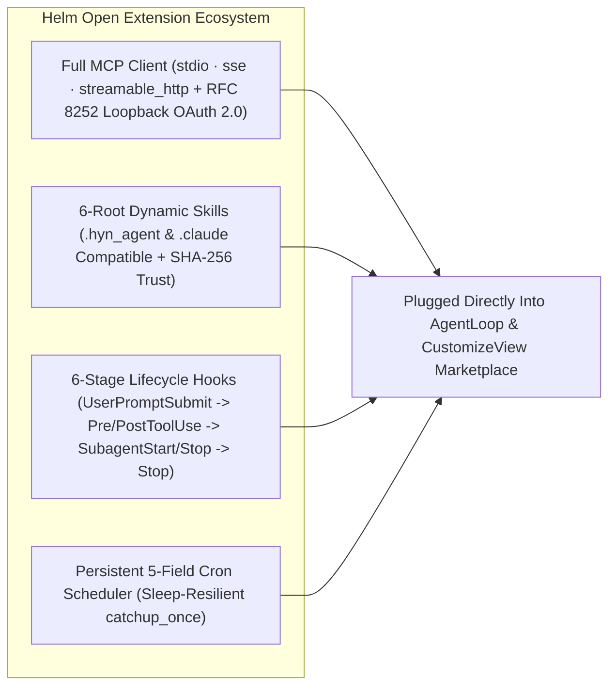

# 6. 5-Tier Permission Sandbox, Zero-RTT Intent Engine & Open Ecosystem

> [!NOTE] Core Modules & Cryptographically Signed Evidence
> - Core Modules: `app/services/permission_mode.py`, `permission.py`, `plan_submission.py`, `clarification.py`, `intent_matcher.py`, `turn_enricher.py`, `mcp_runtime.py`, `mcp_oauth.py`, `skill_loader.py`, `hooks.py`, `cron_scheduler.py`
> - Empirical Report: [Harness Guardrail Ablation (30/30 Attack Block · 0.67ms Zero-RTT Intent Match · 100% Cross-Lingual MCP Recall)](/en/benchmarks/harness-ablation-v1)

## 6.1 Five Interactive Permission Modes & Three-Gate Sandbox

Desktop agents operate directly on real repositories and corporate networks. Helm combines **5 interactive permission tiers** (plus unattended `bypass` for trusted local Cron jobs) with a mandatory **3-Gate Execution Sandbox**:

| Permission Mode | Read Tools | Workspace File Edits | Shell Execution | Protected Paths (`.env*` / `.git/hooks`) | Target Workflow |
| :--- | :--- | :--- | :--- | :--- | :--- |
| **`plan` (Read-Only Plan)** | Auto-Allow | **Physically Blocked** | **Physically Blocked** | **Mandatory HITL** | Architecture discovery & design review |
| **`ask_all` (Strict Audit)** | Auto-Allow | Prompt Every Edit | Prompt Every Command | **Mandatory HITL** | Compliance-critical & production ops |
| **`default` (Balanced)** | Auto-Allow | Diff Confirmation | Safe Read-Only Allowlist | **Mandatory HITL** | Daily engineering & office co-authoring |
| **`auto_edit` (Fast Dev)** | Auto-Allow | **Auto-Allow (Snapshotted)** | Risky Commands Prompted | **Mandatory HITL** | Multi-file coding & TDD iteration |
| **`full_auto` (Autonomous)** | Auto-Allow | **Auto-Allow** | Workspace Auto-Allow | **Mandatory HITL (Escape-Proof Floor)** | Long-horizon refactors & benchmark runs |

- **Prefix-Safe `Plan Mode` & Disk-Persisted `ask_user`**: Toggling `Plan Mode` injects planning constraints via Layer 4 `<system-reminder>` without mutating Layer 1/2 hashes (`PlanCard.js`); `ask_user` serializes structured single/multi-select prompts to disk (`QuestionCard.js`) so sessions survive full app restarts without dangling Futures.

---

## 6.2 Sub-`1ms` Zero-RTT Trilingual Intent Enricher

Preloading every `SKILL.md` wastes tens of thousands of prompt tokens, whereas making the LLM call `load_skill` first adds `2–5 seconds` of extra round-trip latency. `intent_matcher.py` and `turn_enricher.py` resolve intent on CPU in **`0.67 ms` median (`<1 ms`)**:

> [!TIP] Architectural Trade-off: Pure-CPU Trilingual BM25 vs Heavy Local Embedding Models
> - **Engineering Bottleneck**: Chinese/Japanese prompts querying English MCP schemas fail naive keyword matching, yet bundling a 500 MB local embedding model bloats installer size and RAM.
> - **Flaw in Conventional Designs**: Secondary LLM router calls add multi-second TTFT overhead on every message.
> - **Helm's Underlying Solution**: Combine a curated EN/ZH/JA technical synonym bridge with ASCII stemming and CJK bigram inverted indexing in pure Python.
> - **Measured Engineering Gain**: **`0.67 ms` median latency**, **1 full LLM round-trip saved** per `/skill` invocation, and **`100.0%` Top-3 cross-lingual MCP tool recall**.

---

## 6.3 Full MCP Client (RFC 8252 OAuth 2.0), 6-Stage Hooks & Local Cron

1. **Enterprise MCP + DPAPI-Backed OAuth 2.0 (`mcp_runtime.py`, `mcp_oauth.py`)**: Supports `stdio`, `sse`, and `streamable_http`, RFC 8252 PKCE loopback browser login encrypted via Windows DPAPI, MCP Resources/Elicitation, and automatic `mcp_search_tools` lazy loading whenever mounted MCP tools exceed `30`.
2. **6-Stage Deterministic Hooks & Repo Trust (`hooks.py`)**: Supports exit-code `2` hard blocking, `updatedInput` sanitization, and `additionalContext` injection; workspace-bundled skills and hooks require explicit **SHA-256 content-fingerprint approval** before execution, automatically revoking trust if a single byte changes.
3. **Sleep-Resilient Local Cron (`cron_scheduler.py`)**: Executes recurring 5-field cron automations locally and runs `catchup_once` recovery upon laptop wake-from-sleep.