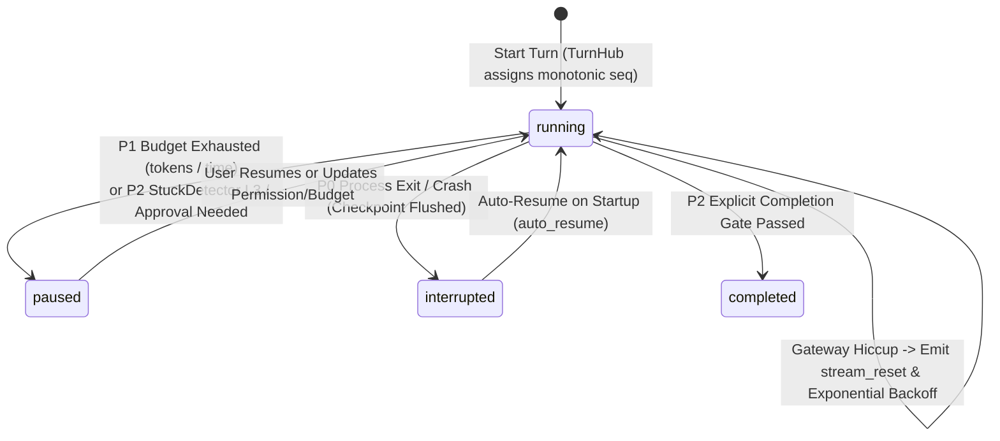

# 2. Long-Horizon Autonomous Engine (P0–P3)

> [!IMPORTANT] The Four Failure Modes of Long-Running Agents
> Typical coding agents fail during multi-hour runs due to: **① stream drops on network/gateway hiccups, ② context window exhaustion, ③ infinite tool-error loops or premature exits, and ④ destructive working-tree changes that cannot be cleanly rolled back**.
> Helm resolves these systematically across four architecture phases (**P0–P3** in `docs/long_running/` and `app/services/`).



---

## 2.1 P0 Reliability: `TurnHub` Monotonic `seq` & `stream_reset`

**Source**: `app/services/turn_hub.py`, `app/services/llm_retry.py`

- **Decoupled Ring-Buffer Replay**: `TurnHub` assigns a monotonically increasing `seq` to every SSE event. If the renderer reloads or reconnects, passing `last_seq` replays missed events seamlessly without aborting the backend turn.
- **Stream Reset on Retry (`stream_reset`)**: When an LLM stream fails mid-generation and `llm_retry.py` initiates a retry, `TurnHub` emits `stream_reset` so the UI cleanly discards partial dirty tokens before rendering the new attempt.

---

## 2.2 P1 Token/Time Budgets & Three-Stage Compaction

**Source**: `app/services/turn_budget.py`, `app/services/context_compact.py`

- **Dynamic Token & Wall-Clock Budgets**: Replaces rigid step caps with configurable token and duration budgets streamed live to `ContextRing.js`.
- **Pre-Compaction Memory Rescue & `ContextCompactor`**: Before trimming historical messages via `compact_history`, `reactive_compact`, or `snip_compact` (400+ message guardrail), discarded messages are queued into `memory_queue.py` so critical architectural decisions are never lost.

---

## 2.3 P2 Convergence: `StuckDetector` v2 & Explicit Completion Gate

**Source**: `app/services/stuck_detector.py`, `app/services/completion.py`

- **L1/L2 Retrospective Injection**: `ProgressTracker` fingerprints tool calls and outcomes. Repeated identical failures trigger `L1` warnings followed by `L2_RETROSPECTIVE_NOTICE`, forcing the model to pause tool execution, analyze the root cause, and switch strategies.
- **Explicit Completion Gate**: Prevents premature task termination by requiring structured verification status (`summary`, `verification`, `remaining`, `gate_passed`).

---

## 2.4 P3 Unattended Horizon: Non-Invasive Shadow Git Checkpoints & Live Permissions

**Source**: `app/services/git_checkpoints.py`, `app/services/permission_mode.py`, `app/services/progress_notes.py`

### Shadow Git Checkpoints (Zero Pollution to User `HEAD` or Staging Area)
Instead of running `git commit` on the user's active branch, `git_checkpoints.py` uses low-level Git plumbing commands with a temporary index file:

```bash
# Core mechanism (app/services/git_checkpoints.py)
GIT_INDEX_FILE=<temp_index> git add -A
tree=$(GIT_INDEX_FILE=<temp_index> git write-tree)
commit=$(git commit-tree $tree -p $parent -m "hyn checkpoint: step N")
git update-ref refs/hyn/checkpoints/<session_id> $commit
```

- **Result**: The user's `HEAD`, branch history, and `.git/index` remain **100% untouched**, while the UI can inspect diffs against any checkpoint and roll back with one click.
- **Compaction-Proof Progress Notes (`progress_notes.py`)**: Persisted in `DATA_DIR/session_state/<session_id>/progress.md` and injected into `<progress_notes>` on every turn.
- **4-Tier Live Permission Mode (`permission_mode.py`)**: Uses `bind_mode_getter` so switching between `ask_all`, `auto_edit`, `default`, and `full_auto` takes effect on the very next tool call without stopping the turn—while hard-deny sandbox boundaries remain strictly enforced.

---

## 2.5 Deterministic Code Navigation & SWE-bench Verified Mini (84.0% Pass@1)

**Source**: `app/services/ripgrep.py`, `app/services/code_outline.py`, `app/services/syntax_check.py`, `app/api/tools.py`

In real-world multi-thousand-file repositories, long-horizon coding agents are frequently bottlenecked not by LLM reasoning, but by **slow workspace search, unaligned file truncation that drops lines between pages, and post-edit syntax typos that waste test turns**. Helm integrates four deterministic code navigation primitives, validated end-to-end on **SWE-bench Verified Mini (`n = 50`, Docker `--network none`)**:

| Primitive & Module | Legacy Baseline | Helm Deterministic Engine | Measured Engineering Gain |
| --- | --- | --- | --- |
| **Bundled `ripgrep 15.2.0` (`search_in_files`)** | Python `os.walk` P50 `5,026.2 ms`, noise rate `49.17%` | P50 **`119.3 ms`** (P95 `160.3 ms`), noise rate **`0.00%`** | **42.1× speedup**, scoped `path` drill-down & full regex |
| **`tree-sitter` Multi-Lang AST (`code_outline`)** | Blindly reading multi-thousand-line files into context | Cold P50 **`23.81 ms`** (warm `0.8 ms`), `4.59%` size ratio | **95.41% theoretical token savings** with exact line ranges |
| **`read_file` Pagination & Truncation Alignment** | 2,000-line char truncation had `30.33%` page consistency (`288,084` missed lines) | Synchronized line/byte cursor with **`100.00%`** sequential consistency | **Zero missed lines (`L2 = 0%`)** across multi-page reads |
| **Post-Edit In-Process Syntax Guard (`syntax_check.py`)** | Broken brackets/indentation only caught during full test runs | Median **`37 ms`** in-process `ast.parse` + `tree-sitter` check | **100% recall / 0.0% false positives**, instant self-repair |

### SWE-bench Verified Mini (`n = 50`) Empirical Summary
- **Single-Run Peak & 2-Run Mean**: Powered by cost-efficient `DeepSeek-V4.1-Flash` (`deepseek-flash`), Helm achieved **`42 / 50 = 84.00%` Pass@1** in `hyn_flash_r1_clean` (Wilson 95% CI `[71.49%, 91.66%]`) and `39 / 50 = 78.00%` in the independent full-gate rerun `hyn_flash_r2`, yielding a **2-run mean of `81.00% ± 4.24%`** (with `django/django` at **`22 / 25 = 88.00% ± 0.00%`** across both runs).
- **1:1 Controlled Comparison vs. Official `mini-SWE-agent`**: On the exact same 50 tasks and `DeepSeek-V4.1-Flash` model, official `mini-SWE-agent` scored `82.00%` (statistically tied under paired exact McNemar test, $p = 1.00$). However, `mini-SWE-agent` produced **2 empty patches (`96.0%` valid rate)** due to 80-step exhaustion, whereas Helm achieved **`100.0%` (`100/100`) valid non-empty patches, 0 errors, and 0 timeouts** across both runs.
- **98.0% Gold File Localization & Ultra-Low Cost**: Helm viewed the ground-truth Gold file in **100% (50/50)** of tasks and directly edited the Gold file in **98.0% (49/50)** of tasks. Backed by a **97.74%** Prefix Cache hit rate, an entire 50-issue run (~60M input tokens) costs just **¥10.39–¥12.16 (¥0.27–¥0.29 per resolved issue)**.
- **Public Verifiable Evidence Bundle**: Inspect [`/benchmarks/swebench-mini-v1/REPORT.md`](/benchmarks/swebench-mini-v1/REPORT.md) and the SHA-256 signed manifest at [`/benchmarks/swebench-mini-v1/manifest.json`](/benchmarks/swebench-mini-v1/manifest.json).
