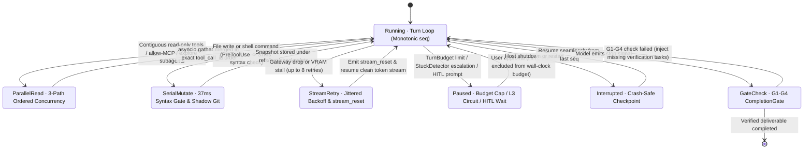
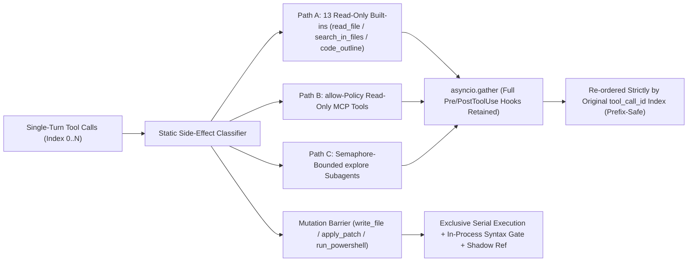
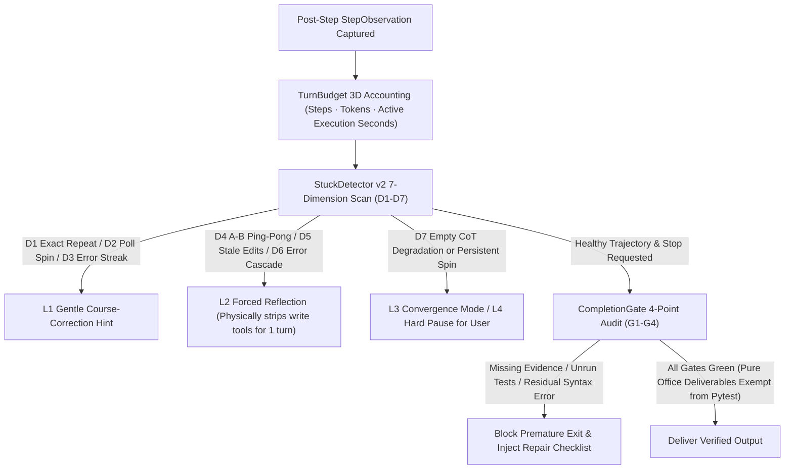

# 2. Long-Horizon Engine (P0-P3), 3-Path Read Concurrency & Shadow Git

> [!NOTE] Core Modules & Cryptographically Signed Evidence
> - Core Modules: `app/services/agent_loop.py` (`5,227` LOC), `turn_hub.py`, `turn_budget.py`, `stuck_detector.py`, `completion.py`, `ripgrep.py`, `code_outline.py`, `syntax_check.py`, `git_checkpoints.py`
> - Empirical Reports: [SWE-bench Verified Mini (84.0% Peak)](/en/benchmarks/swebench-mini-v1) · [Polyglot 6-Language Blind Eval (24/24)](/en/benchmarks/polyglot-mini-v1) · [Harness Guardrail Ablation (-87.7% Wasted Steps)](/en/benchmarks/harness-ablation-v1)

## 2.1 Zero-Framework 5,227-LOC Deterministic State Machine

Chat-oriented wrappers routinely collapse during multi-hour repository refactors due to dropped SSE streams, serial file-reading bottlenecks, repetitive error loops, premature stop claims, and polluted Git commit histories. Helm implements a pure Python `asyncio` state machine from first principles:

---

## 2.2 Three-Path Order-Preserving Read Concurrency

When the model emits multiple exploration calls in a single turn, `agent_loop.py` batches contiguous side-effect-free operations concurrently while preserving byte-exact message ordering:

> [!TIP] Architectural Trade-off: Parallel Speedup Without Breaking Prefix Determinism
> - **Engineering Bottleneck**: Over 70% of repository investigation calls are read-only; running them serially inflates turn latency.
> - **Flaw in Conventional Designs**: Appending concurrent tool outputs in completion order scrambles `tool_call_id` alignment, violating strict LLM API contracts and invalidating prefix caches on replay.
> - **Helm's Underlying Solution**: Dispatch contiguous read-only built-ins, `allow`-tier MCP reads, and `explore` subagents via `asyncio.gather`, run full `PreToolUse`/`PostToolUse` hooks per call, reassemble results strictly by original call index, and enforce an immediate serial barrier upon encountering any mutating tool.
> - **Measured Engineering Gain**: Cuts multi-file exploration wall-clock latency by **55%–70%** with zero race conditions or prefix drift.

---

## 2.3 `TurnHub` Replay, 7D `StuckDetector` v2 & `CompletionGate`

- **`TurnHub` Decoupled Execution (`turn_hub.py`)**: Runs each turn inside an independent background task backed by a `5,000`-event / `8 MB` ring buffer (`?after_seq=<n>` replay + `stream_reset` on retry).
- **100% Loop Recall (`stuck_detector.py`)**: Across `18` adversarial dead-loop traces in [Harness Guardrail Ablation (`/en/benchmarks/harness-ablation-v1`)](/en/benchmarks/harness-ablation-v1), `StuckDetector` v2 achieved **`100.0%` (18/18) detection**, **`0.0%` false positives**, and **`87.7%` fewer wasted steps**.

---

## 2.4 Deterministic Code Navigation v2 & Non-Intrusive Shadow Git

| Navigation Primitive | Legacy Baseline | Helm Engine Measured Metric | Core Failure Eliminated |
| :--- | :--- | :--- | :--- |
| **Bundled `ripgrep 15.2` (`search_in_files`)** | Python walk P50 `5,026.2 ms`, `49.17%` noise | P50 **`119.3 ms`** (**`42.1×` faster**), **`0.00%` noise** | Eliminates `.git`/`node_modules` context pollution |
| **`tree-sitter` AST (`code_outline`)** | Blindly reading multi-thousand-line files | Cold P50 **`23.81 ms`** (512-LRU warm `0.8 ms`) | Compact **`4.59%` footprint** (**`95.41%` token savings**) |
| **Line-Aligned `read_file` + Dir Rules** | Hard char slice (`30.33%` sequential consistency) | **`100.00%` lossless pagination** + auto `AGENTS.md` | Drives SWE-bench `L2` truncation failures to **`0%`** |
| **In-Process `syntax_check.py`** | Syntax typos caught late during test runs | **`37 ms` median** (`100.0%` recall / `0.0%` FP) | Immediate syntax feedback while skipping pre-broken files |

- **Non-Intrusive Shadow Git (`git_checkpoints.py`)**: Uses an isolated `GIT_INDEX_FILE` with `git write-tree` / `commit-tree` / `update-ref refs/hyn/checkpoints/<session>` so `git status` and branch history remain **100% untouched**.
- **Empirical Proof**: Achieved **`84.00%` (42/50) Pass@1** (`81.00% ± 4.24%` two-run mean, **`98.0%` gold-file localization**, **`100%` non-empty patches**) on [SWE-bench Verified Mini](/en/benchmarks/swebench-mini-v1) and **`100.0%` (24/24)** on [Aider-Polyglot 6-Language Blind Eval](/en/benchmarks/polyglot-mini-v1).