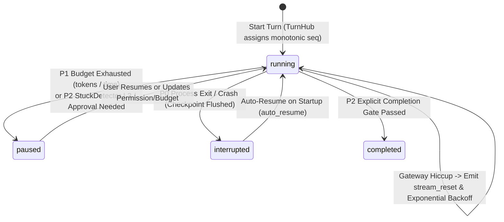

# 2. Long-Horizon Autonomous Engine (P0–P3)

> [!IMPORTANT] The Four Failure Modes of Long-Running Agents
> Typical coding agents fail during multi-hour runs due to: **① stream drops on network/gateway hiccups, ② context window exhaustion, ③ infinite tool-error loops or premature exits, and ④ destructive working-tree changes that cannot be cleanly rolled back**.
> HYN Agent resolves these systematically across four architecture phases (**P0–P3** in `docs/long_running/` and `app/services/`).



---

## 2.1 P0 Reliability: `TurnHub` Monotonic `seq` & `stream_reset`

**Source**: `app/services/turn_hub.py`, `app/services/llm_retry.py`

- **Decoupled Ring-Buffer Replay**: `TurnHub` assigns a monotonically increasing `seq` to every SSE event. If the renderer reloads or reconnects, passing `last_seq` replays missed events seamlessly without aborting the backend turn.
- **Stream Reset on Retry (`stream_reset`)**: When an LLM stream fails mid-generation and `llm_retry.py` initiates a retry, `TurnHub` emits `stream_reset` so the UI cleanly discards partial dirty tokens before rendering the new attempt.

---

## 2.2 P1 Token/Time Budgets & Three-Stage Compaction

**Source**: `app/services/turn_budget.py`, `app/services/context_compact.py`

- **Dynamic Token & Wall-Clock Budgets**: Replaces rigid step caps with configurable token and duration budgets streamed live to `ContextRing.js`.
- **Pre-Compaction Memory Rescue & `ContextCompactor`**: Before trimming historical messages via `compact_history`, `reactive_compact`, or `snip_compact` (400+ message guardrail), discarded messages are queued into `memory_queue.py` so critical architectural decisions are never lost.

---

## 2.3 P2 Convergence: `StuckDetector` v2 & Explicit Completion Gate

**Source**: `app/services/stuck_detector.py`, `app/services/completion.py`

- **L1/L2 Retrospective Injection**: `ProgressTracker` fingerprints tool calls and outcomes. Repeated identical failures trigger `L1` warnings followed by `L2_RETROSPECTIVE_NOTICE`, forcing the model to pause tool execution, analyze the root cause, and switch strategies.
- **Explicit Completion Gate**: Prevents premature task termination by requiring structured verification status (`summary`, `verification`, `remaining`, `gate_passed`).

---

## 2.4 P3 Unattended Horizon: Non-Invasive Shadow Git Checkpoints & Live Permissions

**Source**: `app/services/git_checkpoints.py`, `app/services/permission_mode.py`, `app/services/progress_notes.py`

### Shadow Git Checkpoints (Zero Pollution to User `HEAD` or Staging Area)
Instead of running `git commit` on the user's active branch, `git_checkpoints.py` uses low-level Git plumbing commands with a temporary index file:

```bash
# Core mechanism (app/services/git_checkpoints.py)
GIT_INDEX_FILE=<temp_index> git add -A
tree=$(GIT_INDEX_FILE=<temp_index> git write-tree)
commit=$(git commit-tree $tree -p $parent -m "hyn checkpoint: step N")
git update-ref refs/hyn/checkpoints/<session_id> $commit
```

- **Result**: The user's `HEAD`, branch history, and `.git/index` remain **100% untouched**, while the UI can inspect diffs against any checkpoint and roll back with one click.
- **Compaction-Proof Progress Notes (`progress_notes.py`)**: Persisted in `DATA_DIR/session_state/<session_id>/progress.md` and injected into `<progress_notes>` on every turn.
- **4-Tier Live Permission Mode (`permission_mode.py`)**: Uses `bind_mode_getter` so switching between `ask_all`, `auto_edit`, `default`, and `full_auto` takes effect on the very next tool call without stopping the turn—while hard-deny sandbox boundaries remain strictly enforced.
