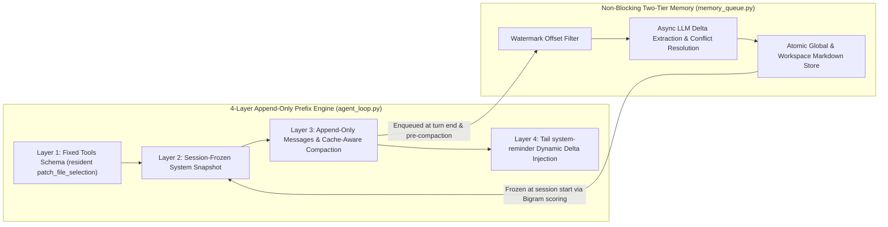
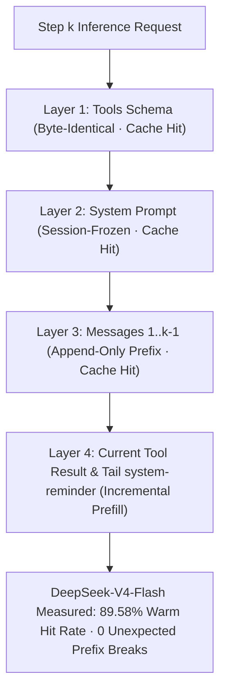

# 4. Four-Layer Pre-Cache, Async Two-Tier Memory & Local RAG

> [!NOTE] Source Modules, Specs & Public Benchmark Evidence
> - Source: `app/services/agent_loop.py`, `app/services/context_compact.py`, `app/services/memory.py`, `app/services/memory_queue.py`, `app/services/knowledge/*`
> - Design Specs: `docs/precache/README.md`, `docs/memory_upgrade_plan.md`
> - Public Evidence Bundle: [manifest.json](/benchmarks/precache-v1/manifest.json) · [summary_report.json](/benchmarks/precache-v1/summary_report.json) · [REPORT.md](/benchmarks/precache-v1/REPORT.md)

## 4.1 Three Classic Bottlenecks in Agent Memory & Prompt Assembly

1. **Invalidating LLM Prefix Cache**: Dynamically rewriting the System Prompt every turn (injecting per-turn recalled memories, target language directives, task board summaries, milestone notes, or conditionally adding/removing selection tools) invalidates the KV cache from byte zero, forcing full prefill recomputation on every step.
2. **Blocking Memory Extraction & Premature History Mutation**: Calling an LLM synchronously before replying stalls user interaction, while eagerly rewriting older `read_file` outputs in place mutates the `messages` prefix and destroys tens of thousands of cached tokens to save a few hundred.
3. **Tool Output Flooding & CJK Tokenization Fallback**: In tool-heavy coding sessions, bulky `tool_result` payloads push user instructions out of fixed windows, while naive whitespace regexes fail on unsegmented Chinese and Japanese text.

---

## 4.2 Four-Layer Append-Only Prefix & Two-Tier Async Memory Architecture

Helm structures every LLM request into a strict **Four-Layer Append-Only Prefix Architecture**, locking static contracts at the head of the prompt and isolating all dynamic turn/step deltas at the tail:



### Five Core Engineering Mechanisms:

1. **Layer 1 Deterministic Tool Schemas + Layer 2 Session-Frozen System Snapshot**:
   - Tool definitions are serialized in deterministic order with `patch_file_selection` permanently resident so UI selection changes never mutate `Layer 1`.
   - Recalled memories (`_memory_snapshot`), base response language, and static Office/skill guides are frozen once on turn 1, keeping `Layer 2` byte-identical across the entire session.
2. **Layer 4 `<system-reminder>` Tail Injection (Zero System-Prompt Churn)**:
   - Mid-session language switches, task board deltas, long-horizon milestone progress notes, time/token budget alerts, active `SelectionAnchor` coordinates, and retry retrospectives are stripped out of the System Prompt and appended as tail `<system-reminder>` blocks.
3. **Layer 3 Cache-Aware Delayed Deduplication & Incremental Compaction (`context_compact.py`)**:
   - Stale `read_file` deduplication is gated by a break-even threshold (`>= 4,000` cumulative saved tokens or approaching the compaction watermark), preventing micro-optimizations from busting warm prefixes; context compaction incrementally merges structured summaries.
   - Multi-turn sessions evict prior-turn `reasoning_content` cleanly at turn boundaries per DeepSeek Thinking-Mode rules while keeping intra-turn tool steps strictly append-only.
4. **Non-Blocking Extraction Queue (`memory_queue.py`) & Watermark Filtering**:
   - Extraction runs asynchronously after turn completion (with a 10-second graceful drain on shutdown) and rescues unextracted slices prior to compaction while stripping `[Scheduled]` and `[Team events]` pseudo-messages.
5. **CJK Bigram Scoring & Atomic Two-Tier Storage (`memory_store.py`)**:
   - Uses adjacent two-character bigram overlap for zero-dependency CJK fallback and writes Global/Workspace `.md` files atomically after scrubbing secret patterns.

---

## 4.3 Local Knowledge Base (`RAGFlow`) & Verifiable Evidence Chains

For large enterprise document repositories, `app/services/knowledge/` connects to local or intranet **RAGFlow** instances. `evidence.py` (`pack_evidence`) packages retrieved chunks with `document_name`, `dataset_id`, and similarity scores into traceable evidence blocks without mutating the static prompt prefix.

---

## 4.4 Pre-Cache Empirical Benchmark & Verifiable Evidence Bundle (DeepSeek-V4-Flash)

To audit real-world prefix cache efficiency without estimation, we benchmarked `legacy_baseline` (pre-upgrade) against `optimized_v1` (current production engine) on `deepseek-v4-flash`, which reports exact 64-token-aligned `prompt_cache_hit_tokens` and `prompt_cache_miss_tokens` on every response.

### 4.4.1 Four-Layer Prefix Cache Boundary Topology



### 4.4.2 Dual-Track Methodology & Billing Formulas

Executed back-to-back within a single UTC window (`2026-11-04T12:18:51Z` – `2026-11-04T12:27:40Z`) via `hyn_agent_backend/scripts/bench_precache.py`:
- **Track A (Controlled Deterministic Replay, `B1`–`B4`, `62 + 62 = 124` paired live API calls)**: Feeds identical tool outputs step-by-step through the real `AgentLoop` prompt/compaction pipeline to eliminate trajectory-length variance.
- **Track B (Live Autonomous End-to-End Bugfix, `B5`)**: Runs `AgentLoop` autonomously inside fresh temporary Git repositories to diagnose and fix two receipt-settlement bugs and pass `pytest` (`6 passed` verified on both variants).
- **Equal-Length Run-Isolation Nonces**: Injects distinct 40-character equal-length decimal isolation tags at byte zero for `legacy_baseline` and `optimized_v1`, guaranteeing `0` cold-start cache hits on Step 1 for both variants with zero BPE token-length bias.

Metrics follow DeepSeek's official cache pricing (`w_read = 0.10` for cached input tokens, `w_miss = 1.00` for uncached input tokens, zero cache-write surcharge):

```text
CHR_all  = Σ T_cache_read / Σ T_input
CHR_warm = Σ_{step >= 2} T_cache_read / Σ_{step >= 2} T_input

Uncached Saved % = (1 - Σ T_uncached_opt / Σ T_uncached_base) × 100%

T_eff = Σ (T_uncached + 0.10 × T_cache_read)
Billable Saved % (vs Baseline) = (1 - T_eff_opt / T_eff_base) × 100%
Billable Saved % (vs 0% Raw)   = (1 - T_eff_opt / Σ T_input_opt) × 100%
```

### 4.4.3 Five-Scenario Baseline vs Optimized Reconciliation Table

| Scenario | Variant | Steps | Input Tokens | Cache Hit (0.1x) | Uncached (1.0x) | CHR All / Warm | Effective Billable | Billable Saved (vs Base / vs Raw) | Long TTFT P50 | Warm Breaks |
| :--- | :--- | :--- | :--- | :--- | :--- | :--- | :--- | :--- | :--- | :--- |
| **B1 Full-Stack Bugfix (16 steps)** | Baseline | 16 | 583,948 | 341,248 | 242,700 | 58.44% / 59.29% | 276,824.8 | — / -52.59% | 976 ms | 6 |
| **B1 Full-Stack Bugfix (16 steps)** | **Optimized** | **16** | **628,343** | **558,464** | **69,879 (-71.21%)** | **88.88% / 90.25%** | **125,725.4** | **-54.58% / -79.99%** | **949 ms (-2.77%)** | **0** |
| **B2 Mixed-Lang Tasks (10 turns)** | Baseline | 14 | 674,168 | 273,024 | 401,144 | 40.50% / 41.01% | 428,446.4 | — / -36.45% | 1341 ms | 7 |
| **B2 Mixed-Lang Tasks (10 turns)** | **Optimized** | **14** | **691,136** | **579,328** | **111,808 (-72.13%)** | **83.82% / 84.99%** | **169,740.8** | **-60.38% / -75.44%** | **960 ms (-28.41%)** | **0** |
| **B3 Office Selection Patch (8 turns)** | Baseline | 12 | 441,932 | 340,096 | 101,836 | 76.96% / 78.45% | 135,845.6 | — / -69.26% | 997 ms | 1 |
| **B3 Office Selection Patch (8 turns)** | **Optimized** | **12** | **446,349** | **375,168** | **71,181 (-30.10%)** | **84.05% / 85.88%** | **108,697.8** | **-19.98% / -75.65%** | **1017 ms (P90 -18.24%)** | **0** |
| **B4 Milestone Refactor (20 steps)** | Baseline | 20 | 1,030,787 | 643,200 | 387,587 | 62.40% / 62.92% | 451,907.0 | — / -56.16% | 973 ms | 7 |
| **B4 Milestone Refactor (20 steps)** | **Optimized** | **20** | **1,080,492** | **998,144** | **82,348 (-78.75%)** | **92.38% / 93.21%** | **182,162.4** | **-59.69% / -83.14%** | **890 ms (-8.53%)** | **0** |
| **B5 Live E2E Bugfix (Track B)** | Baseline | 26 | 882,690 | 729,984 | 152,706 | 82.70% / 83.51% | 225,704.4 | — / -74.43% | 994 ms | 4 |
| **B5 Live E2E Bugfix (Track B)** | **Optimized** | **10** | **303,792** | **267,904** | **35,888 (-76.50%)** | **88.19% / 91.07%** | **62,678.4** | **-72.23% / -79.37%** | **1061 ms** | **0** |
| **Track A Controlled Subtotal** | Baseline vs Opt | 62 / 62 | 2,730,835 → 2,846,320 | 1,597,568 → 2,511,104 | 1,133,267 → 335,216 (**-70.42%**) | 58.50% → **88.22%** (Warm **89.42%**) | 1,293,023.8 → **586,326.4** | **-54.65% / -79.40%** | 1146 → **978 ms (-14.66%)** | 21 → **0** |
| **Overall Suite Total (B1–B5)** | **Baseline vs Opt** | **88 / 72** | **3,613,525 → 3,150,112** | **2,327,552 → 2,779,008** | **1,285,973 → 371,104 (-71.14%)** | **64.41% → 88.22% (Warm 89.58%)** | **1,518,728.2 → 649,004.8** | **-57.27% / -79.40%** | **1096 → 978 ms (-10.77%)** | **25 → 0** |

> [!TIP] Key Engineering Takeaways
> - **Zero Unexpected Warm Prefix Breaks**: `legacy_baseline` suffered `25` warm prefix invalidations (`1` conditional tool mutation + `20` dynamic System Prompt rewrites + `4` eager in-place `messages` dedup edits), whereas `optimized_v1` achieved **`0` unexpected warm prefix breaks** (alongside `7` expected turn-boundary `reasoning_content` evictions across multi-turn `B2`/`B3`).
> - **Compounding Long-Horizon Gains**: On the 20-step `B4` refactor (peaking at `81,487` tokens), warm cache hit rate reached **`93.21%`**, uncached prefill dropped by **`78.75%`**, and effective billable input fell **`83.14%`** compared against uncached raw input.

### 4.4.4 Tamper-Evident Evidence Bundle (`SHA-256`) & One-Command Reproduction

Every JSONL trace records the native DeepSeek `response_id`, UTC timestamp, per-layer SHA-256 hashes (`tools_sha256`, `system_sha256`, `messages_prefix_sha256`), and raw provider `usage` payloads (scrubbed of credentials and local user paths):

- **Signed Manifest & Summary Reports**:
  - [manifest.json](/benchmarks/precache-v1/manifest.json) (SHA-256: `ee7bcb6d7ddad13070f50a94a04f567a61a09e8ed8674d775e50a992d1c00c82`)
  - [summary_report.json](/benchmarks/precache-v1/summary_report.json) (SHA-256: `357b055b22f143de34e9cdd628cdb1e559f2b19997a418c068c57d2823220150`)
  - [REPORT.md](/benchmarks/precache-v1/REPORT.md) (SHA-256: `7c56fc21938fb8dfd7243cd16302e5fa7a09617527bdf4afbf799a74d2e1c7fd`)
- **Raw Per-Request JSONL Traces (`160` Live API Responses)**:
  - B1 Traces: [legacy_baseline.jsonl](/benchmarks/precache-v1/traces/B1_fullstack_bugfix_16steps_legacy_baseline.jsonl) (`d4316949...ecd2c30b`) · [optimized_v1.jsonl](/benchmarks/precache-v1/traces/B1_fullstack_bugfix_16steps_optimized_v1.jsonl) (`ede5eb26...77d39c96`)
  - B2 Traces: [legacy_baseline.jsonl](/benchmarks/precache-v1/traces/B2_multiturn_mixed_lang_10turns_legacy_baseline.jsonl) (`6b866c25...2ff1ecfa`) · [optimized_v1.jsonl](/benchmarks/precache-v1/traces/B2_multiturn_mixed_lang_10turns_optimized_v1.jsonl) (`4ea852ab...aab0d3e8`)
  - B3 Traces: [legacy_baseline.jsonl](/benchmarks/precache-v1/traces/B3_office_selection_8turns_legacy_baseline.jsonl) (`98d0707e...07ea2f79`) · [optimized_v1.jsonl](/benchmarks/precache-v1/traces/B3_office_selection_8turns_optimized_v1.jsonl) (`802aecb3...b62582cc`)
  - B4 Traces: [legacy_baseline.jsonl](/benchmarks/precache-v1/traces/B4_longhorizon_milestone_20steps_legacy_baseline.jsonl) (`14df4009...2f73c68a`) · [optimized_v1.jsonl](/benchmarks/precache-v1/traces/B4_longhorizon_milestone_20steps_optimized_v1.jsonl) (`d11ecb28...ec239c76`)
  - B5 Traces: [legacy_baseline.jsonl](/benchmarks/precache-v1/traces/B5_live_e2e_bugfix_legacy_baseline.jsonl) (`0bad6679...066363cd`) · [optimized_v1.jsonl](/benchmarks/precache-v1/traces/B5_live_e2e_bugfix_optimized_v1.jsonl) (`ec4c3738...00b44de2a`)

Reproduce the full dual-track suite or verify all 12 archived files offline (combined billing window `2026-11-04T12:18:51Z`–`12:27:40Z`: `160` requests, `6,763,637` input tokens = `5,106,560` cache hit + `1,657,077` cache miss, `13,344` completion tokens):

```powershell
# 1. Run the dual-track benchmark against deepseek-v4-flash
cd hyn_agent_backend
.\.venv\Scripts\python.exe scripts/bench_precache.py --model deepseek-v4-flash

# 2. Verify SHA-256 checksums, formulas, and secret-scrubbing invariants offline
.\.venv\Scripts\python.exe -m pytest tests/precache/test_phase3_bench_and_audit.py -q
```
