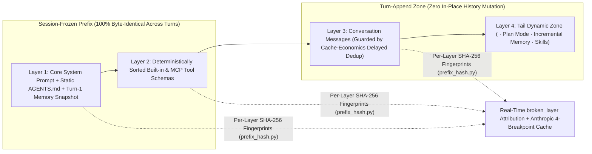
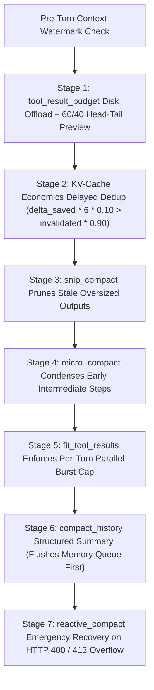
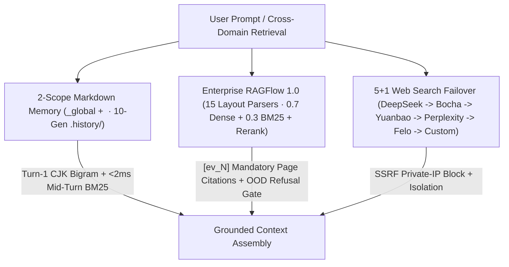

# 4. 97.7% Prefix Cache Economics, 7-Stage Compaction & Hybrid RAG

> [!NOTE] Core Modules & Cryptographically Signed Evidence
> - Core Modules: `app/services/prefix_policy.py`, `prefix_hash.py`, `context_compact.py`, `memory_store.py`, `memory_extractor.py`, `knowledge/ragflow.py`, `web_search/*`
> - Empirical Reports: [Prefix Cache Stability (160 Live Calls · Unexpected Breaks 25->0 · -57.3% Cost)](/en/benchmarks/precache-v1) · [4-Stage RAG Evolution (Strict Recall 36.7%->100.0% · MRR 1.000)](/en/benchmarks/rag-eval-v1)

## 4.1 Four-Layer Append-Only Prefix Architecture & Drift Telemetry

Injecting dynamic timestamps, toggled skills, or unsorted MCP schemas into the system prompt invalidates tens of thousands of cached KV tokens on every turn. Helm enforces a strict **4-Layer Append-Only Prefix Contract**:

> [!TIP] Architectural Trade-off: Mid-Session Mode Switching With Zero Cache Invalidation
> - **Engineering Bottleneck**: Switching into `Plan Mode`, recalling new memories, or invoking `/skill` mid-session must alter behavior immediately without breaking the frozen prefix.
> - **Flaw in Conventional Designs**: Mutating Layer 1 system prompts or filtering Layer 2 tool arrays collapses warm KV-cache hit rates below 45%.
> - **Helm's Underlying Solution**: Lock Layer 1/2 across the session and route all mid-session state changes (`Plan Mode` rules, preloaded `SKILL.md`, `<incremental_memory_recall>`) into Layer 4 tail `<system-reminder>` blocks while auditing per-layer SHA-256 hashes via `prefix_hash.py`.
> - **Measured Engineering Gain**: **`97.74%` live prefix cache hit rate** across 120M+ SWE-bench tokens (**`¥0.27`/solved issue**), and **`0` unexpected warm breaks** (down from `25`, **`-57.27%` billable input cost**) across 160 live calls in [Prefix Cache Benchmark (`/en/benchmarks/precache-v1`)](/en/benchmarks/precache-v1).

---

## 4.2 Seven-Stage Cache-Aware `ContextCompactor`

- **60/40 Head-Tail Truncation**: Retains the first `60%` (invocation context) and final `40%` (stack trace & assertion summary) while saving full output to disk — preserving **`100.0%` of tail tracebacks** vs `33.3%` under head-only truncation at **`93.1%` compression**.

---

## 4.3 Zero-DB Dual-Scope Memory, 4-Stage Hybrid RAG & 5+1 Web Failover

| RAG Stage (`/en/benchmarks/rag-eval-v1`) | Key Engineering Upgrade | `Strict Recall@5` | `MRR` | Distractor Pollution | `OOD` Refusal Accuracy |
| :--- | :--- | :--- | :--- | :--- | :--- |
| **`v0` Baseline** | Dense vector search with fixed chunking | `36.7%` | `0.489` | `46.7%` | `66.7%` |
| **`v1` Hybrid** | `0.7` Dense + `0.3` BM25 + layout-aware chunking | `73.3%` | `0.811` | `20.0%` | `83.3%` |
| **`v2` Reranked** | Cross-Encoder semantic reranking | `93.3%` | `0.956` | `3.3%` | `100.0%` |
| **`v3` Production** | Confidence gating + mandatory `[ev_N]` grounding | **`100.0%` (30/30)** | **`1.000`** | **`0.0%`** | **`100.0%` (6/6)** |