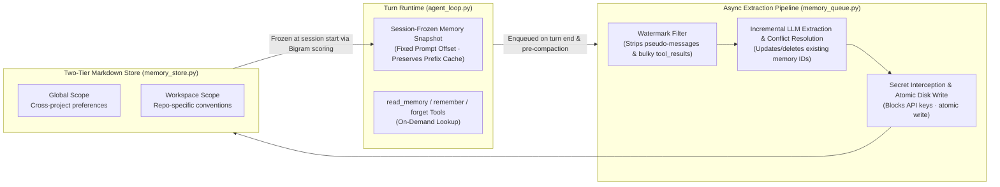

# 4. Prefix-Cache-Friendly Two-Tier Memory & Local RAG

> [!NOTE] Source Modules & Design Docs
> - Source: `app/services/memory.py`, `app/services/memory_queue.py`, `app/services/memory_store.py`, `app/services/knowledge/*`
> - Design Plan: `docs/memory_upgrade_plan.md`

## 4.1 Solving the Three Classic Agent Memory Bottlenecks

1. **Protecting LLM Prefix Cache (90%+ Hit Rate)**: Dynamically mutating the system prompt's memory block on every turn invalidates the LLM KV prefix cache. HYN Agent **freezes a recalled memory snapshot per session** at a fixed prompt offset and provides an on-demand `read_memory` tool for mid-session lookups.
2. **Non-Blocking Async Extraction Queue (`memory_queue.py`)**: Memory extraction runs asynchronously in the background after turn completion (and right before context compaction), adding zero latency to user replies.
3. **Watermark Filtering & CJK Bigram Scoring (`memory_text.py`)**: Tracks per-session extraction watermarks, strips pseudo-messages (`[Scheduled]`, `[Team events]`) and bulky `tool_result` blocks, and uses **adjacent character bigram scoring** for accurate Chinese/Japanese keyword fallback without requiring a heavy external vector DB.

---

## 4.2 Local RAGFlow Knowledge Base & Verifiable Evidence Chains

For large enterprise document repositories, `app/services/knowledge/` connects to local or intranet **RAGFlow** instances. `evidence.py` (`pack_evidence`) packages retrieved chunks with document titles, dataset IDs, and similarity scores so every claim is traceable to internal source files.
