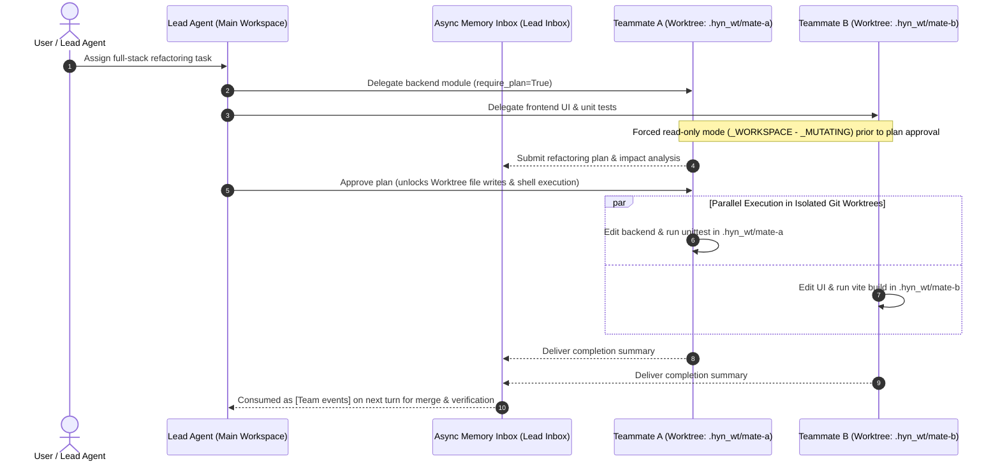

# 3. Multi-Agent Team & Git Worktree Isolation

> [!NOTE] Source Modules
> - Backend: `app/services/team_runtime.py`, `app/services/team_worktree.py`, `app/services/team_store.py`, `app/services/subagent.py`
> - Frontend: `src/views/LiveFloor.js`, `src/views/TeamSettingsPanel.js`

## 3.1 Resident Teammates vs. One-Shot Subagents

Running multiple subagents concurrently in the same directory causes file overwrites and `.git/index.lock` contention. Helm introduces **Resident Teams** (`team_runtime.py`), allowing a **Lead** agent to coordinate up to **4 resident teammates (`_MAX_TEAMMATES = 4`)**, each bound to an isolated **Git Worktree**.

---

## 3.2 Core Engineering Mechanisms

1. **Zero-Polling Async Inbox**: Teammate tool logs stay out of the main conversation history. Deliverables and approval requests are pushed to the Lead's in-memory inbox and automatically digested as `[Team events]` on the next turn.
2. **Plan Approval Gate (`require_plan`)**: Mutating tools (`_MUTATING = {"write_file", "edit_file", "apply_patch", "write_docx", "edit_document", "run_powershell"}`) are physically stripped from teammates until their proposed plan is approved.
3. **Worktree Lease & Crash Recovery (`team_worktree.py`)**: Each teammate thread binds its tool root (`bind_tool_root`) to its dedicated worktree directory, with automatic lease cleanup on startup (`recover_after_restart`).
