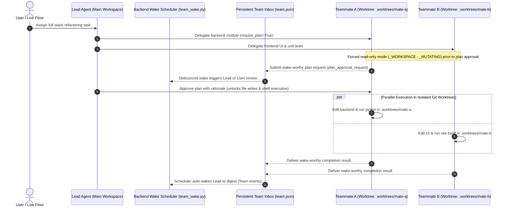

# 3. Multi-Agent Team & Git Worktree Isolation

> [!NOTE] Source Modules
> - Backend: `app/services/team_runtime.py`, `app/services/team_wake.py`, `app/services/team_worktree.py`, `app/services/team_store.py`, `app/services/subagent.py`
> - Frontend: `src/views/LiveFloor.js`, `src/views/TeamSettingsPanel.js`, `src/App.js`

## 3.1 Resident Teammates vs. One-Shot Subagents

Running multiple subagents concurrently in the same directory causes file overwrites and `.git/index.lock` contention. Helm introduces **Resident Teams** (`team_runtime.py`), allowing a **Lead** agent to coordinate resident teammates (**configurable per session, default 4, up to 8**), each with its own persistent transcript (`sessions/<sid>/team/teammates/<name>.jsonl`) and optional isolated **Git Worktree**.

---

## 3.2 Core Engineering Mechanisms

1. **Message Classification & Debounced Zero-Polling Inbox**:
   - Teammate tool logs stay out of the main conversation history and are persisted to `teammates/<name>.jsonl` (inspectable anytime in the Live Floor **Transcript** tab, where users can also message a teammate directly).
   - Messages to the Lead are classified into **wake-worthy** (`result`, `error`, `plan_approval_request`, direct `message`) and **ancillary** (`idle_notification`, `shutdown_response`, `stopped`). Only wake-worthy messages arm `lead_pending_since` and trigger a Lead turn after the debounce window (`wake_debounce_s`, default 3s), while ancillary messages piggyback on the next turn.
   - On recoverable LLM errors (rate limits, timeouts, transient network errors), teammates enter `error_paused` without losing context and notify the Lead via an `error` message.
2. **Persistence, Idle Auto-Suspend & Resume**:
   - Team metadata (`team.json`) and teammate transcripts (`teammates/<name>.jsonl`) are persisted to disk. When a teammate is idle beyond `idle_suspend_minutes` (default 30 min) or when the app exits, its background coroutine exits cleanly and the teammate enters `suspended`.
   - Claimed tasks are retained for `suspended_lease_grace_hours` (default 24 hr) so other sessions cannot steal them; after app restart or at any time from the Live Floor, users can **Resume** a suspended teammate or **Dismiss** it to release its task.
3. **User-Only Permission Confirmation & Session Allow Rules**:
   - A teammate's effective permission is `min(session_permission_mode, teammate_permission_override)` (`inherit`, `auto_edit`, or `readonly`—never looser than the session).
   - Operations requiring confirmation transition the teammate to `waiting_permission` and surface directly to the **user** in the Live Floor and via desktop notifications (supporting Allow, Deny, and "Always allow similar in this session" rules). **The Lead Agent can never approve permissions on the user's behalf.** Three consecutive denials/timeouts pause the teammate and mark the task `blocked`.
4. **Plan Approval Gate & Configurable Approver**:
   - Mutating tools (`_MUTATING = {"write_file", "edit_file", "apply_patch", "write_docx", "edit_document", "run_powershell"}`) are physically stripped from teammates until their plan is approved (`require_plan` or global `force_plan`).
   - `plan_approver` supports `auto` (User in `ask_all` mode, Lead otherwise), `lead` (Lead reviews against optional `plan_criteria` and must provide rationale of at least 10 characters when approving), and `user` (User only). Decisions are recorded in `recent_plans`.
5. **Backend Wake Scheduler (`team_wake.py`), Unattended Deferral & Guardrails**:
   - **Backend Scheduler & `/team/stream` SSE**: `team_wake.py` runs inside the FastAPI event loop and supports `background_wake` modes `on`, `active_only` (only while the user is viewing the session), and `off` (manual button only). Turn events (`source="team"`), unified desktop notifications (`team_notice`), and sidebar badge summaries (`team_summary`) stream over `GET /api/v1/team/stream`.
   - **Presence Detection & Unattended Deferral (`TEAM_DEFERRED` / `needs_user`)**: Active sessions send `watch=1` to maintain a 10s presence TTL (`is_attended`). When the user is away, unattended Lead wakes bind `_team_unattended`: any tool requiring user confirmation (such as `spawn_teammate` or sensitive tools) is neither executed nor shown as a blocking modal—instead it returns `Deferred:`, records `needs_user` on the team, shows a sidebar attention badge and banner, and waits for the user's return.
   - **Multi-Layer Guardrails**:
     - **Max Consecutive Auto-Wakes (`max_auto_wakes`, default 8)**: Pauses auto-wakes until the user speaks or clicks Continue (`wake_paused_reason = "max_auto_wakes"`).
     - **Unattended Token Budget (`unattended_token_budget`, default 200,000 tokens)**: Tracks tokens used by unattended Lead wakes and teammate turns while the user is away; exceeding the budget pauses wakes (`wake_paused_reason = "budget"`) and stops running teammates at the end of their current step (`exit_reason = "team_budget"`).
     - **Teammate Per-Task Token Budget (`teammate_token_budget`)**: Stops a teammate and marks its task `blocked` if a single task exceeds the budget (`exit_reason = "token_budget"`).
     - **Manual Stop & Single-Turn Exclusivity**: Sessions manually stopped by the user (`run_status == "stopped"`) are never auto-woken, and `turn_hub` guarantees at most one active turn per session.
6. **Git Worktree Lifecycle (`worktree_core.py`, `team_worktree.py`, `worktree_records.py`)**:
   - **Snapshot Baseline & Detached Checkout**: Worktrees under `.worktrees/<name>` start from a full snapshot of the current workspace (including uncommitted and untracked files) in `--detach` mode, keeping local branches clean and auto-excluding `.worktrees/` in `.git/info/exclude`.
   - **`.hyn/worktree.json` Setup & Junction Safety**: Automatically copies config files, links heavy dependency directories (`node_modules`, `.venv`) via Windows junctions, and safely unlinks junctions before removing worktree directories.
   - **Auto-Commit & Hidden Refs (`refs/hyn/worktrees/<key>/{base,head,pre_apply}`)**: Changes are automatically committed on task/subagent completion. Users can diff, 3-way apply (`git apply --3way`), undo apply (via `pre_apply` snapshot), save as a `wt/<name>` branch, or discard changes, and manage orphan refs from the Worktree Manager.
   - **Subagent Isolation (`isolation="worktree"`) & Multi-Plan Comparison (`compare_group`)**: One-shot writable subagents can run in isolated `.worktrees/sub-<run_id>` worktrees with adopt/diff actions directly on the chat card; team tasks sharing a `compare_group` can be compared side-by-side and adopted in one click.
   - **Worktree Escape Guard**: `bind_tool_root` restricts file tools to the worktree, while `permission.py` intercepts shell commands that reference main-workspace paths, `cd ..`, `git -C`, or `git checkout/switch/reset/merge` and routes them to user permission confirmation.
7. **Task System (`task_store.py`)**:
   - Supports `pending`, `in_progress`, `blocked` (`blockedReason`), `completed` (`result` summary), and `cancelled` (with optional downstream cascade).
   - Provides lease heartbeat, suspended teammate grace period retention (`suspended_lease_grace_hours`), expired-lease takeover (`leaseExpiresAt`), one-shot DAG creation (`create_tasks` with symbolic `ref`), activity audit logs, `(mtime_ns, size)` in-memory index caching, and automatic task archiving.
