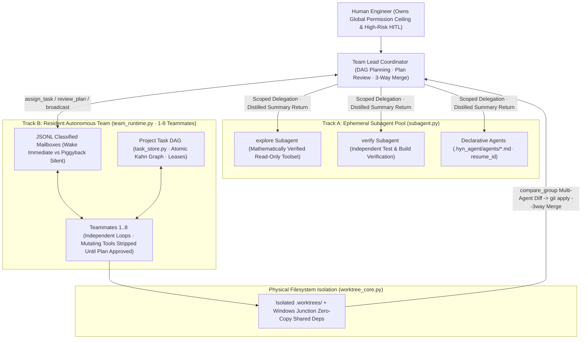
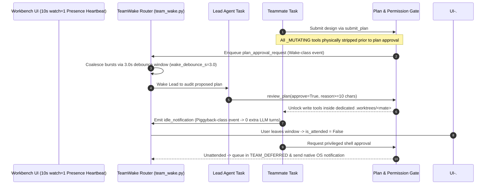

# 3. Resident Agent Teams, Project Task DAG & Git Worktree Compare

> [!NOTE] Core Modules & Cryptographically Signed Evidence
> - Core Modules: `app/tools/subagent.py`, `app/services/subagent_registry.py`, `app/services/team_runtime.py` (`4,585` LOC), `app/services/team_wake.py`, `app/services/task_store.py`, `app/services/worktree_core.py`
> - Empirical Report: [Harness Guardrail Ablation (4-Mate 3.04× Speedup · 0.0% Write Collisions · 100% Escalation Block)](/en/benchmarks/harness-ablation-v1)

## 3.1 Dual-Tier Topology: Ephemeral Subagents + Resident Teams

Single-threaded agents hit context exhaustion and serial latency walls on multi-module engineering tasks, while naive multi-agent chatrooms trigger `O(N^2)` token storms and concurrent file overwrites. Helm separates **Ephemeral Subagents** (stateless, bounded exploration/verification) from **Resident Teams** (`1` Lead + `1–8` persistent Teammates):

---

## 3.2 Classified Wake Mailboxes, Presence Heartbeat & Permission Convergence

> [!TIP] Architectural Trade-off: Stopping Token Storms and Subagent Privilege Escalation
> - **Engineering Bottleneck**: Unthrottled heartbeats burn tokens while idle, and allowing a Lead agent to auto-approve dangerous teammate commands enables prompt-injection privilege escalation.
> - **Flaw in Conventional Designs**: Broadcast group-chat loops wake every agent on every message and trust parent-agent text instructions for access control.
> - **Helm's Underlying Solution**: (1) Split mailbox traffic into **Wake** (`result`/`error`/`plan_approval_request`/`message`, coalesced over `3s`) vs **Piggyback** (`idle_notification`/`shutdown_response`, zero standalone LLM calls); (2) Enforce `effective_permission = min(user_session_mode, teammate_mode)`; (3) Bound unattended runs via `unattended_token_budget = 200,000`, `max_auto_wakes = 8`, and `30 min` auto-suspend (`24h` lease grace).
> - **Measured Engineering Gain**: **`100.0%` (30/30) adversarial privilege-escalation block rate** (`0.0%` ASR) and **0 idle token burn**.

---

## 3.3 Atomic Task DAG & Zero-Copy Windows Junction Git Worktrees

```mermaid
flowchart LR
  Create["Atomic create_tasks (Up to 30 Nodes · Kahn Cycle Check)"] --> Ready["Unlock in-degree=0 Ready Tasks"]
  Ready --> Lease["Teammate Acquires Heartbeat Lease (Cascading Cancel on Failure)"]
  Lease --> Sandbox["Provision .worktrees/<mate> Detached HEAD"]
  Sandbox --> Junction["Windows _winapi.CreateJunction Zero-Copy node_modules & .venv"]
  Junction --> Code["Parallel Multi-Agent Coding & Testing (0.0% Write Collision)"]
  Code --> Compare["compare_group Side-by-Side Diff Inspection"]
  Compare --> Apply["git apply --3way Atomic Merge + pre_apply 1-Click Undo"]
```

- **Safe Junction Unlinking (`worktree_core.py`)**: Creates admin-free Windows directory junctions (`_winapi.CreateJunction`) so worktrees share gigabyte-scale `node_modules` and `.venv` instantaneously; upon teardown, junctions are explicitly unlinked prior to directory removal so host dependencies are never touched.
- **Empirical Speedup**: 4-Teammate parallel execution achieved **`2.88×–3.04×` end-to-end wall-clock speedup** with **`0.0%` file collisions** in [Harness Guardrail Ablation (`/en/benchmarks/harness-ablation-v1`)](/en/benchmarks/harness-ablation-v1).