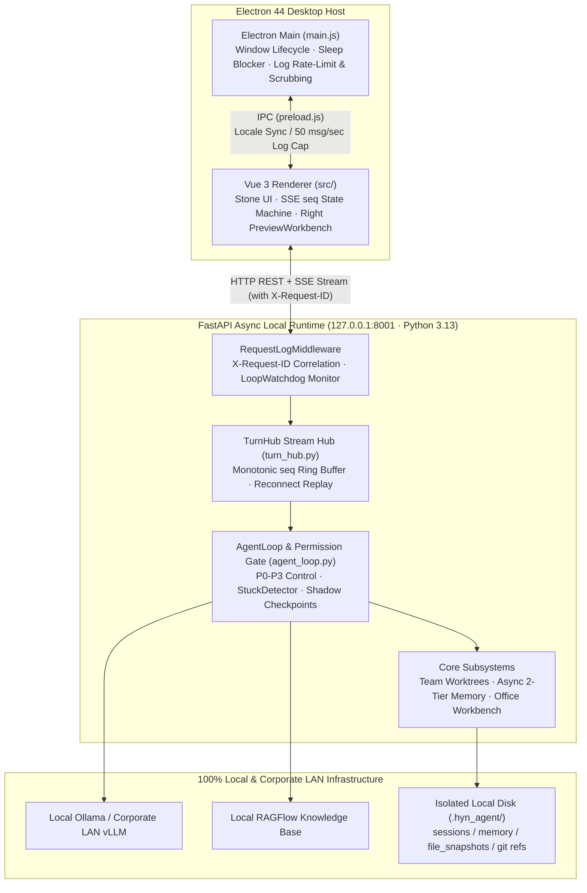

# 1. System Overview & Dual-Process Design

> [!NOTE] Engineering Whitepaper Series (For Technical Reviewers)
> This 5-part series documents **Helm**'s internal architecture, state machines, and edge-case handling at the source-code level. Part 1 covers `hyn_agent_frontend/main.js`, `src/i18n.js`, and `hyn_agent_backend/app/main.py`, `app/core/*`.

## 1.1 Three-Tier Process Topology

Helm decouples its desktop runtime into three distinct layers: **Electron Main (OS Bridge)**, **Vue 3 Renderer (Stone Workbench)**, and **Local FastAPI Async Runtime (`127.0.0.1:8001`)**.



---

## 1.2 Full-Stack Observability & Security by Design

1. **Cross-Process `X-Request-ID` Correlation (`app/core/request_log.py`)**:
   - `RequestLogMiddleware` wraps the outermost Starlette middleware layer and exposes `X-Request-ID` via CORS headers, enabling instant correlation between renderer logs (`renderer.log`) and backend structured logs.
2. **Asyncio Event Loop Watchdog (`app/core/loop_watchdog.py`)**:
   - Monitors event-loop lag and hooks `loop.set_exception_handler` so unawaited background task exceptions are never silently swallowed.
3. **Pre-Write Secret Scrubbing & IPC Log Rate-Limiting (`main.js`)**:
   - `sanitizeLogMessage` scrubs `sk-*`, `AIza*`, `Bearer *`, and `api_key / secret / password` patterns into `***` before writing to disk, while enforcing a 4KB per-field cap (`truncate4KB`) and 50 logs/sec rate limit.

---

## 1.3 Deterministic Graceful Shutdown Sequence

To prevent corrupted checkpoints, lost memory extractions, or orphan MCP child processes on exit, `app/main.py` enforces a strict 6-step shutdown sequence inside `_lifespan`:

```python
# Excerpt from hyn_agent_backend/app/main.py (_lifespan finally block)
await turn_hub.shutdown()             # 1. Flush active turns to interrupted checkpoints
await memory_queue.shutdown(timeout=10) # 2. Drain async memory extraction queue
await shutdown_teams()                # 3. Stop resident teammates & release worktree leases
await stop_cron_runtime()             # 4. Stop Cron automation scheduler
shutdown_background_tasks()           # 5. Terminate background shell processes
await shutdown_mcp()                  # 6. Close active MCP client sessions
stop_watchdog()
```
