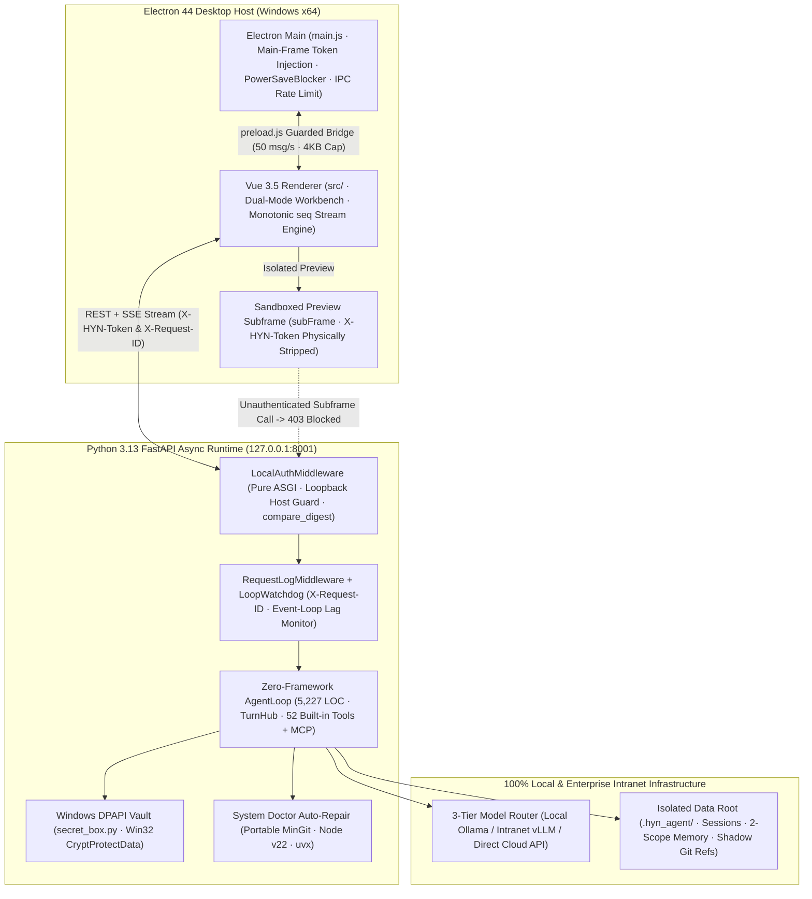
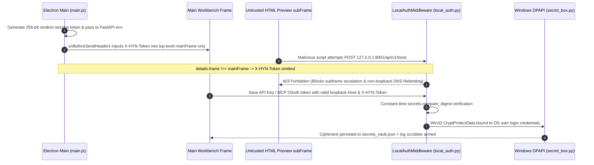
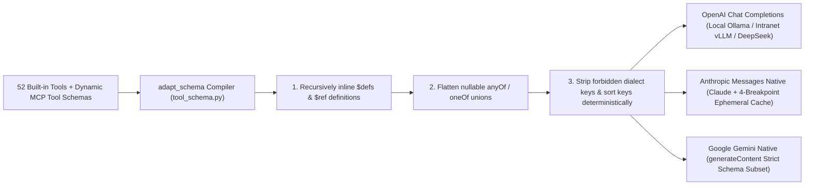

# 1. System Topology, Zero-Trust Loopback Auth & Self-Healing Runtime

> [!NOTE] Engineering Whitepaper Series (6 Volumes)
> This 6-volume series documents the state machines, security boundaries, and empirical benchmarks behind **Helm** (`167` backend Python modules / `70,223` LOC / `502` automated `pytest` tests; `69` frontend ESM modules / `42,326` LOC). Volume 01 covers `hyn_agent_frontend/main.js`, `preload.js`, `app/main.py`, `app/core/*`, `app/services/tool_schema.py`, and `app/services/system_doctor.py`.

## 1.1 Three-Plane Decoupled Desktop Topology

Helm avoids cramming heavy I/O into the Electron main process or routing user workspaces through third-party cloud sandboxes. Instead, it separates responsibilities across **Electron 44 Main Host (system bridge & security boundary) + Vue 3.5 Renderer (dual-mode workbench) + Local Python 3.13 FastAPI Engine (zero-framework async agent runtime)**:

> [!TIP] Architectural Trade-off: Why Electron + Dedicated Python 3.13 Subprocess Instead of Pure Node.js?
> - **Engineering Bottleneck**: A desktop agent must keep a complex multi-tab document UI at 60 FPS while simultaneously executing CPU/I/O-heavy AST parsing, binary OpenXML (`docx/xlsx/pptx`) patching, and multi-agent Git worktree orchestration.
> - **Flaw in Conventional Designs**: Running heavy document parsing inside Node.js freezes IPC and window responsiveness; wrapping heavyweight frameworks like LangChain obscures prompt byte layout and breaks KV-cache determinism.
> - **Helm's Underlying Solution**: Keep Electron Main minimal (window lifecycle, `powerSaveBlocker`, native notifications) while driving a pure `asyncio + httpx` FastAPI engine bundled with an embedded official Python 3.13 runtime.
> - **Measured Engineering Gain**: Guarded by **`502` passing `pytest` tests**, achieving **0-byte unintended public telemetry** while allowing the exact same backend to deploy unchanged onto enterprise Docker clusters.

---

## 1.2 Zero-Trust Loopback Auth & Windows DPAPI Hardware-Bound Vault

Desktop apps listening on `127.0.0.1` face two classic attack vectors: **DNS rebinding from malicious websites** and **privilege escalation from untrusted HTML preview iframes stealing local auth headers**. Helm enforces defense-in-depth:

1. **Pure-ASGI Zero-Buffering Auth (`app/core/local_auth.py`)**: Bypasses Starlette `BaseHTTPMiddleware` (which buffers streaming SSE responses), validates loopback `Host` headers against DNS rebinding, and runs `secrets.compare_digest` constant-time token verification.
2. **Windows DPAPI Credential Vault (`app/core/secret_box.py`, `secret_vault.py`)**: Encrypts every provider API key and MCP OAuth refresh token via Win32 `CryptProtectData` tied to the current Windows user account, paired with pre-write secret scrubbing (`***`), `4 KB` log line caps, and `50 msg/s` IPC rate limiting.

---

## 1.3 Three-Tier Compute Routing & Cross-Protocol Schema Compiler

LLM gateways enforce incompatible JSON Schema subsets (e.g., Gemini rejects `$defs`/`$ref` and `additionalProperties`, while several intranet engines reject `anyOf`). `app/services/tool_schema.py` compiles tool schemas deterministically:

| Deployment Tier | Supported Gateways (`8` Built-in Providers / `18` Curated Models) | Network Boundary | Core Engineering Capability |
| :--- | :--- | :--- | :--- |
| **`local` (Air-Gapped)** | Local `Ollama` (`127.0.0.1:11434/v1`) | **0 Bytes External** | Keyless model auto-discovery & VRAM reallocation backoff |
| **`lan` (Enterprise Intranet)** | Private `vLLM` / `SGLang` / `OneAPI` | **Inside Corporate Firewall** | Shared GPU clusters + intranet RAGFlow + reasoning trace parsing |
| **`cloud` (Direct Frontier)** | `DeepSeek` / `Qwen` / `GLM` / `Claude` / `Gemini` / `OpenAI` | Direct TLS to Official API | Zero proxy middlemen; native DeepSeek 64-token & Claude breakpoint caching |

---

## 1.4 Admin-Free `System Doctor` & 8-Step Deterministic Shutdown

1. **Portable Toolchain Auto-Repair (`app/services/system_doctor.py`)**: Performs 3-tier diagnostics across core runtime, external binaries, and MCP servers. On restricted corporate laptops without UAC admin rights, missing `git`, `node`/`npx`, or `uv`/`uvx` binaries are automatically provisioned using official portable **MinGit**, **Node.js v22**, and **`uv`** inside `DATA_DIR/toolchains/` without touching global system `PATH` or registry keys.
2. **Symmetric 6-Step Startup & 8-Step Graceful Shutdown (`app/main.py`)**: On exit, `_lifespan` deterministically checkpoints active `TurnHub` runs as `interrupted`, flushes the async memory queue (up to `10s`), suspends resident agent teams with a `24h` lease grace window, stops Cron jobs, terminates background process trees, closes MCP sessions, drains HTTP pools, and disarms `LoopWatchdog`.