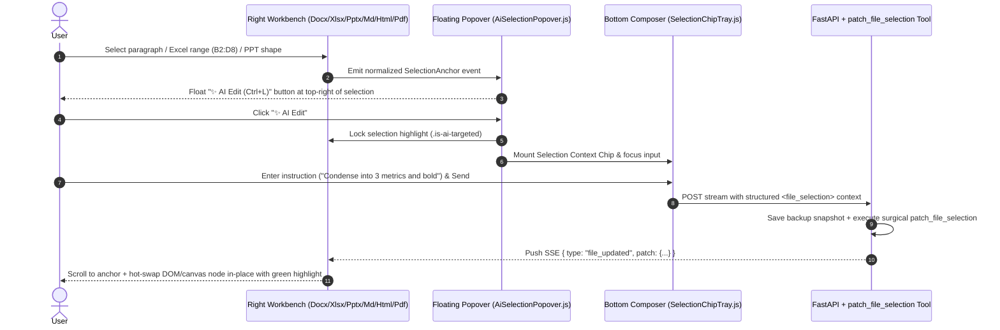

# 5. Document Workbench & In-Place AI Patching

> [!NOTE] Source Modules & Design Docs
> - Frontend: `src/components/preview/PreviewWorkbench.js`, `WpsFormatToolbar.js`, `AiSelectionPopover.js`, `editors/{DocxEditor,XlsxEditor,PptxEditor,MarkdownEditor,HtmlEditor,PdfViewer,TextEditor}.js`
> - Backend: `app/services/file_workbench.py`, `app/services/tools/selection_patch.py`, `app/services/tools/office.py`
> - Design Plans: `docs/file_preview_phase1_plan.md`, `docs/file_ai_edit_phase2_plan.md`

## 5.1 Dual-Insurance Deliverable Detection & WPS-Grade Workbench

1. **Filtering Intermediate Scripts**: Combines explicit `present_files` tool declarations with end-of-turn rich document detection so users see clean **Artifact Cards** (`.pptx`, `.docx`, `.xlsx`, `.pdf`, `.md`, `.html`) rather than temporary `.py` helper scripts.
2. **In-App Preview & Non-Destructive Editing (`PreviewWorkbench.js` + `file_workbench.py`)**: Renders Word, Excel, PowerPoint, PDF, Markdown, and HTML in a resizable right-hand workbench with a unified WPS-style formatting toolbar and automatic 5-version rollback snapshots (`DATA_DIR/file_snapshots/`).

---

## 5.2 Mouse Selection "✨ AI Edit" & SSE In-Place Hot-Reloading

### Cross-Format `SelectionContext` Anchor Contract

| Format | `locator.type` | Structured Coordinates | Surgical Write-Back Engine |
| :--- | :--- | :--- | :--- |
| **PowerPoint (`.pptx`)** | `pptx_shape` | `slide_index` + `shape_id` + `paragraph_indices` | `python-pptx` mutates only the targeted shape's paragraphs and runs |
| **Word (`.docx`)** | `docx_paragraphs` | `paragraph_start` ~ `paragraph_end` (`data-p-idx`) | `python-docx` updates targeted paragraphs while preserving tables, headers, and styles |
| **Excel (`.xlsx`)** | `xlsx_range` | `sheet_name` + `cell_range` (e.g., `Sheet1!B2:D8`) | `openpyxl` patches cell values, formulas, and styles in the selected rectangle |
| **Code / MD / HTML** | `text_lines` / `dom_selector` | `line_start` ~ `line_end` or CSS selector | Atomic line-range replacement and diff patch emission |
