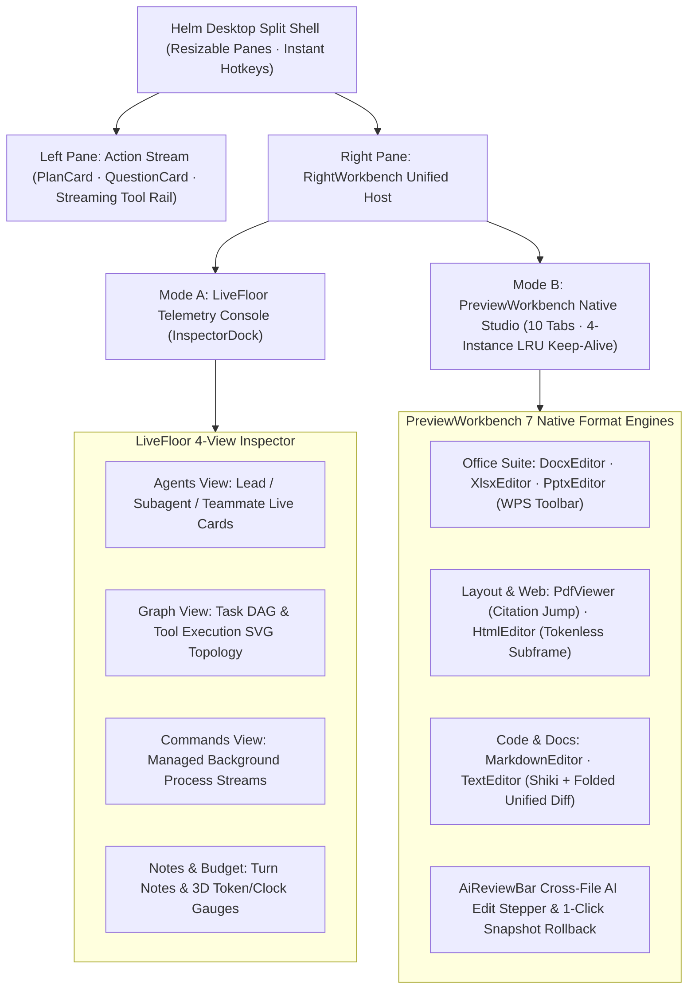
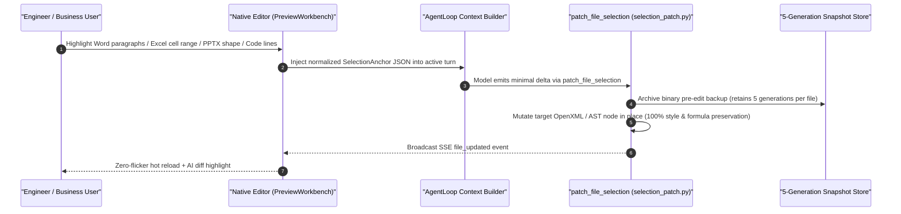
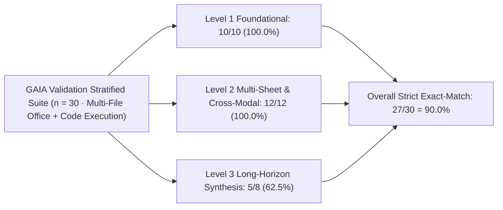

# 5. Dual-Mode Workbench, 7 Native Editors & Surgical Selection Patching

> [!NOTE] Core Modules & Cryptographically Signed Evidence
> - Frontend Modules: `hyn_agent_frontend/src/components/RightWorkbench.js`, `LiveFloor.js`, `PreviewWorkbench.js`, `AiReviewBar.js`, `WpsFormatToolbar.js`, `src/components/editors/*`
> - Backend Modules: `app/tools/file_workbench.py`, `app/services/selection_patch.py`
> - Empirical Report: [GAIA Multimodal Document & Office Benchmark (27/30 = 90.0% Exact Match)](/en/benchmarks/gaia-mini-v1)

## 5.1 Unified Dual-Mode `RightWorkbench` Architecture

Helm pairs a structured left-hand conversation stream with a unified right-hand workspace (`RightWorkbench.js`) that switches instantaneously between **real-time runtime telemetry (`LiveFloor`)** and **7 native document/code editors (`PreviewWorkbench`)**:

---

## 5.2 `SelectionAnchor` Protocol & OpenXML Surgical Patching

Rewriting an entire `.docx`, `.xlsx`, or `.pptx` file just to polish one slide or recalculate one table destroys master layouts, corrupts formulas, and wastes thousands of output tokens. Helm bridges UI selections directly to AST/OpenXML node-level patching:

> [!TIP] Architectural Trade-off: In-Place OpenXML Node Patching vs Markdown Round-Tripping
> - **Engineering Bottleneck**: Enterprise decks, financial workbooks, and contracts rely on merged cells, cross-sheet formulas, and slide masters that vanish if converted to plain Markdown and regenerated.
> - **Flaw in Conventional Designs**: Full-file regeneration is slow, token-expensive, and prone to silent section omissions.
> - **Helm's Underlying Solution**: Standardize five structural coordinates (`docx_paragraphs`, `xlsx_range`, `pptx_shape`, `text_lines`, `dom_selector`) backed by 5-generation binary snapshots (`DATA_DIR/file_snapshots/`) and SSE `file_updated` live reload.
> - **Measured Engineering Gain**: **`20/20` (100%) layout-intact pass rate** on Office surgical microbenchmarks and **over `82%` output token savings** per targeted edit.

---

## 5.3 Seven Native Editors & 90.0% GAIA Validation Proof

| Native Editor | File Types | Core Capabilities | `SelectionAnchor` Coordinate |
| :--- | :--- | :--- | :--- |
| **`DocxEditor.js`** | `.docx` | Style-faithful paragraph rendering, WPS format bar, diff highlights | `docx_paragraphs` |
| **`XlsxEditor.js`** | `.xlsx` / `.csv` | Multi-sheet tabs, frozen headers, range selection & formula audit | `xlsx_range` |
| **`PptxEditor.js`** | `.pptx` | Slide filmstrip, canvas shape selection, master-preserving edits | `pptx_shape` |
| **`PdfViewer.js`** | `.pdf` | Crisp vector rendering & 1-click jump from RAG `[ev_N]` citations | Page & span anchors |
| **`TextEditor.js`** | `40+` languages | `Shiki` syntax highlighting, folded Unified Diff, line-range anchors | `text_lines` |
| **`MarkdownEditor.js`** | `.md` | Split source/rendered view with live Mermaid & table rendering | `text_lines` |
| **`HtmlEditor.js`** | `.html` | Token-stripped sandboxed preview + visual DOM selector targeting | `dom_selector` |