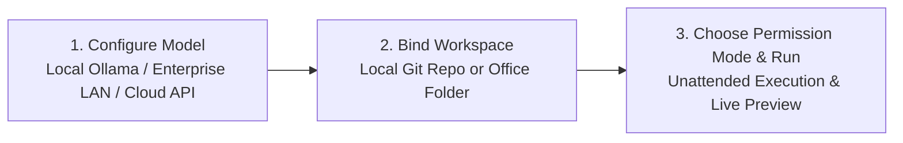

# Quick Start & Installation

HYN Agent combines an **Electron + Vue 3 frontend** with an **embedded Python 3.13 FastAPI local backend**. It runs out of the box after installation or extraction—no external Python setup or server deployment required.

## 1. Launch the Desktop Client

Choose either distribution format from [Download & Security](/en/download):
- **Standard Installer (`HYN-Agent-Setup.exe`)**: Creates desktop shortcuts and sets up an isolated data directory.
- **Portable Edition (`HYN-Agent-Portable.zip`)**: Requires no admin rights and leaves zero registry footprint. Unzip and launch `hyn_agent.exe`.

## 2. Three Steps to Your First Autonomous Task

### Step 1: Select a Model Provider (100% Offline Supported)
Open **Settings → Models** in the bottom-left sidebar:
- **For air-gapped / strict privacy environments**: Enable built-in **Ollama (Local Offline)** or **Enterprise LAN Server (`lan_server`)**—no API key required.
- **For frontier cloud models**: Supports DeepSeek, Kimi, Anthropic Claude, Google Gemini, and any OpenAI-compatible endpoint. API keys are stored strictly on local disk and automatically scrubbed from logs.

### Step 2: Bind a Local Workspace
Click the workspace path beneath the top-left **HYN** mark to select your Git repository or document directory.
- When bound to a Git repo, **Shadow Git Checkpoints** are enabled automatically, creating non-invasive snapshots under `refs/hyn/checkpoints/<session_id>` without touching your `HEAD` or staging area.

### Step 3: Pick a Live Permission Mode
Switch between 4 permission tiers at any time (even mid-run, taking effect on the very next tool call):

| Mode | Best For | Behavior |
| :--- | :--- | :--- |
| **🔒 Ask All (`ask_all`)** | Auditing unfamiliar repos | Read-only tools pass; every file write, patch, or shell command requires approval |
| **✏️ Auto Edit (`auto_edit`)** | Interactive coding & writing | Workspace file edits and whitelisted read-only commands pass automatically |
| **🛡️ Smart Default (`default`)** | Everyday engineering | Normal edits and test runs pass; destructive commands require confirmation |
| **⚡ Full Auto (`full_auto`)** | **Multi-hour unattended runs** | Auto-approves workspace tools, MCP, and teammates; **out-of-workspace & system-destructive commands remain 100% hard-denied** |
