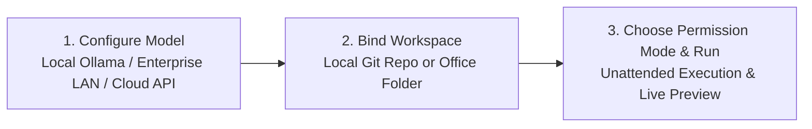

# Quick Start & Installation

Helm combines an **Electron + Vue 3 frontend** with an **embedded Python 3.13 FastAPI local backend**. It runs out of the box after installation—no external Python setup or server deployment required.

## 1. Launch the Desktop Client

Download the Windows installer from [Download & Security](/en/download):
- **[📥 Download for Windows (.exe)](https://github.com/HelmAgent/Helm_website/releases/latest/download/Helm.Setup.1.0.0.exe)**: Creates desktop shortcuts and sets up an isolated data directory.
- 🔒 **100% Local & Safe** · [✅ VirusTotal Security Scan Report (0/57)](https://www.virustotal.com/gui/file/c93002b281b848c534538236819c135139aa78e9ae85e88a04e67ba9536ccf0f?nocache=1) · `SHA-256: c93002b2...536ccf0f`

| File | SHA-256 Checksum | VirusTotal Scan Report |
| :--- | :--- | :--- |
| `Helm Setup 1.0.0.exe` | `c93002b281b848c534538236819c135139aa78e9ae85e88a04e67ba9536ccf0f` | [✅ View Report on VirusTotal (0/57)](https://www.virustotal.com/gui/file/c93002b281b848c534538236819c135139aa78e9ae85e88a04e67ba9536ccf0f?nocache=1) |

## 2. Three Steps to Your First Autonomous Task

### Step 1: Select a Model Provider (100% Offline Supported)
Open **Settings → Models** in the bottom-left sidebar:
- **For air-gapped / strict privacy environments**: Enable built-in **Ollama (Local Offline)** or **Enterprise LAN Server (`lan_server`)**—no API key required.
- **For frontier cloud models**: Supports DeepSeek, Kimi, Anthropic Claude, Google Gemini, and any OpenAI-compatible endpoint. API keys are stored strictly on local disk and automatically scrubbed from logs.

### Step 2: Bind a Local Workspace
Click the workspace path beneath the top-left **Helm** mark to select your Git repository or document directory.
- When bound to a Git repo, **Shadow Git Checkpoints** are enabled automatically, creating non-invasive snapshots under `refs/hyn/checkpoints/<session_id>` without touching your `HEAD` or staging area.

### Step 3: Pick a Live Permission Mode
Switch between 4 permission tiers at any time (even mid-run, taking effect on the very next tool call):

| Mode | Best For | Behavior |
| :--- | :--- | :--- |
| **🔒 Ask All (`ask_all`)** | Auditing unfamiliar repos | Read-only tools pass; every file write, patch, or shell command requires approval |
| **✏️ Auto Edit (`auto_edit`)** | Interactive coding & writing | Workspace file edits and whitelisted read-only commands pass automatically |
| **🛡️ Smart Default (`default`)** | Everyday engineering | Normal edits and test runs pass; destructive commands require confirmation |
| **⚡ Full Auto (`full_auto`)** | **Multi-hour unattended runs** | Auto-approves workspace tools, MCP, and teammates; **out-of-workspace & system-destructive commands remain 100% hard-denied** |

## 3. Community, Issue Feedback & Custom Development

- **Helm Discord Community**: [https://discord.gg/AsU9Xqd6g](https://discord.gg/AsU9Xqd6g)
- **QQ Community Group ID**: `1129820733`
- **Collaboration & Custom Dev Email**: `785430621@qq.com`

> [!IMPORTANT] Beta Gratitude & Free Pain-Point Co-Creation Plan
> Currently in beta—thank you for your support! Please report any issues so I can optimize and fix them promptly. Following the official release and across future upgrades, we will collect your feedback so you decide the next version's features, helping AI serve every industry. High-vote requests meeting our 3 objective criteria (industry commonality, clear input/output sample, public built-in sharing) will be developed for free. For urgent and private custom features, please contact me directly via email (`785430621@qq.com`).
