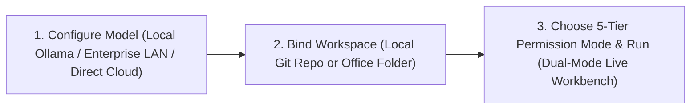

# Quick Start & Installation

Helm pairs an **Electron 44 + Vue 3.5 frontend** with an **embedded Python 3.13 FastAPI local runtime**. No external Python or database setup is needed—and if `git`, `node`, or `uvx` are missing on a locked-down corporate laptop, built-in **System Doctor** provisions portable toolchains without UAC admin rights.

## 1. Launch the Desktop Client

Download the Windows installer from [Download & Security](/en/download):
- **[Download for Windows (.exe)](https://github.com/HelmAgent/Helm_website/releases/latest/download/Helm.Setup.1.0.0.exe)**: Supports custom non-system drive installation and isolated `.hyn_agent` storage.
- **100% Local & DPAPI Encrypted** · [VirusTotal Security Scan Report (0/57)](https://www.virustotal.com/gui/file/c93002b281b848c534538236819c135139aa78e9ae85e88a04e67ba9536ccf0f?nocache=1) · `SHA-256: c93002b2...536ccf0f`

| File | SHA-256 Checksum | VirusTotal Scan Report |
| :--- | :--- | :--- |
| `Helm Setup 1.0.0.exe` | `c93002b281b848c534538236819c135139aa78e9ae85e88a04e67ba9536ccf0f` | [View Report on VirusTotal (0/57)](https://www.virustotal.com/gui/file/c93002b281b848c534538236819c135139aa78e9ae85e88a04e67ba9536ccf0f?nocache=1) |

## 2. Three Steps to Your First Autonomous Task

### Step 1: Select a Model Provider (100% Offline Supported)
Open **Settings → Models** in the bottom-left sidebar:
- **Air-gapped / strict privacy environments**: Enable built-in **Ollama (Local Offline)** or **Enterprise LAN Server (`lan_server`)**—no API key required.
- **Frontier & high-efficiency cloud models**: Built-in support for DeepSeek, Qwen, GLM, Kimi, Anthropic Claude, Google Gemini, and OpenAI-compatible gateways. All keys are encrypted via **Windows DPAPI (`CryptProtectData`)** and automatically scrubbed from logs.

### Step 2: Bind a Local Workspace
Click the workspace path beneath the top-left **Helm** mark to select your Git repository or document directory.
- In Git repositories, **Shadow Git Checkpoints** snapshot every edit under `refs/hyn/checkpoints/<session_id>` without touching `HEAD` or `git status`.

### Step 3: Pick from 5 Live Permission Modes
Switch seamlessly across **5 permission modes** at any time (prefix-cache safe, taking effect on the very next tool call):

| Mode | Best For | Behavior |
| :--- | :--- | :--- |
| **`plan` (Plan Mode)** | Unfamiliar repos & up-front architecture review | Allows read-only exploration, blocks all writes/shell calls, and presents an interactive `PlanCard` |
| **`ask_all` (Ask All)** | High-sensitivity audits & prod configs | Read-only tools pass; every file write, patch, or shell command requires explicit approval |
| **`default` (Smart Default)** | Everyday engineering & office workflows | Safe reads and diff-reviewed edits pass; potentially destructive commands prompt for approval |
| **`auto_edit` (Auto Edit)** | Fast interactive coding & document authoring | Workspace edits (backed by 5-gen snapshots) and read-only commands pass automatically |
| **`full_auto` (Full Auto)** | **Multi-hour refactors & multi-agent teams** | Auto-approves workspace tools, MCP, and teammates; **protected paths (`.git/hooks`, `.env*`) still mandate human approval** |

## 3. Community, Issue Feedback & Custom Development

- **Helm Discord Community**: [https://discord.gg/AsU9Xqd6g](https://discord.gg/AsU9Xqd6g)
- **QQ Community Group ID**: `1129820733`
- **Collaboration & Custom Dev Email**: `785430621@qq.com`

> [!IMPORTANT] Beta Gratitude & Free Pain-Point Co-Creation Plan
> Currently in beta—thank you for your support! Please report any issues so I can optimize and fix them promptly. Following the official release and across future upgrades, we will collect your feedback so you decide the next version's features, helping AI serve every industry. High-vote requests meeting our 3 objective criteria (industry commonality, clear input/output sample, public built-in sharing) will be developed for free. For urgent and private custom features, please contact me directly via email (`785430621@qq.com`).