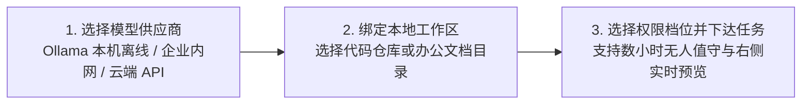

# 快速开始与安装指南

Helm 采用 **Electron + Vue 3 前端 + 内嵌 Python 3.13 FastAPI 本地后端** 架构，安装完成后即可直接运行，无需手动配置 Python 环境或搭建外部数据库。

## 1. 获取并启动客户端

请前往 [客户端下载与安全验证](/download) 获取 Windows 桌面安装程序：
- **[📥 立即下载 Windows 版 (.exe)](https://github.com/HelmAgent/Helm_website/releases/latest/download/Helm.Setup.1.0.0.exe)**：支持自定义非系统盘安装路径，双击安装后自动创建桌面快捷方式。
- 🔒 **100% Local & Safe** · [✅ VirusTotal 安全扫描报告 (0/57)](https://www.virustotal.com/gui/file/c93002b281b848c534538236819c135139aa78e9ae85e88a04e67ba9536ccf0f?nocache=1) · `SHA-256: c93002b2...536ccf0f`

| File / 文件 | SHA-256 Checksum | VirusTotal Scan Report |
| :--- | :--- | :--- |
| `Helm Setup 1.0.0.exe` | `c93002b281b848c534538236819c135139aa78e9ae85e88a04e67ba9536ccf0f` | [✅ View Report on VirusTotal (0/57)](https://www.virustotal.com/gui/file/c93002b281b848c534538236819c135139aa78e9ae85e88a04e67ba9536ccf0f?nocache=1) |

> [!TIP] 零 C 盘空间占用设计
> Helm 默认将所有会话记录、记忆库、文件历史快照与日志存储在程序父级目录的 `.hyn_agent` 文件夹中（你也可以在 **「设置 → 存储位置」** 中一键迁移至任意磁盘路径，通过 `.hyn_agent_location.json` 引导生效）。

## 2. 三步完成首次任务

### 第一步：配置大模型（支持 100% 离线）
打开左侧栏底部的 **「设置 (Settings) → 模型 (Models)」**：
- **若追求极度隐私或无网环境**：直接开启内置的 **「Ollama（本机离线）」** 或 **「局域网大模型（企业内网）」**，无需填写 API Key 即可一键探测连通性。
- **若使用云端前沿模型**：支持 DeepSeek、Kimi、Anthropic Claude、Google Gemini 及任意 OpenAI 兼容网关，API Key 仅保存在本机 JSON 中，且日志写盘前自动脱敏。

### 第二步：绑定本地工作区（Workspace）
点击左侧栏顶部的 **「Helm」** 品牌标识下方的工作区路径，选择你要处理的本地 Git 代码仓库或文档目录。
- 当工作区为 Git 仓库时，系统默认开启 **无侵入影子 Git 检查点（Shadow Git Checkpoints）**，在每批写文件工具完成后自动记录快照，且绝不污染你的当前分支与 `git status`。

### 第三步：选择会话权限档位并开始执行
在底部书写条右侧（上下文预算圆环旁），点击 **权限模式按钮** 可在 4 档间随时切换（运行中切换将在下一次工具调用时立即生效）：

| 权限档位 | 适用场景 | 行为特征 |
| :--- | :--- | :--- |
| **🔒 全部询问 (`ask_all`)** | 审阅陌生项目、高敏代码审计 | 所有只读工具直接放行；任何写文件、打补丁或执行终端命令均弹出确认框 |
| **✏️ 自动编辑 (`auto_edit`)** | 日常交互式编码与文档撰写 | 工作区内写文件与白名单只读命令（`git status/diff` 等）自动放行，其余命令需确认 |
| **🛡️ 智能确认 (`default`)** | 默认推荐模式 | 常规读写与构建测试命令自动放行，仅对潜在破坏性命令要求确认 |
| **⚡ 完全放行 (`full_auto`)** | **数小时无人值守长程任务** | 自动批准工作区内工具、MCP 与队友协同；**硬拒绝规则（越出工作区、高危系统指令）依然 100% 生效** |

## 3. 界面语言实时切换（中 / 日 / 英）
在 **「设置 → 外观 / 通用」** 中可随时切换 **简体中文 (`zh-CN`)**、**日本語 (`ja-JP`)** 与 **English (`en-US`)**。基于响应式 i18n 引擎，切换瞬间全界面、工具卡片摘要与系统提示即刻重绘，无需重启窗口。

## 4. 社区交流、问题反馈与定制开发

- **Helm 的 Discord 交流群链接**：[https://discord.gg/AsU9Xqd6g](https://discord.gg/AsU9Xqd6g)
- **QQ 交流群号**：`1129820733`
- **交流合作邮箱**：`785430621@qq.com`

> [!IMPORTANT] 内测致谢与「你提痛点 · 我免费开发」共创计划
> 目前处于内测阶段，感谢大家的支持与使用，大家有使用中遇到任何问题都请务必提出，我会尽快优化并修复。并计划在正式版本发布后，征集大家的意见，由大家来决定下一个版本的新功能，希望 AI 能够服务各行各业，尽可能地解决大家的痛点。且在后续的升级中，也会积极听取大家的意见（符合**「具备行业共性、输入输出边界清晰、公开内置共享与同行投票排期」**3 条客观标准），免费为大家开发新的功能。要是大家有紧急且私人订制的功能也请通过邮箱（`785430621@qq.com`）单独与我联系。
