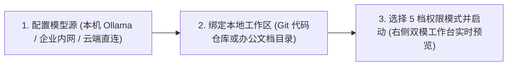

# 快速开始与安装指南

Helm 采用 **Electron 44 + Vue 3.5 前端 + 内嵌 Python 3.13 FastAPI 本地后端** 架构，安装完成后即可直接运行，无需手动安装 Python 或配置外部数据库；若宿主机缺失 `git`、`node` 或 `uvx`，内置 **System Doctor** 支持免管理员权限一键拉取便携版工具链自愈。

## 1. 获取并启动客户端

请前往 [客户端下载与安全验证](/download) 获取 Windows 桌面安装程序：
- **[立即下载 Windows 安装包 (.exe)](https://github.com/HelmAgent/Helm_website/releases/latest/download/Helm.Setup.1.0.0.exe)**：支持自定义非系统盘安装路径，双击安装后自动创建桌面快捷方式。
- **100% 本地闭环与硬件级加密** · [VirusTotal 安全扫描报告 (0/57 零报毒)](https://www.virustotal.com/gui/file/c93002b281b848c534538236819c135139aa78e9ae85e88a04e67ba9536ccf0f?nocache=1) · `SHA-256: c93002b2...536ccf0f`

| 安装包文件 | SHA-256 完整性校验值 | 第三方安全扫描报告 |
| :--- | :--- | :--- |
| `Helm Setup 1.0.0.exe` | `c93002b281b848c534538236819c135139aa78e9ae85e88a04e67ba9536ccf0f` | [查看 VirusTotal 扫描报告 (0/57)](https://www.virustotal.com/gui/file/c93002b281b848c534538236819c135139aa78e9ae85e88a04e67ba9536ccf0f?nocache=1) |

> [!TIP] 零 C 盘空间侵占与 Windows DPAPI 密钥金库
> Helm 默认将所有会话记录、双层 Markdown 记忆库、文件历史快照与便携工具链存储在隔离目录 `.hyn_agent` 中（支持在 **「设置 → 存储位置」** 一键迁移至任意磁盘）；所有 API Key 与 OAuth 令牌均通过 **Windows DPAPI (`CryptProtectData`)** 绑定当前系统账户硬件级加密存储，绝不明文落盘。

## 2. 三步完成首次自治任务

### 第一步：配置大模型（支持 100% 物理断网）
打开左侧栏底部的 **「设置 (Settings) → 模型 (Models)」**：
- **极度隐私或无网环境**：直接开启内置的 **「Ollama（本机离线）」** 或 **「局域网大模型（企业内网）」**，无需填写 API Key 即可一键探测连通性。
- **高性价比与前沿云端模型**：内置 `8` 大供应商（DeepSeek、Qwen、GLM、Kimi、Anthropic Claude、Google Gemini、OpenAI 等），API Key 经系统级 DPAPI 加密入库，写日志前自动擦除脱敏。

### 第二步：绑定本地工作区（Workspace）
点击左侧栏顶部的 **「Helm」** 标识下方的工作区路径，选择你要处理的本地 Git 代码仓库或办公文档目录。
- 当工作区为 Git 仓库时，默认开启 **无侵入影子 Git 检查点（Shadow Git Checkpoints）**，将每步快照写入私有引用 `refs/hyn/checkpoints/<session_id>`，绝不污染你的当前分支与 `git status`。

### 第三步：选择 5 档会话权限模式并开始执行
在底部输入栏右侧点击 **权限模式按钮**，可在 **5 档交互模式** 间随时无感切换（零前缀缓存破环，下一次工具调用立即生效）：

| 权限档位 | 适用场景 | 行为特征 |
| :--- | :--- | :--- |
| **`plan`（只读规划）** | 陌生大库架构梳理、先审方案再动工 | 放行只读探查工具，物理拦截一切写文件与命令执行；生成交互式 `PlanCard` 待批准后开工 |
| **`ask_all`（步步确认）** | 高敏代码审计、生产配置排查 | 所有只读工具直接放行；任何写文件、打补丁或执行终端命令均弹出审批卡 |
| **`default`（智能默认）** | 日常推荐均衡模式 | 常规读写与安全只读命令放行，对潜在破坏性命令要求人工确认 |
| **`auto_edit`（自动编辑）** | 高频交互式编码与文档精修 | 工作区内写文件（自动留存 5 代快照）与白名单只读命令自动放行，其余命令需确认 |
| **`full_auto`（完全自治）** | **数小时长程重构与多代理并行** | 自动批准工作区内工具、MCP 与常驻团队协同；**敏感受保护路径（`.git/hooks`、`.env*`）与越界指令依然强制人工审批** |

## 3. 界面语言实时切换（中 / 日 / 英）
在 **「设置 → 外观 / 通用」** 中可随时切换 **简体中文 (`zh-CN`)**、**日本語 (`ja-JP`)** 与 **English (`en-US`)**，全界面与工具状态卡即时响应式重绘，无需重启窗口。

## 4. 社区交流、问题反馈与定制开发

- **Helm 的 Discord 交流群链接**：[https://discord.gg/AsU9Xqd6g](https://discord.gg/AsU9Xqd6g)
- **QQ 交流群号**：`1129820733`
- **交流合作邮箱**：`785430621@qq.com`

> [!IMPORTANT] 内测致谢与「你提痛点 · 我免费开发」共创计划
> 目前处于内测阶段，感谢大家的支持与使用，大家有使用中遇到任何问题都请务必提出，我会尽快优化并修复。并计划在正式版本发布后，征集大家的意见，由大家来决定下一个版本的新功能，希望 AI 能够服务各行各业，尽可能地解决大家的痛点。且在后续的升级中，也会积极听取大家的意见（符合**「具备行业共性、输入输出边界清晰、公开内置共享与同行投票排期」**3 条客观标准），免费为大家开发新的功能。要是大家有紧急且私人订制的功能也请通过邮箱（`785430621@qq.com`）单独与我联系。