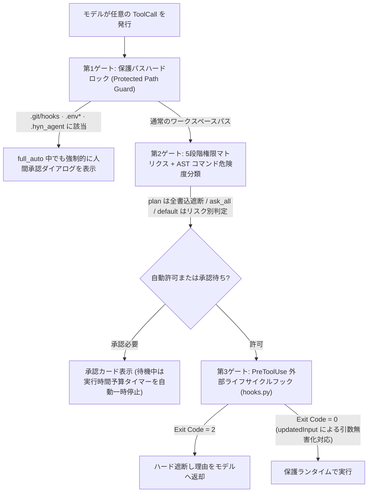
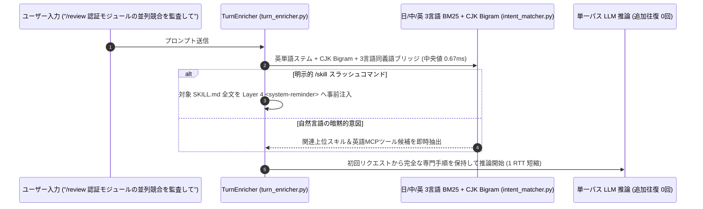
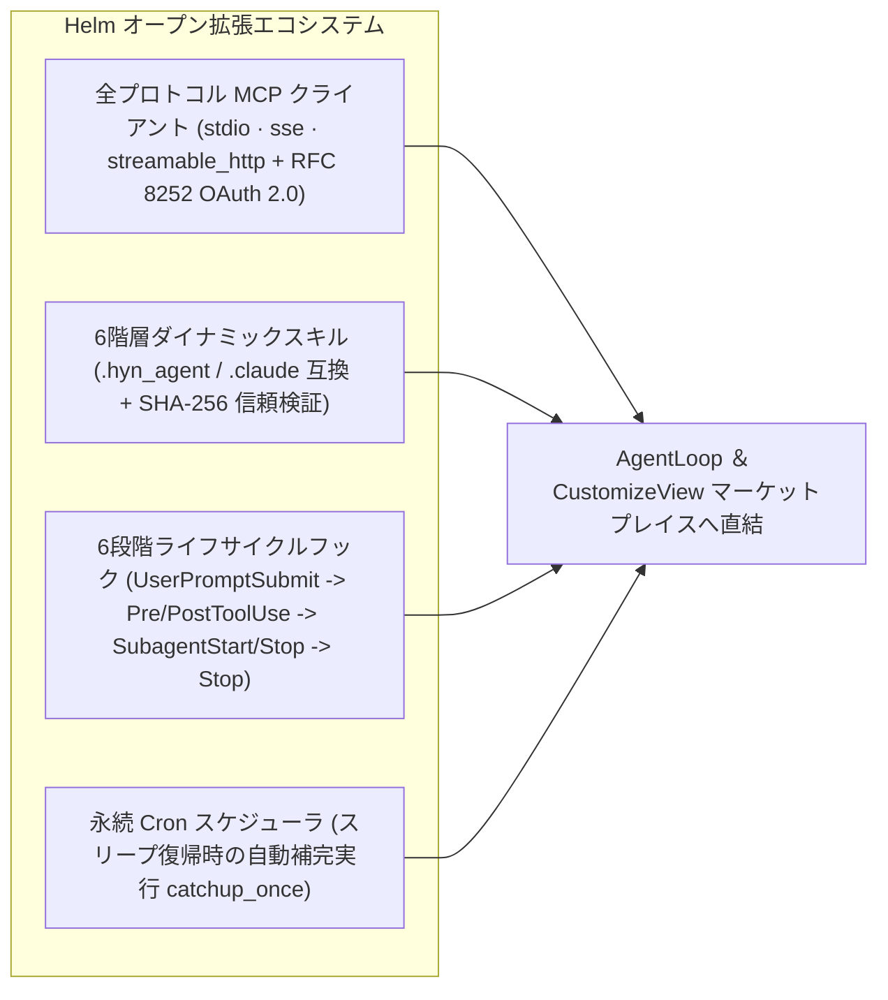

# 6. 5段階権限サンドボックス・1ms未満ゼロRTT意図推論＆拡張エコシステム

> [!NOTE] 対象モジュールと署名済み実測レポート
> - 対象ソース：`app/services/permission_mode.py`、`permission.py`、`plan_submission.py`、`clarification.py`、`intent_matcher.py`、`turn_enricher.py`、`mcp_runtime.py`、`mcp_oauth.py`、`skill_loader.py`、`hooks.py`、`cron_scheduler.py`
> - 実測レポート：[Harness ガードレール消融実験 (攻撃阻止 30/30 · 0.67ms ゼロRTT意図推論 · 多言語MCP検索 100%)](/ja/benchmarks/harness-ablation-v1)

## 6.1 5段階対話権限モードと3重実行ゲート

| 権限モード (`mode`) | 読取ツール | ファイル編集 | シェル実行 | 機密保護パス (`.env*` / `.git/hooks`) | 推奨シーン |
| :--- | :--- | :--- | :--- | :--- | :--- |
| **`plan`（読取・計画）** | 自動許可 | **物理遮断（計画提出のみ）** | **物理遮断** | **強制人間承認** | 大規模コード調査・事前設計レビュー |
| **`ask_all`（全件確認）** | 自動許可 | 毎回承認 | 毎回承認 | **強制人間承認** | 本番環境調査・高機密フォルダ操作 |
| **`default`（標準均衡）** | 自動許可 | Diff 確認 | 安全読取のみ自動許可 | **強制人間承認** | 日常の開発＆オフィス文書作成 |
| **`auto_edit`（高速編集）** | 自動許可 | **自動許可（スナップショット付）** | 危険コマンドは承認 | **強制人間承認** | マルチファイル実装・TDD反復 |
| **`full_auto`（完全自律）** | 自動許可 | **自動許可** | ワークスペース内自動許可 | **強制人間承認（脱獄防止底線）** | 長時間リファクタリング・ベンチマーク |

- **キャッシュ破綻ゼロの `Plan Mode` と永続化 `ask_user`**：`Plan Mode` 切替は Layer 4 `<system-reminder>` で制御するため KV キャッシュを一切壊しません（`PlanCard.js`）。曖昧さ解消の `ask_user`（`QuestionCard.js`）はディスクへ直列化保存され、アプリ再起動後も続きから回答可能です。

---

## 6.2 `1ms` 未満のゼロRTT 3言語意図エンリッチャー

> [!TIP] アーキテクチャ上のトレードオフ：なぜローカル Embedding モデルではなく純粋 CPU 3言語 BM25 なのか？
> - **技術的課題**：日本語・中国語の指示から英語記述の MCP ツールを検索する際、単純一致では漏れますが、数百MBの Embedding モデル常駐はメモリと起動時間を圧迫します。
> - **従来手法の限界**：ルータ用の別 LLM 呼び出しを挟むと毎回 2〜5 秒の遅延が発生します。
> - **Helm の解決策**：日・中・英の技術同義語辞書＋語幹抽出＋CJK Bigram 転置インデックスを純粋 Python メモリ上で実装しました。
> - **定量的成果**：中央値 **`0.67 ms`**、`/skill` 実行時の追加通信 **1往復削減**、多言語 MCP ツール Top-3 検索再現率 **`100.0%`** を達成しました。

---

## 6.3 全プロトコル MCP（OAuth 2.0 対応）・6段階フック・ローカル Cron

1. **エンタープライズ MCP + DPAPI 暗号化 OAuth 2.0（`mcp_runtime.py`、`mcp_oauth.py`）**：`stdio`・`sse`・`streamable_http` に対応し、RFC 8252 ループバック PKCE OAuth 2.0 トークンを Windows DPAPI でハードウェア保護。外部 MCP ツールが `30` 個を超えると自動的に `mcp_search_tools` オンデマンド読込へ切り替わります。
2. **6段階フックと SHA-256 リポジトリ信頼チェーン（`hooks.py`）**：外部リポジトリ同梱の `.hyn_agent` フックやスキルは、ユーザーが内容の **SHA-256 ハッシュ**を承認しない限り実行されず、1バイトでも改ざんされると即座に失効します。
3. **スリープ耐性ローカル Cron（`cron_scheduler.py`）**：PC スリープ中に逃した定期ジョブも、復帰時に `catchup_once` で安全に1回補完実行します。