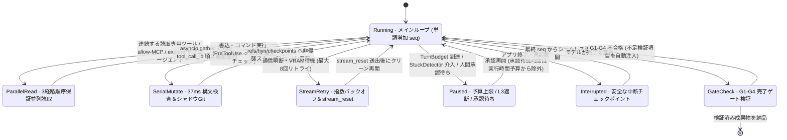
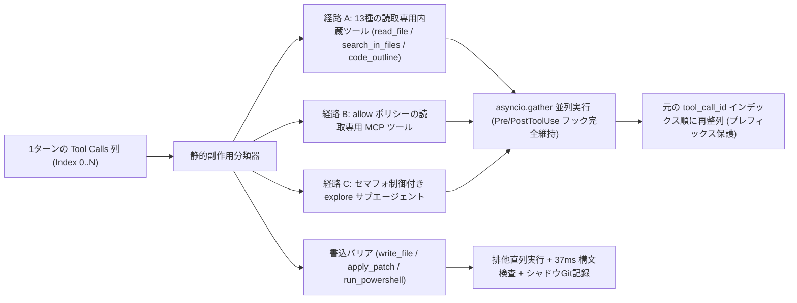
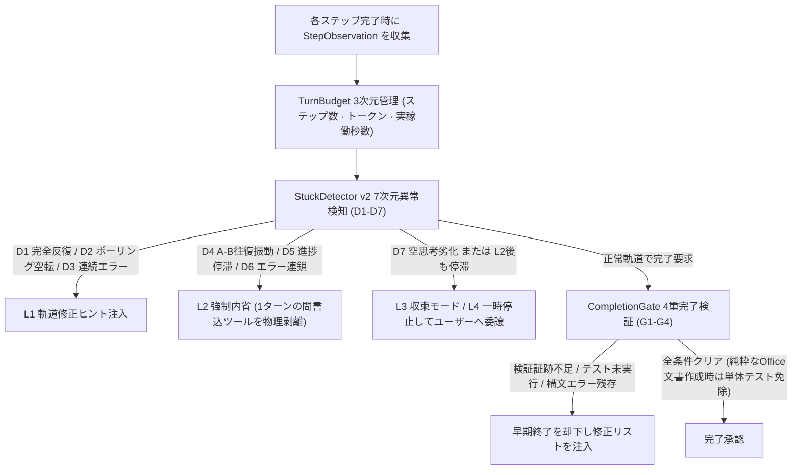

# 2. 長時間自律エンジン (P0-P3)・3経路読取並列とシャドウGit

> [!NOTE] 対象モジュールと署名済み実測レポート
> - 対象ソース：`app/services/agent_loop.py`（`5,227` 行）、`turn_hub.py`、`turn_budget.py`、`stuck_detector.py`、`completion.py`、`ripgrep.py`、`code_outline.py`、`syntax_check.py`、`git_checkpoints.py`
> - 実測レポート：[SWE-bench Verified Mini (最高 84.0%)](/ja/benchmarks/swebench-mini-v1) · [Polyglot 6言語ブラインド検証 (24/24)](/ja/benchmarks/polyglot-mini-v1) · [Harness ガードレール消融実験 (-87.7% 無駄ステップ削減)](/ja/benchmarks/harness-ablation-v1)

## 2.1 フレームワーク非依存・5,227行の決定論的状態機械

LangChain 等の汎用ラッパーを排し、長時間の複数ファイル改修における切断・直列読取遅延・無限ループ・未検証終了を防ぐ純粋 Python `asyncio` ステートマシンを構築しています。

---

## 2.2 3経路の順序保証付き並列読取（3-Path Parallel Read）

> [!TIP] アーキテクチャ上のトレードオフ：KVキャッシュ順序を壊さずに並列高速化する仕組み
> - **技術的課題**：コード調査フェーズの 70% 以上を占める読取ツールを直列実行すると応答が大きく遅延します。
> - **従来手法の限界**：完了順でメッセージを返すと `tool_call_id` の並びが崩れ、API エラーやプレフィックスキャッシュ破綻を招きます。
> - **Helm の解決策**：連続する読取専用区間を自動抽出し、`asyncio.gather` 実行後に元のインデックス順へ厳密再配置。書込系ツールに到達した時点で即座に直列メモリバリアを張ります。
> - **定量的成果**：マルチファイル調査の所要時間を **55%〜70% 短縮**しつつ、キャッシュ決定論を 100% 維持します。

---

## 2.3 `TurnHub` 再接続・7次元 `StuckDetector` v2・`CompletionGate`

- [Harness 消融実験 (`/ja/benchmarks/harness-ablation-v1`)](/ja/benchmarks/harness-ablation-v1) において、`StuckDetector` v2 は `18` 件の無限ループ軌跡を **`100.0%`（18/18）検知・誤検知 `0.0%`** で遮断し、無駄な消費ステップを **`87.7%` 削減**しました。

---

## 2.4 決定論的コードナビゲーション v2 と非侵襲シャドウGit

| ナビゲーション基盤 | 従来ベースライン | Helm 実測値 | 解決した課題 |
| :--- | :--- | :--- | :--- |
| **同梱 `ripgrep 15.2` (`search_in_files`)** | Python 走査 P50 `5,026.2 ms`・ノイズ `49.17%` | P50 **`119.3 ms`**（**`42.1倍`高速**）・ノイズ **`0.00%`** | `.git`/`node_modules` 汚染を根絶 |
| **`tree-sitter` 構文木 (`code_outline`)** | 数千行ファイルの丸読みによる枠圧迫 | P50 **`23.81 ms`**（512-LRU 温態 `0.8 ms`） | 原文比 **`4.59%`** サイズ（**`95.41%` 節約**） |
| **行境界整合 `read_file` + 規約自動検出** | 文字数切断で連続読取一致率 `30.33%` | **`100.00%` 無欠損ページング** + `AGENTS.md` 自動注入 | SWE-bench `L2` 切断起因ミス **`0%`** |
| **インプロセス構文検査 (`syntax_check.py`)** | テスト実行まで括弧抜けに気付かない | 中央値 **`37 ms`**（検出率 `100.0%` / 誤報 `0.0%`） | 書込直後に構文ミスを即時フィードバック |

- **実証スコア**：[SWE-bench Verified Mini](/ja/benchmarks/swebench-mini-v1) にて `DeepSeek-V4.1-Flash` 単体で **最高 `84.00%`（42/50）Pass@1**（2回平均 `81.00% ± 4.24%`・正解ファイル特定率 `98.0%`）、[Polyglot 6言語検証](/ja/benchmarks/polyglot-mini-v1) にて **`100.0%`（24/24）** を達成しました。