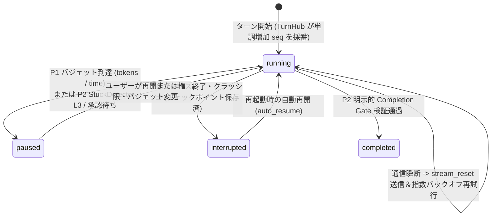

# 2. 長時間自律実行エンジン (P0–P3)

> [!IMPORTANT] 解決すべきエンジニアリング課題
> 一般的なエージェントは数分の短い対話では動作するものの、数時間にわたる大規模リファクタリングでは **① 通信瞬断によるストリーム喪失、② コンテキスト長超過、③ 同一ツールエラーの無限ループと早期終了、④ コード破損時のロールバック困難** という4つの壁に直面します。
> Helm は **P0〜P3 の4段階設計**（`docs/long_running/` および `app/services/`）によりこれらを体系的に解決しました。



---

## 2.1 P0 信頼性基盤：`TurnHub` 単調増加 `seq` と `stream_reset`

**対応モジュール**：`app/services/turn_hub.py`、`app/services/llm_retry.py`

1. **`TurnHub` リングバッファと再接続リプレイ**：
   - SSE ストリームのライフサイクルを単一の HTTP リクエストから切り離し、`TurnHub` が全イベントに単調増加のシーケンス番号 `seq` を付与してバッファリングします。
   - 画面リロードや一時的な切断が発生しても、フロントエンドは `last_seq` を指定して欠落イベントのみを正確にリプレイできます。
2. **再試行時の不完全ストリーム自動破棄（`stream_reset`）**：
   - LLM ストリームの途中でタイムアウトやエラーが発生し `llm_retry.py` が再試行に入る際、バックエンドは `retry` イベントと共に `stream_reset` を送出します。
   - フロントエンドは途中の不完全なテキスト・思考ブロックを即座に破棄し、再試行後のクリーンな出力のみを描画します。

---

## 2.2 P1 バジェット制御と3段階コンテキスト圧縮

**対応モジュール**：`app/services/turn_budget.py`、`app/services/context_compact.py`

1. **ステップ数上限の撤廃と Token / 時間バジェットへの移行**：
   - 固定ステップ数制限を廃止し、`token_budget` と `time_budget_s` をリアルタイムで `ContextRing.js` に配信します。
2. **圧縮前のメモリ救出と3段階コンパクション（`ContextCompactor`）**：
   - 古い会話履歴を圧縮・切り詰める直前に、破棄対象メッセージを非同期メモリ抽出キュー（`memory_queue.py`）へ送り、重要な決定事項の喪失を防ぎます。
   - `compact_history`（能動的要約）、`reactive_compact`（コンテキスト逼迫時の即時要約）、`snip_compact`（400メッセージ超過時の中間ツール結果トリミング）の3段階で長時間の稼働を支えます。

---

## 2.3 P2 収束制御：`StuckDetector` v2 と明示的完了ゲート

**対応モジュール**：`app/services/stuck_detector.py`、`app/services/completion.py`

1. **2段階のスタック検知と内省プロンプト注入**：
   - 同一コマンドの連続失敗やファイルの反復書き換え（A↔B ループ）を `ProgressTracker` が検知すると、まず `L1` 注意喚起を行い、それでも解消しない場合は **`L2_RETROSPECTIVE_NOTICE`（強制内省プロンプト）** を注入してツール乱発を止め、原因分析と別アプローチへの転換を強制します。
2. **明示的完了プロトコル（Explicit Completion Gate）**：
   - テスト未実行のままタスク完了を宣言する「早期終了（Premature Exit）」を防ぐため、`completion` イベント（`summary`、`verification`、`remaining`、`gate_passed`）による完了検証ゲートを設けています。

---

## 2.4 P3 長時間無人稼働：非侵襲シャドウGitチェックポイントと4段階リアルタイム権限

**対応モジュール**：`app/services/git_checkpoints.py`、`app/services/permission_mode.py`、`app/services/progress_notes.py`

### 1. シャドウGitチェックポイント（Shadow Git Checkpoints）—— 作業ブランチを一切汚さないタイムマシン
通常のエージェントがチェックポイントを作る際、直接 `git commit` を実行するとユーザーのブランチ履歴や `git status`（ステージング領域）を汚してしまいます。`git_checkpoints.py` は **Git の低レベル Plumbing コマンド** を組み合わせることで、完全非侵襲なスナップショットを実現しました：

```bash
# コア実装原理（app/services/git_checkpoints.py）
# 1. 一時インデックスファイルを使用し、ユーザーの .git/index には一切触れない
GIT_INDEX_FILE=<temp_index> git add -A
# 2. ツリーオブジェクトを Git オブジェクトデータベースへ書込
tree=$(GIT_INDEX_FILE=<temp_index> git write-tree)
# 3. 親コミットを指定してコミットオブジェクトを生成
commit=$(git commit-tree $tree -p $parent -m "hyn checkpoint: step N")
# 4. 専用の名前空間 refs/hyn/checkpoints/<session_id> を更新（HEAD やブランチは無変更）
git update-ref refs/hyn/checkpoints/<session_id> $commit
```

- **メリット**：ユーザーの `HEAD`・ブランチ・ステージング領域は **100% 無変更** のまま、UI上から任意のチェックポイントとの Diff 比較およびワンクリック復元が可能です（復元操作は人間のみがUIから実行でき、モデル自身による勝手なロールバックは禁止されています）。

### 2. 圧縮耐性を持つ進捗ノート（`progress_notes.py`）とリアルタイム4段階権限（`permission_mode.py`）
- **進捗ノート**：`DATA_DIR/session_state/<session_id>/progress.md` に保存され、毎ターン `<progress_notes>` としてシステムプロンプト末尾に自動注入されるため、何回コンテキスト圧縮が行われても「目標・完了項目・次のステップ」を失いません。
- **リアルタイム権限切替**：`bind_mode_getter` により、実行中にUI（`PermissionModeButton.js`）でモードを切り替えると**次のツール呼び出しから即座に反映**されます。`full_auto`（完全自動）モードであっても、ワークスペース外へのアクセスやOS破壊コマンドは `permission.py` の強制遮断ルール（ハードリジェクト）により 100% ブロックされます。

---

## 2.5 決定的コードナビゲーション基盤と SWE-bench Verified Mini 84.0% 実証

**対応モジュール**：`app/services/ripgrep.py`、`app/services/code_outline.py`、`app/services/syntax_check.py`、`app/api/tools.py`

大規模リポジトリにおける自律エージェントのボトルネックは、LLMの推論能力そのものよりも「全文検索の遅延」「長大ファイルの切り捨てによる行欠落」「編集後の構文エラーによるテスト浪費」にあります。Helm は4つの決定的コードナビゲーション基盤を内蔵し、**SWE-bench Verified Mini（50課題、Docker `--network none` 完全隔離コンテナ）** でエンドツーエンド実証を完了しました：

| モジュールと機能 | 刷新前ベースライン | Helm 決定的エンジン実測値 | エンジニアリング効果 |
| --- | --- | --- | --- |
| **同梱 `ripgrep 15.2.0` 全文検索 (`search_in_files`)** | Python `os.walk` 中央値 `5,026.2 ms`、ノイズ率 `49.17%` | P50 **`119.3 ms`**（P95 `160.3 ms`）、ノイズ率 **`0.00%`** | **42.1倍の高速化**、`path` 絞り込みと正規表現に完全対応 |
| **`tree-sitter` 多言語 AST 構造抽出 (`code_outline`)** | 数千行のファイルを丸ごと読み込みトークンを浪費 | コールド P50 **`23.81 ms`**（キャッシュ `0.8 ms`）、圧縮比 `4.59%` | **読取トークンを理論値 95.41% 削減**、関数シグネチャと行範囲を即時返却 |
| **`read_file` ページング・切り捨て整合性** | 2000行の文字数切り捨てで連続ページング整合性 `30.33%`（`288,084` 行欠落） | 行・バイト予算の同期進行により連続ページング整合性 **`100.00%`** | **読み飛ばしゼロ (`L2 = 0%`)**、長大ファイルの盲点を完全解消 |
| **編集後のプロセス内構文検査 (`syntax_check.py`)** | インデントや括弧ミスが pytest 実行まで発覚しない | 中央値 **`37 ms`** で `ast.parse` + `tree-sitter` 即時検証 | **検知率 100% / 誤検知率 0.0%**、構文破損をその場で遮断 |

### SWE-bench Verified Mini (`n = 50`) 実証サマリー
- **ピーク解決率と2回独立平均**：高コスパな `DeepSeek-V4.1-Flash` を用い、`hyn_flash_r1_clean` で **`42 / 50 = 84.00%` Pass@1**（Wilson 95% CI `[71.49%, 91.66%]`）、独立再実行 `hyn_flash_r2` で `39 / 50 = 78.00%`、**2回平均 `81.00% ± 4.24%`** を達成（うち `django/django` 25課題は2回とも **`88.00% ± 0.00%`**）。
- **同一モデル `mini-SWE-agent` との 1:1 厳密対照実験**：同一50課題・同一モデルにおける公式 `mini-SWE-agent` の解決率は `82.00%`（対応のある厳密 McNemar 検定 $p = 1.00$ で統計的に同等）。しかし `mini-SWE-agent` が80ステップ上限により **2件の空パッチ（有効率 96.0%）** を出したのに対し、Helm は計100タスクすべてで **100.0%（100/100）有効な非空パッチ・エラー0・タイムアウト0** を達成しました。
- **98.0% の Gold ファイル特定率と圧倒的コスト効率**：全50課題の **100%（50/50）** で正解ファイル（Gold File）を閲覧し、**98.0%（49/50）** で直接編集に到達。**97.74%** の Prefix Cache ヒット率により、約6,000万入力トークンに及ぶ50課題全体の推論コストはわずか **¥10.39〜¥12.16（1課題解決あたり ¥0.27〜¥0.29）** です。
- **公開検証バンドル**：[`/benchmarks/swebench-mini-v1/REPORT.md`](/benchmarks/swebench-mini-v1/REPORT.md) および SHA-256 マニフェスト [`/benchmarks/swebench-mini-v1/manifest.json`](/benchmarks/swebench-mini-v1/manifest.json) を参照してください。
