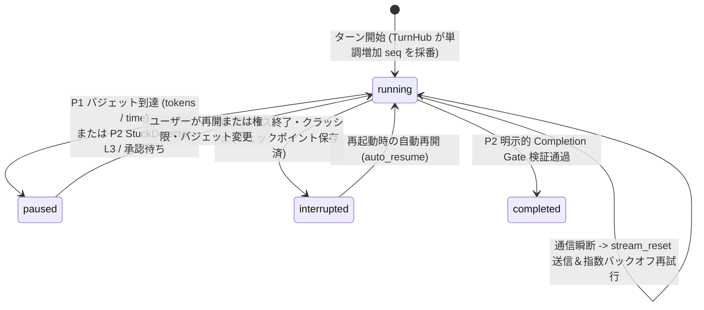

# 2. 長時間自律実行エンジン (P0–P3)

> [!IMPORTANT] 解決すべきエンジニアリング課題
> 一般的なエージェントは数分の短い対話では動作するものの、数時間にわたる大規模リファクタリングでは **① 通信瞬断によるストリーム喪失、② コンテキスト長超過、③ 同一ツールエラーの無限ループと早期終了、④ コード破損時のロールバック困難** という4つの壁に直面します。
> HYN Agent は **P0〜P3 の4段階設計**（`docs/long_running/` および `app/services/`）によりこれらを体系的に解決しました。



---

## 2.1 P0 信頼性基盤：`TurnHub` 単調増加 `seq` と `stream_reset`

**対応モジュール**：`app/services/turn_hub.py`、`app/services/llm_retry.py`

1. **`TurnHub` リングバッファと再接続リプレイ**：
   - SSE ストリームのライフサイクルを単一の HTTP リクエストから切り離し、`TurnHub` が全イベントに単調増加のシーケンス番号 `seq` を付与してバッファリングします。
   - 画面リロードや一時的な切断が発生しても、フロントエンドは `last_seq` を指定して欠落イベントのみを正確にリプレイできます。
2. **再試行時のストリーム洗浄（`stream_reset`）**：
   - LLM ストリームの途中でタイムアウトやエラーが発生し `llm_retry.py` が再試行に入る際、バックエンドは `retry` イベントと共に `stream_reset` を送出します。
   - フロントエンドは途中の不完全なテキスト・思考ブロックを即座に破棄し、再試行後のクリーンな出力のみを描画します。

---

## 2.2 P1 バジェット制御と3段階コンテキスト圧縮

**対応モジュール**：`app/services/turn_budget.py`、`app/services/context_compact.py`

1. **ステップ数上限の撤廃と Token / 時間バジェットへの移行**：
   - 固定ステップ数制限を廃止し、`token_budget` と `time_budget_s` をリアルタイムで `ContextRing.js` に配信します。
2. **圧縮前のメモリ救出と3段階コンパクション（`ContextCompactor`）**：
   - 古い会話履歴を圧縮・切り詰める直前に、破棄対象メッセージを非同期メモリ抽出キュー（`memory_queue.py`）へ送り、重要な決定事項の喪失を防ぎます。
   - `compact_history`（能動的要約）、`reactive_compact`（コンテキスト逼迫時の即時要約）、`snip_compact`（400メッセージ超過時の中間ツール結果トリミング）の3段階で長時間の稼働を支えます。

---

## 2.3 P2 収束制御：`StuckDetector` v2 と明示的完了ゲート

**対応モジュール**：`app/services/stuck_detector.py`、`app/services/completion.py`

1. **2段階のスタック検知と内省プロンプト注入**：
   - 同一コマンドの連続失敗やファイルの反復書き換え（A↔B ループ）を `ProgressTracker` が検知すると、まず `L1` 注意喚起を行い、それでも解消しない場合は **`L2_RETROSPECTIVE_NOTICE`（強制内省プロンプト）** を注入してツール乱発を止め、原因分析と別アプローチへの転換を強制します。
2. **明示的完了プロトコル（Explicit Completion Gate）**：
   - テスト未実行のままタスク完了を宣言する「早期終了（Premature Exit）」を防ぐため、`completion` イベント（`summary`、`verification`、`remaining`、`gate_passed`）による完了検証ゲートを設けています。

---

## 2.4 P3 長時間無人稼働：非侵襲シャドウGitチェックポイントと4段階リアルタイム権限

**対応モジュール**：`app/services/git_checkpoints.py`、`app/services/permission_mode.py`、`app/services/progress_notes.py`

### 1. シャドウGitチェックポイント（Shadow Git Checkpoints）—— 作業ブランチを一切汚さないタイムマシン
通常のエージェントがチェックポイントを作る際、直接 `git commit` を実行するとユーザーのブランチ履歴や `git status`（ステージング領域）を汚してしまいます。`git_checkpoints.py` は **Git の低レベル Plumbing コマンド** を組み合わせることで、完全非侵襲なスナップショットを実現しました：

```bash
# コア実装原理（app/services/git_checkpoints.py）
# 1. 一時インデックスファイルを使用し、ユーザーの .git/index には一切触れない
GIT_INDEX_FILE=<temp_index> git add -A
# 2. ツリーオブジェクトを Git オブジェクトデータベースへ書込
tree=$(GIT_INDEX_FILE=<temp_index> git write-tree)
# 3. 親コミットを指定してコミットオブジェクトを生成
commit=$(git commit-tree $tree -p $parent -m "hyn checkpoint: step N")
# 4. 専用の名前空間 refs/hyn/checkpoints/<session_id> を更新（HEAD やブランチは無変更）
git update-ref refs/hyn/checkpoints/<session_id> $commit
```

- **メリット**：ユーザーの `HEAD`・ブランチ・ステージング領域は **100% 無変更** のまま、UI上から任意のチェックポイントとの Diff 比較およびワンクリック復元が可能です（復元操作は人間のみがUIから実行でき、モデル自身による勝手なロールバックは禁止されています）。

### 2. 圧縮耐性を持つ進捗ノート（`progress_notes.py`）とリアルタイム4段階権限（`permission_mode.py`）
- **進捗ノート**：`DATA_DIR/session_state/<session_id>/progress.md` に保存され、毎ターン `<progress_notes>` としてシステムプロンプト末尾に自動注入されるため、何回コンテキスト圧縮が行われても「目標・完了項目・次のステップ」を失いません。
- **リアルタイム権限切替**：`bind_mode_getter` により、実行中にUI（`PermissionModeButton.js`）でモードを切り替えると**次のツール呼び出しから即座に反映**されます。`full_auto`（完全自動）モードであっても、ワークスペース外へのアクセスやOS破壊コマンドは `permission.py` のハード拒否ルールにより 100% ブロックされます。
