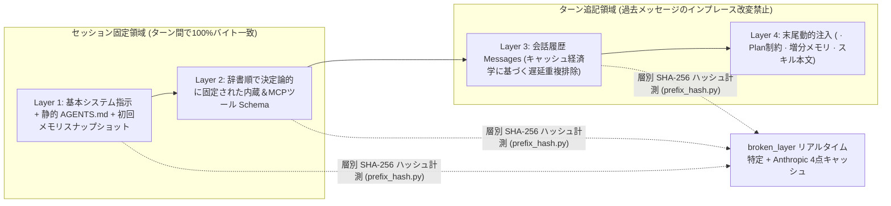
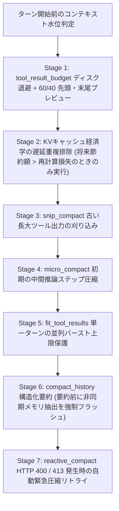
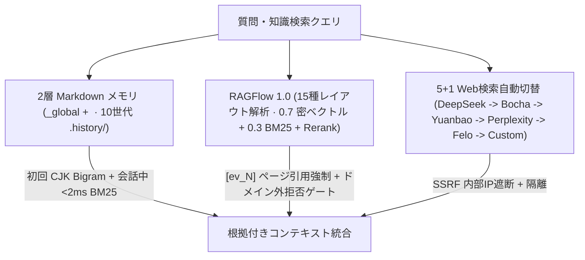

# 4. 4層追記プレフィックス・7段階圧縮・2層メモリ＆異種文書RAG

> [!NOTE] 対象モジュールと署名済み実測レポート
> - 対象ソース：`app/services/prefix_policy.py`、`prefix_hash.py`、`context_compact.py`、`memory_store.py`、`memory_extractor.py`、`knowledge/ragflow.py`、`web_search/*`
> - 実測レポート：[プレフィックスキャッシュ安定性検証 (160回呼出 · 意図せぬ破綻 25->0 · コスト -57.3%)](/ja/benchmarks/precache-v1) · [4段階 RAG 進化検証 (Strict Recall 36.7%->100.0% · MRR 1.000)](/ja/benchmarks/rag-eval-v1)

## 4.1 4層追記専用プレフィックス契約と SHA-256 破綻診断

システムプロンプトへ現在時刻や動的スキル全文を直接差し込むと、数万トークンの KV キャッシュが毎ターン無効化されます。Helm は**4層追記専用プレフィックス（4-Layer Append-Only Prefix）**を徹底しています。

> [!TIP] アーキテクチャ上のトレードオフ：会話途中のモード切替でキャッシュ破綻ゼロを実現する理由
> - **技術的課題**：会話途中で `Plan Mode` へ切り替えたり新しいメモリや `/skill` を呼び出したりする際、Layer 1/2 を書き換えると蓄積済み KV キャッシュが消滅します。
> - **従来手法の限界**：毎ターン System Prompt や `tools` 配列を再構築する実装では、実運用時のキャッシュヒット率が 45% 未満に低下します。
> - **Helm の解決策**：Layer 1/2 を完全凍結し、実行中の状態変化はすべて Layer 4 末尾の `<system-reminder>` へ集約。`prefix_hash.py` で各層の SHA-256 を常時監視します。
> - **定量的成果**：[SWE-bench 1.2億トークン検証](/ja/benchmarks/swebench-mini-v1) で **`97.74%` のキャッシュヒット率（1問あたり `¥0.27`）**、[160回キャッシュ検証 (`/ja/benchmarks/precache-v1`)](/ja/benchmarks/precache-v1) で意図せぬ破綻を **`25回 -> 0回`**、課金入力コストを **`-57.27%`** 削減しました。

---

## 4.2 キャッシュ経済学に基づく 7段階コンテキスト圧縮（`ContextCompactor`）

- **60/40 先頭・末尾保持プレビュー**：スタックトレースは常に出力末尾に現れるため、先頭 `60%` と末尾 `40%` を残して全文をディスク退避します。**`93.1%` 圧縮時でも末尾トレース保持率 `100.0%`**（単純先頭切り詰めでは `33.3%`）を達成しました。

---

## 4.3 DB不要の2層メモリ・4段階ハイブリッドRAG・5+1 Web検索フォールバック

| RAG 進化段階 (`/ja/benchmarks/rag-eval-v1`) | 主要アーキテクチャ改善 | `Strict Recall@5` | `MRR` | 類似ノイズ混入率 | `OOD` 拒否精度 |
| :--- | :--- | :--- | :--- | :--- | :--- |
| **`v0` ベースライン** | 固定長チャンク + 密ベクトル検索のみ | `36.7%` | `0.489` | `46.7%` | `66.7%` |
| **`v1` ハイブリッド** | `0.7` 密ベクトル + `0.3` BM25 + レイアウト分割 | `73.3%` | `0.811` | `20.0%` | `83.3%` |
| **`v2` 再ランキング** | Cross-Encoder 精選リランキング導入 | `93.3%` | `0.956` | `3.3%` | `100.0%` |
| **`v3` 最終構成** | 信頼度閾値ゲート + `[ev_N]` 引用強制 | **`100.0%` (30/30)** | **`1.000`** | **`0.0%`** | **`100.0%` (6/6)** |