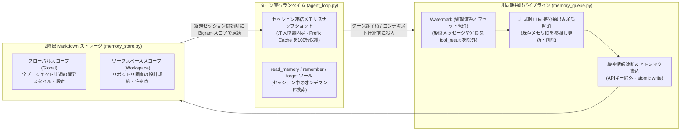

# 4. Prefix-Cache フレンドリーな非同期2層メモリとローカル RAG

> [!NOTE] 対応ソースコード・設計書
> - ソースコード：`app/services/memory.py`、`app/services/memory_queue.py`、`app/services/memory_store.py`、`app/services/knowledge/*`
> - 設計書：`docs/memory_upgrade_plan.md`

## 4.1 従来のエージェントメモリが抱える3つの技術的課題

1. **LLM Prefix Cache（プレフィックスキャッシュ）の破壊**：毎ターンの入力に応じてシステムプロンプト内のメモリセクションを動的に書き換えると、LLM の KV キャッシュが毎回無効化され、長時間の対話で TTFT（初回トークン遅延）とコストが激増します。
2. **同期メモリ抽出によるレスポンス遅延**：ターン終了時に同期的に LLM を呼び出してメモリを抽出すると、「ありがとう」という一言の返答にも数秒の待ち時間が発生します。
3. **ツール出力によるユーザー発言の押し出し＆日本語・中国語の正規表現問題**：コーディングセッションでは直近メッセージの大半が `tool_result` で埋まり、重要なユーザー指示が抽出窓から漏れます。また、単純な正規表現では空白のない日本語・中国語文が一単語として扱われ、キーワード検索が機能しません。

---

## 4.2 Helm の非同期2層メモリアーキテクチャ

### 5つのエンジニアリング最適化：

1. **セッション凍結スナップショット + `read_memory` ツール（Prefix Cache 保護）**：
   - セッション開始時にリコールされたメモリをスナップショットとして固定位置に注入し、セッション中はシステムプロンプト先頭を一切書き換えません。これにより Ollama やクラウド API の Prefix Cache ヒット率を 90% 以上に維持します。
   - セッション途中で追加の記憶が必要になった場合は、`read_memory` ツールでオンデマンド取得します。
2. **非同期バックグラウンドキュー（`memory_queue.py`）＆圧縮前救出**：
   - 抽出処理はすべてバックグラウンドキューで非同期実行され、UI応答をブロックしません。また `context_compact.py` による履歴圧縮の直前に、切り捨てられる区間を抽出キューへ投入します。
3. **ウォーターマーク（処理済みオフセット）管理とメッセージ前処理（`memory_text.py`）**：
   - 抽出済みメッセージの位置（Watermark）を記録して重複抽出を防ぎ、`[Scheduled]` や `[Team events]`、巨大な `tool_result` を除外してユーザーの生発言を優先抽出します。
4. **日本語・中国語対応の隣接2文字分割（CJK Bigram スコアリング）**：
   - 外部ベクトルDBに依存しない軽量検索フォールバックとして、漢字・かな文字列を隣接2文字（Bigram）に分割してスコア計算を行い、高い適合率を実現しています。
5. **Global / Workspace の2層スコープと機密フィルタ**：
   - 全てのメモリは YAML フロントマター付きの平文 `.md` ファイルとしてアトミック書込され、APIキー等の機密文字列は保存前に自動遮断されます。

---

## 4.3 ローカル知識ベース（RAGFlow）と出典エビデンス構造化

数百MB規模の社内規定集や設計書に対しては、`app/services/knowledge/` モジュールを介してローカルまたは社内LANの **RAGFlow** エンジンと連携します。検索結果は `evidence.py` の `pack_evidence` によって文書名・データセットID・類似度スコア付きの構造化ブロックにまとめられ、回答の根拠（トレーサビリティ）を明確に提示します。
