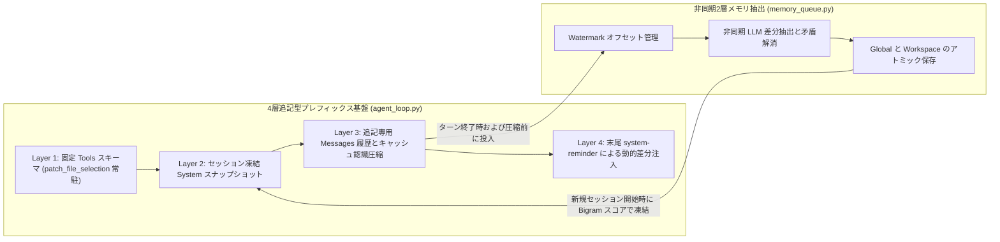
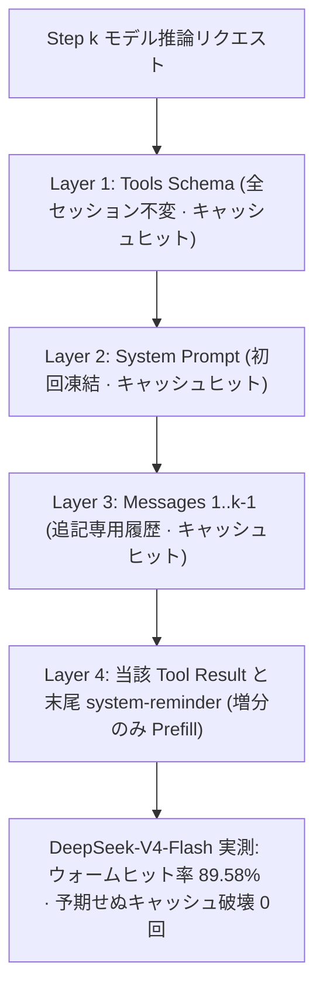

# 4. 4層追記型 Pre-Cache・非同期2層メモリとローカル知識ベース (RAG)

> [!NOTE] 対応ソースコード・設計仕様・公開ベンチマーク証跡
> - ソースコード：`app/services/agent_loop.py`、`app/services/context_compact.py`、`app/services/memory.py`、`app/services/memory_queue.py`、`app/services/knowledge/*`
> - 設計仕様：`docs/precache/README.md`、`docs/memory_upgrade_plan.md`
> - 公開実測証跡バンドル：[manifest.json](/benchmarks/precache-v1/manifest.json) · [summary_report.json](/benchmarks/precache-v1/summary_report.json) · [REPORT.md](/benchmarks/precache-v1/REPORT.md)

## 4.1 従来のエージェントメモリとコンテキスト構築が抱える3つの技術的課題

1. **LLM Prefix Cache（プレフィックスキャッシュ）の破壊**：毎ターンの入力に応じてシステムプロンプト（メモリ、出力言語、タスク進捗、選択範囲に応じたツール配列の動的増減など）を書き換えると、先頭バイトから KV キャッシュが無効化され、全ステップで Prefill の再計算が発生します。
2. **同期メモリ抽出と過剰な履歴書き換えによるキャッシュ逆効果**：ターン終了時に同期的に LLM を呼び出すと UI が数秒停止します。また、過去の `read_file` 結果を毎ステップ即座にインプレース置換すると、`messages` プレフィックスが破壊され、削減トークン以上の再計算コストが発生します。
3. **ツール出力によるユーザー発言の押し出し＆日中韓テキストの分割問題**：長時間のコーディング対話では直近履歴が巨大な `tool_result` で埋まり、重要なユーザー指示が抽出窓から漏れます。さらに空白のない日本語・中国語文では単純な正規表現検索が機能しません。

---

## 4.2 4層追記型プレフィックス構造と非同期2層メモリアーキテクチャ

Helm はモデルへの入力を厳格な **「4層追記型プレフィックス構造（Four-Layer Append-Only Prefix Architecture）」** として編成し、不変の契約を先頭に固定して動的な状態変化をすべて末尾へ分離します。



### 5つのコアエンジニアリング機構：

1. **Layer 1 固定ツールスキーマ + Layer 2 セッション凍結 System スナップショット**：
   - ツール定義の順序を決定論的に固定し、`patch_file_selection` を常駐させることで選択範囲の有無による `tools` 配列の変動を排除します。
   - セッション開始時にリコールされたメモリ（`_memory_snapshot`）、基本言語、静的スキル定義を一度だけ固定注入し、セッション終了まで `Layer 2` を一切書き換えません。
2. **Layer 4 `<system-reminder>` 末尾注入（動的変動要素の完全分離）**：
   - ターンごとの言語切替ヒント、タスクボード差分、マイルストーン進捗ノート、予算アラート、Office 選択範囲アンカー（`SelectionAnchor`）、リトライ内省指示をすべて System Prompt から切り離し、末尾の `<system-reminder>` ブロックとして追記します。
3. **Layer 3 キャッシュ認識型の遅延重複排除と増分コンテキスト圧縮（`context_compact.py`）**：
   - 重複 `read_file` の整理に損益分岐ゲート（累計削減見込み `>= 4,000` トークンまたは圧縮閾値到達時のみ一括実行）を設け、わずかな節約で数万トークンのキャッシュを壊す逆効果を防止します。長大履歴の圧縮時は既存の構造化要約を増分マージします。
   - マルチターン対話ではターン境界で過去ターンの `reasoning_content` を規約通り回収し、同一ターン内のツール実行ステップ間ではプレフィックス連続性を完全維持します。
4. **非同期バックグラウンドキュー（`memory_queue.py`）＆ Watermark フィルタ**：
   - メモリ抽出はバックグラウンドで非同期実行され（終了時は最大10秒ドレイン待機）、履歴圧縮前にも未抽出区間を自動救出します。`[Scheduled]` や `[Team events]` 等の擬似メッセージは自動除外されます。
5. **日本語・中国語対応の隣接2文字分割（CJK Bigram）と2階層ストレージ（`memory_store.py`）**：
   - 外部ベクトルDB不要の軽量フォールバックとして漢字・かなの隣接2文字（Bigram）一致度を採用し、APIキー等の機密文字列を遮断した上で `.md` へアトミック書込します。

---

## 4.3 ローカル知識ベース（RAGFlow）と出典エビデンス構造化

数百MB規模の社内規定集や設計書に対しては、`app/services/knowledge/` モジュールを介してローカルまたは社内LANの **RAGFlow** エンジンと連携します。検索結果は `evidence.py` の `pack_evidence` によって文書名・データセットID・類似度スコア付きの構造化ブロックにまとめられ、静的プレフィックスを汚染することなく厳格なトレーサビリティを提供します。

---

## 4.4 Pre-Cache 実測ベンチマークと検証可能な証跡バンドル（DeepSeek-V4-Flash）

4層追記型プレフィックス構造の実効性を客観的に証明するため、64トークン単位で `prompt_cache_hit_tokens` と `prompt_cache_miss_tokens` を返す本番モデル `deepseek-v4-flash` を用いたデュアルトラック実測を実施し、生の `response_id` と改ざん検知 `SHA-256` マニフェストを公開しています。

### 4.4.1 4層追記型プレフィックスのキャッシュ境界モデル



### 4.4.2 デュアルトラック評価手法と課金換算式

ベンチマークスクリプト `hyn_agent_backend/scripts/bench_precache.py` は、同一時間窓（`2026-11-04T12:18:51Z` – `2026-11-04T12:27:40Z`）内で改修前ベースライン `legacy_baseline` と現行実装 `optimized_v1` を連続計測します：
- **Track A（決定論的リプレイ、`B1`–`B4` 計 `62 + 62 = 124` 回の実APIペア呼び出し）**：同一のツール出力系列を実際の `AgentLoop` コンテキスト構築器に入力し、探索ステップ数のばらつきを排除した厳密比較を行います。
- **Track B（E2E 実機自律バグ修正、`B5` 一時Gitリポジトリ自律修復）**：隔離された精算エンジンのリポジトリに対し、`AgentLoop` がタイムゾーン境界と割引課税ベースの2件の不具合を自律特定・修正して `pytest` を実行します（両バリアントとも `6 passed` を達成）。
- **等長 Run-Isolation Nonce によるコールドスタート名前空間分離**：各バリアントの先頭に独立した40文字等長の10進分離識別子を付与し、初回ステップの `prompt_cache_hit_tokens` がともに厳密に `0` となることを保証しつつ、BPEトークン長の偏りを完全に排除しています。

DeepSeek 公式キャッシュ料金体系（キャッシュヒット入力重み `w_read = 0.10`、ミス入力重み `w_miss = 1.00`、書込追加課金なし）に基づく集計式は以下の通りです：

```text
CHR_all  = Σ T_cache_read / Σ T_input
CHR_warm = Σ_{step >= 2} T_cache_read / Σ_{step >= 2} T_input

Uncached Saved % = (1 - Σ T_uncached_opt / Σ T_uncached_base) × 100%

T_eff = Σ (T_uncached + 0.10 × T_cache_read)
Billable Saved % (vs Baseline) = (1 - T_eff_opt / T_eff_base) × 100%
Billable Saved % (vs 0% Raw)   = (1 - T_eff_opt / Σ T_input_opt) × 100%
```

### 4.4.3 全5シナリオ Baseline vs Optimized 実測対照表

| 評価シナリオ (Scenario) | バリアント | ステップ数 | 総入力 Token | キャッシュヒット (0.1x) | 未キャッシュ再計算 (1.0x) | 全ステップ / ウォームヒット率 | 実効課金入力 Token | 課金削減率 (対Base / 対Raw) | 長文脈 TTFT P50 | 予期せぬ破壊 |
| :--- | :--- | :--- | :--- | :--- | :--- | :--- | :--- | :--- | :--- | :--- |
| **B1 フルスタック障害調査 (16歩)** | Baseline | 16 | 583,948 | 341,248 | 242,700 | 58.44% / 59.29% | 276,824.8 | — / -52.59% | 976 ms | 6 回 |
| **B1 フルスタック障害調査 (16歩)** | **Optimized** | **16** | **628,343** | **558,464** | **69,879 (-71.21%)** | **88.88% / 90.25%** | **125,725.4** | **-54.58% / -79.99%** | **949 ms (-2.77%)** | **0 回** |
| **B2 多言語タスク操作 (10ターン)** | Baseline | 14 | 674,168 | 273,024 | 401,144 | 40.50% / 41.01% | 428,446.4 | — / -36.45% | 1341 ms | 7 回 |
| **B2 多言語タスク操作 (10ターン)** | **Optimized** | **14** | **691,136** | **579,328** | **111,808 (-72.13%)** | **83.82% / 84.99%** | **169,740.8** | **-60.38% / -75.44%** | **960 ms (-28.41%)** | **0 回** |
| **B3 Office 選択範囲更新 (8ターン)** | Baseline | 12 | 441,932 | 340,096 | 101,836 | 76.96% / 78.45% | 135,845.6 | — / -69.26% | 997 ms | 1 回 |
| **B3 Office 選択範囲更新 (8ターン)** | **Optimized** | **12** | **446,349** | **375,168** | **71,181 (-30.10%)** | **84.05% / 85.88%** | **108,697.8** | **-19.98% / -75.65%** | **1017 ms (P90 -18.24%)** | **0 回** |
| **B4 長時間マイルストーン改修 (20歩)** | Baseline | 20 | 1,030,787 | 643,200 | 387,587 | 62.40% / 62.92% | 451,907.0 | — / -56.16% | 973 ms | 7 回 |
| **B4 長時間マイルストーン改修 (20歩)** | **Optimized** | **20** | **1,080,492** | **998,144** | **82,348 (-78.75%)** | **92.38% / 93.21%** | **182,162.4** | **-59.69% / -83.14%** | **890 ms (-8.53%)** | **0 回** |
| **B5 実機自律バグ修正 (Track B)** | Baseline | 26 | 882,690 | 729,984 | 152,706 | 82.70% / 83.51% | 225,704.4 | — / -74.43% | 994 ms | 4 回 |
| **B5 実機自律バグ修正 (Track B)** | **Optimized** | **10** | **303,792** | **267,904** | **35,888 (-76.50%)** | **88.19% / 91.07%** | **62,678.4** | **-72.23% / -79.37%** | **1061 ms** | **0 回** |
| **Track A 制御リプレイ小計** | Baseline vs Opt | 62 / 62 | 2,730,835 → 2,846,320 | 1,597,568 → 2,511,104 | 1,133,267 → 335,216 (**-70.42%**) | 58.50% → **88.22%** (ウォーム **89.42%**) | 1,293,023.8 → **586,326.4** | **-54.65% / -79.40%** | 1146 → **978 ms (-14.66%)** | 21 → **0 回** |
| **全シナリオ総合計 (B1–B5)** | **Baseline vs Opt** | **88 / 72** | **3,613,525 → 3,150,112** | **2,327,552 → 2,779,008** | **1,285,973 → 371,104 (-71.14%)** | **64.41% → 88.22% (ウォーム 89.58%)** | **1,518,728.2 → 649,004.8** | **-57.27% / -79.40%** | **1096 → 978 ms (-10.77%)** | **25 → 0 回** |

> [!TIP] 主要な技術的結論
> - **予期せぬウォームキャッシュ破壊を完全ゼロ化**：`legacy_baseline` では計 `25` 回のプレフィックス破壊（`tools` 変動 `1` 回 + `system` 動的書換 `20` 回 + 早期重複排除による `messages` 破壊 `4` 回）が発生したのに対し、`optimized_v1` では **`0` 回**に抑制されました（マルチターンの `B2`/`B3` におけるターン境界での `reasoning_content` 規定回収 `7` 回を除く）。
> - **長時間の自律改修ほど高い削減効果**：最大コンテキスト `81,487` トークンに達する `B4`（20ステップ改修）ではウォームヒット率 **`93.21%`**・未キャッシュ再計算 **`-78.75%`** を記録し、キャッシュなし素の入力比で実効課金トークンを **`83.14%`** 削減しました。

### 4.4.4 改ざん検知証跡バンドル（SHA-256）の検証と再現手順

公開されているすべての `.jsonl` トレースには、DeepSeek ネイティブの `response_id`、UTC タイムスタンプ、層別 SHA-256 ハッシュ、および生の `usage` オブジェクトが記録されています（認証情報やローカルパスは完全にサニタイズ済み）：

- **署名マニフェストおよび集計レポート**：
  - [manifest.json](/benchmarks/precache-v1/manifest.json)（SHA-256: `ee7bcb6d7ddad13070f50a94a04f567a61a09e8ed8674d775e50a992d1c00c82`）
  - [summary_report.json](/benchmarks/precache-v1/summary_report.json)（SHA-256: `357b055b22f143de34e9cdd628cdb1e559f2b19997a418c068c57d2823220150`）
  - [REPORT.md](/benchmarks/precache-v1/REPORT.md)（SHA-256: `7c56fc21938fb8dfd7243cd16302e5fa7a09617527bdf4afbf799a74d2e1c7fd`）
- **リクエスト単位の生 JSONL トレース（全 160 リクエスト分）**：
  - B1 トレース：[legacy_baseline.jsonl](/benchmarks/precache-v1/traces/B1_fullstack_bugfix_16steps_legacy_baseline.jsonl) (`d4316949...ecd2c30b`) · [optimized_v1.jsonl](/benchmarks/precache-v1/traces/B1_fullstack_bugfix_16steps_optimized_v1.jsonl) (`ede5eb26...77d39c96`)
  - B2 トレース：[legacy_baseline.jsonl](/benchmarks/precache-v1/traces/B2_multiturn_mixed_lang_10turns_legacy_baseline.jsonl) (`6b866c25...2ff1ecfa`) · [optimized_v1.jsonl](/benchmarks/precache-v1/traces/B2_multiturn_mixed_lang_10turns_optimized_v1.jsonl) (`4ea852ab...aab0d3e8`)
  - B3 トレース：[legacy_baseline.jsonl](/benchmarks/precache-v1/traces/B3_office_selection_8turns_legacy_baseline.jsonl) (`98d0707e...07ea2f79`) · [optimized_v1.jsonl](/benchmarks/precache-v1/traces/B3_office_selection_8turns_optimized_v1.jsonl) (`802aecb3...b62582cc`)
  - B4 トレース：[legacy_baseline.jsonl](/benchmarks/precache-v1/traces/B4_longhorizon_milestone_20steps_legacy_baseline.jsonl) (`14df4009...2f73c68a`) · [optimized_v1.jsonl](/benchmarks/precache-v1/traces/B4_longhorizon_milestone_20steps_optimized_v1.jsonl) (`d11ecb28...ec239c76`)
  - B5 トレース：[legacy_baseline.jsonl](/benchmarks/precache-v1/traces/B5_live_e2e_bugfix_legacy_baseline.jsonl) (`0bad6679...066363cd`) · [optimized_v1.jsonl](/benchmarks/precache-v1/traces/B5_live_e2e_bugfix_optimized_v1.jsonl) (`ec4c3738...00b44de2a`)

以下のコマンドにより、手元の環境でベンチマークを再実行するか、公開証跡全12ファイルの `SHA-256` 整合性をオフライン検証できます（計測時間窓 `2026-11-04T12:18:51Z`–`12:27:40Z` の合算請求実績：`160` リクエスト、総入力 `6,763,637` トークン、うちキャッシュヒット `5,106,560`・ミス `1,657,077`・出力 `13,344` トークン）：

```powershell
# 1. デュアルトラック実測を再実行し、署名付き証跡バンドルを生成
cd hyn_agent_backend
.\.venv\Scripts\python.exe scripts/bench_precache.py --model deepseek-v4-flash

# 2. アーカイブ済み全12ファイルのサイズ・SHA-256・サニタイズ状態を単体テストで検証
.\.venv\Scripts\python.exe -m pytest tests/precache/test_phase3_bench_and_audit.py -q
```

### 4.4.5 SWE-bench Verified Mini（累計 1.15億+ Token 実戦規模）でのキャッシュヒット率：97.74%

上記の `B1`–`B5` ベンチマークに加え、**SWE-bench Verified Mini（50課題 × 独立2回評価、累計 1.15億+ 入力トークン）** における長時間自律バグ修正でも、4層追記型プレフィックスは圧倒的なスケール効果を実証しました：
- **Run 1 Clean (`hyn_flash_r1_clean`, `42 / 50 = 84.00%`)**：総入力 `61,671,694` トークンのうちキャッシュヒット `60,278,464` トークン、**総合 Prefix Cache ヒット率 `97.74%`**（Step 2+ ウォームヒット率 **`97.81%`**）を記録し、50課題全体のAPI費用はわずか **¥12.16（1課題解決あたり ¥0.289）**。
- **Run 2 Full Gate (`hyn_flash_r2`, `39 / 50 = 78.00%`)**：総入力 `53,332,377` トークンのうちキャッシュヒット `52,061,888` トークン、**総合 Prefix Cache ヒット率 `97.62%`**（Step 2+ ウォームヒット率 **`97.71%`**）、50課題全体のAPI費用は **¥10.39（1課題解決あたり ¥0.267）**。
- **公開証跡の検証**：[`/benchmarks/swebench-mini-v1/manifest.json`](/benchmarks/swebench-mini-v1/manifest.json) および [`/benchmarks/swebench-mini-v1/REPORT.md`](/benchmarks/swebench-mini-v1/REPORT.md) を参照してください。
