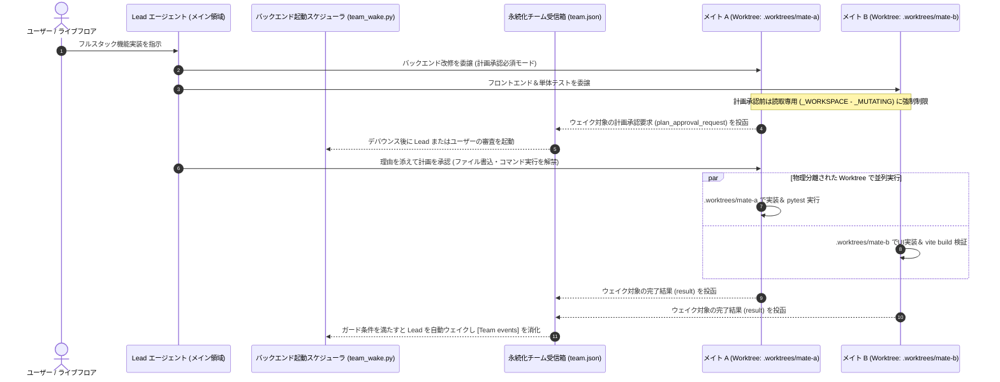

# 3. マルチエージェントと Git Worktree 物理分離

> [!NOTE] 対応ソースコード
> - バックエンド：`app/services/team_runtime.py`、`app/services/team_wake.py`、`app/services/team_worktree.py`、`app/services/team_store.py`、`app/services/subagent.py`
> - フロントエンド：`src/views/LiveFloor.js`、`src/views/TeamSettingsPanel.js`、`src/App.js`

## 3.1 使い捨てサブエージェントの限界と常駐チームの設計

大規模なフルスタック改修では、単一エージェントの逐次実行では時間がかかりすぎます。一方で、複数エージェントを同じディレクトリで並列実行すると、**ファイルの相互上書きや `.git/index.lock` の競合**が発生します。

Helm は、1セッションにつき **常駐チームメイト（Resident Teammates、人数上限は設定可能：デフォルト 4 名、最大 8 名）** を編成し、個別の永続化トランスクリプト（`sessions/<sid>/team/teammates/<name>.jsonl`）と独立した **Git Worktree** を割り当てるアーキテクチャを採用しています。

---

## 3.2 コアエンジニアリング機構

1. **メッセージ分類とデバウンス付き非同期メールボックス（Classified Inbox & Debounced Wake）**：
   - 各メイトのツール呼び出し履歴はメイン会話の `messages` とは分離され、`teammates/<name>.jsonl` に保存されます（ライブフロアの「履歴」タブからいつでも閲覧でき、特定のメイトへ直接メッセージを送ることも可能です）。
   - Lead 宛てのメールは**ウェイク対象**（`result`、`error`、`plan_approval_request`、直接の `message`）と**付随通知**（`idle_notification`、`shutdown_response`、`stopped`）に分類されます。ウェイク対象のみがデバウンス時間（`wake_debounce_s`、デフォルト 3 秒）後に次ターンを起動し、付随通知はその際にまとめて引き渡されます。
   - モデル呼び出しで一時的なエラー（レート制限やタイムアウト等）が発生した場合、メイトはコンテキストを保持したまま `error_paused` に遷移し、指示を受け次第そのまま再開できます。
2. **永続化・アイドル自動一時停止と再開（Persistence & Suspend/Resume）**：
   - チーム状態（`team.json`）と各メイトの会話履歴（`teammates/<name>.jsonl`）はディスクへ永続化されます。アイドル状態が `idle_suspend_minutes`（デフォルト 30 分）を超えるかアプリ終了時には、バックグラウンドコルーチンを終了して `suspended`（一時停止）状態に移行します。
   - 一時停止中のメイトが担当しているタスクは保持期間（`suspended_lease_grace_hours`、デフォルト 24 時間）の間保護され、再起動後にライブフロアからワンクリックで**再開（Resume）**するか、**解散（Dismiss）**してタスクを解放できます。
3. **ユーザー直結の権限確認とセッション内許可ルール（User-Only Permission Gate）**：
   - チームメイトの実効権限は `min(セッション権限モード, チームメイト権限オーバーライド)`（`inherit` / `auto_edit` / `readonly`）で決定され、セッションより緩和されることは決してありません。
   - 確認が必要な操作を実行しようとすると、メイトは `waiting_permission` となり、ライブフロアおよびデスクトップ通知を通じて**ユーザー本人に直接確認**を求めます（「このセッションでは同種の操作を常に許可」の記憶にも対応）。**Lead エージェントが権限を代理承認することは絶対にありません。** 3 回連続で拒否またはタイムアウトすると、タスクは `blocked` になります。
4. **計画承認ゲートと承認者の選択（Plan Approval Gate）**：
   - `team_runtime.py` では変更系ツール群 `_MUTATING = {"write_file", "edit_file", "apply_patch", "write_docx", "edit_document", "run_powershell"}` を分離し、計画承認前は読取専用ツールのみを許可します（`require_plan` または全員強制の `force_plan`）。
   - 計画の承認者（`plan_approver`）は `auto`（権限モードに従う：`ask_all` の時はユーザー、それ以外は Lead）、`lead`（カスタム基準 `plan_criteria` を参照し、承認時は 10 文字以上の理由記載が必須）、`user`（ユーザーのみ）から選択でき、履歴は `recent_plans` に記録されます。
5. **バックエンド起動スケジューラ（`team_wake.py`）と離席時ガードレール**：
   - **バックエンド主導の調整と `/team/stream` SSE**：`team_wake.py` は FastAPI のイベントループ内で動作し、バックグラウンド調整モード（`background_wake`: `on` 常時 / `active_only` セッション表示中のみ / `off` 手動のみ）をサポートします。別セッションを表示中やウィンドウ最小化時でもバックエンドが Lead を自動起動でき、ストリームイベント・デスクトップ通知（`team_notice`）・サイドバーバッジ集計（`team_summary`）を `/api/v1/team/stream` で配信します。
   - **在席検知と離席時の保留（`TEAM_DEFERRED` / `needs_user`）**：フロントエンドがセッションを表示中は `watch=1` により 10 秒間の在席ハートビート（`is_attended`）を更新します。離席中の自動ウェイクでは `_team_unattended` がバインドされ、ユーザー確認を要する操作（`spawn_teammate` 等）はモーダル表示も実行もせず `Deferred:` を返し、Lead が返信内で提案を説明した上で `needs_user` を記録してユーザーの帰還を待ちます。
   - **多重ガードレール**：連続自動ウェイク上限（`max_auto_wakes`、デフォルト 8 回）、離席中トークン予算（`unattended_token_budget`、デフォルト 200,000 tokens、超過時は自動ウェイクと実行中メイトを停止）、チームメイト 1 タスクあたりのトークン予算（`teammate_token_budget`）、およびユーザー手動停止セッション（`run_status == "stopped"`）の自動起動抑止と `turn_hub` による単一ターン排他制御を備えています。
6. **`worktree_core.py`・`team_worktree.py`・`worktree_records.py` による Git Worktree ライフサイクル管理**：
   - **スナップショット起点と Detached チェックアウト**：`.worktrees/<name>` は未コミット変更を含む現在のワークスペースのスナップショット（`baseSha`）から `--detach` モードで作成され、ローカルブランチを汚さず `.git/info/exclude` にも自動登録されます。
   - **`.hyn/worktree.json` 初期化と Windows ジャンクション保護**：設定ファイルのコピーや `node_modules` / `.venv` のジャンクション作成を自動化し、削除時にはジャンクションを先に解除してメイン領域の依存破壊を防ぎます。
   - **自動コミットと隠し参照（`refs/hyn/worktrees/<key>/{base,head,pre_apply}`）**：完了時に変更を自動コミットし、3-way パッチ適用（`git apply --3way`）、適用取り消し（Undo）、`wt/<name>` ブランチ保存、破棄、および孤立参照の一括管理を提供します。
   - **サブエージェント分離（`isolation="worktree"`）と複数プラン比較（`compare_group`）**：書き込み可能なサブエージェントも `.worktrees/sub-<run_id>` で隔離実行でき、チャットカードから直接比較・採用が可能です。また同一 `compare_group` のチームタスクは完了後に並列比較画面からワンクリックで採用できます。
   - **ワークツリー越境コマンド保護**：`bind_tool_root` に加え、`run_powershell` でメイン領域の絶対パス、`cd ..`、`git -C`、`git checkout/switch/reset/merge` 等が検出された場合、ユーザーの権限確認へルーティングします。
7. **プロジェクトタスクシステム（`task_store.py`）**：
   - **ステータス管理と連鎖キャンセル**：`pending`、`in_progress`、`blocked`（ブロック理由）、`completed`（完了サマリー `result`）、`cancelled`（後続タスクの連鎖キャンセル対応）をサポートします。
   - **リース期限・一時停止保持期間・一括作成・アーカイブ**：`leaseExpiresAt` によるハートビート、一時停止中メイトのタスク保持期間（`suspended_lease_grace_hours`）、期限切れタスクの引き継ぎ、`create_tasks` による一時 `ref` を用いた DAG 一括構築、アクティビティ履歴、`(mtime_ns, size)` メモリキャッシュ、および完了タスクの自動アーカイブを備えています。
