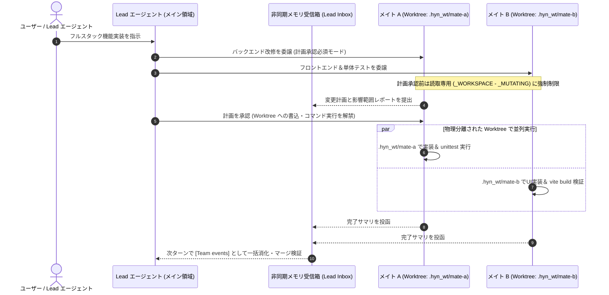

# 3. マルチエージェントと Git Worktree 物理分離

> [!NOTE] 対応ソースコード
> - バックエンド：`app/services/team_runtime.py`、`app/services/team_worktree.py`、`app/services/team_store.py`、`app/services/subagent.py`
> - フロントエンド：`src/views/LiveFloor.js`、`src/views/TeamSettingsPanel.js`

## 3.1 使い捨てサブエージェントの限界と常駐チームの設計

大規模なフルスタック改修では、単一エージェントの逐次実行では時間がかかりすぎます。一方で、複数エージェントを同じディレクトリで並列実行すると、**ファイルの相互上書きや `.git/index.lock` の競合**が発生します。

HYN Agent は、1セッションにつき最大4名の **常駐チームメイト（Resident Teammates, `_MAX_TEAMMATES = 4`）** を編成し、それぞれに独立した **Git Worktree** を割り当てるアーキテクチャを採用しています。

---

## 3.2 3つのコアエンジニアリング機構

1. **ポーリング不要の非同期メールボックス（Zero-Polling Inbox）**：
   - 各メイトのツール呼び出し履歴はメイン会話の `messages` とは完全に分離されており、メインコンテキストの肥大化を防ぎます。
   - メイトの完了報告や承認要求はメモリ内の Lead 受信箱へ投函され、メイン会話の次ターン開始時に `[Team events]` として自動注入されます。
2. **計画承認前の読取専用ゲート（Plan Approval Gate）**：
   - `team_runtime.py` では、変更系ツール群 `_MUTATING = {"write_file", "edit_file", "apply_patch", "write_docx", "edit_document", "run_powershell"}` を厳密に分離しています。
   - `require_plan=True` のメイトは、計画が承認されるまで `read_file / glob / grep` 等の読取専用ツールしか実行できず、意図しないコード書き換えを物理的に防止します。
3. **`team_worktree.py` による Worktree リース管理とクラッシュ復旧**：
   - 各メイトの実行スレッドは `bind_tool_root`（ContextVar）によって自身の Worktree パスに拘束されます。
   - プロセス再起動時には `recover_after_restart()` が孤立した Worktree リースと未完了タスクを安全にクリーンアップします。
