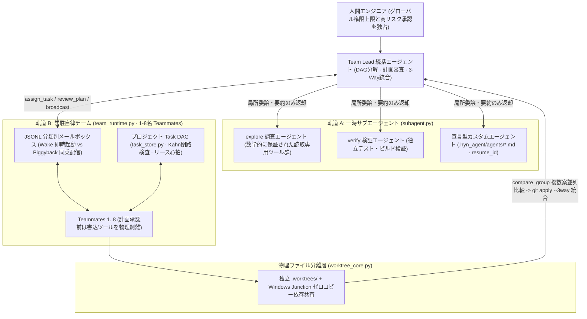
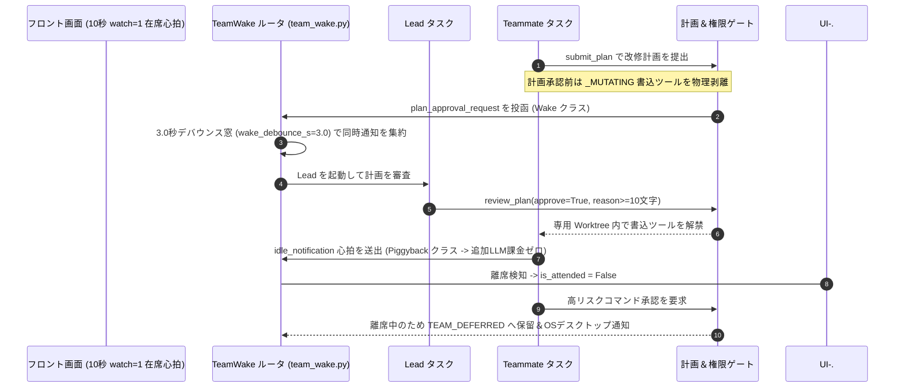
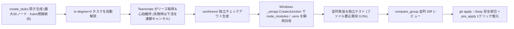

# 3. 常駐マルチエージェントチーム・タスクDAGと Git Worktree 並列比較

> [!NOTE] 対象モジュールと署名済み実測レポート
> - 対象ソース：`app/tools/subagent.py`、`subagent_registry.py`、`team_runtime.py`（`4,585` 行）、`team_wake.py`、`task_store.py`、`worktree_core.py`
> - 実測レポート：[Harness ガードレール消融実験 (4名並列 3.04倍高速化 · 書込衝突 0.0% · 特権昇格阻止 100%)](/ja/benchmarks/harness-ablation-v1)

## 3.1 一時サブエージェントと常駐チームメイトの2層協調トポロジ

単一エージェントのコンテキスト枯渇と、従来型グループチャット方式のトークン爆発・ファイル上書き衝突を同時に解決するため、Helm は**一時サブエージェント（Subagents）**と**常駐チーム（Resident Teams：Lead + 1〜8名）**を明確に分離しています。

---

## 3.2 分類別起動メールボックス・在席検知・権限収束ガード

> [!TIP] アーキテクチャ上のトレードオフ：トークン暴走と特権昇格をどう防ぐか？
> - **技術的課題**：並列エージェントの心拍通信による無限課金と、プロンプト注入による親エージェント経由の権限昇格が大きな脅威となります。
> - **従来手法の限界**：全員同報チャット方式ではメッセージごとに全エージェントが起動し、テキスト指示ベースの権限管理は容易に突破されます。
> - **Helm の解決策**：① メールを **Wake**（`3秒` 集約起動）と **Piggyback**（次回ターン同乗・単独課金ゼロ）に分離。② 実効権限を `min(ユーザー現在のモード, メンバー設定権限)` にハード固定。③ 無人実行上限 `200,000` トークン・連続自動起動 `8回`・`30分` 自動休眠（`24時間` リース保護）を強制します。
> - **定量的成果**：[Harness 消融実験](/ja/benchmarks/harness-ablation-v1) にて権限昇格・注入攻撃を **`100.0%`（30/30）阻止**し、待機中トークン消費 **0** を実現しました。

---

## 3.3 原子的タスク DAG と Windows Junction ゼロコピー Git Worktree

- **安全な Junction 解除（`worktree_core.py`）**：管理者権限不要の `_winapi.CreateJunction` で数GBの依存環境をゼロコピー共有し、破棄時は必ず先に再解析ポイントを解除してから削除するため、本体の `node_modules` を誤削除する事故は起こりません。4名並列実行により **`2.88倍〜3.04倍` の実時間高速化**と **衝突率 `0.0%`** を実証しています。