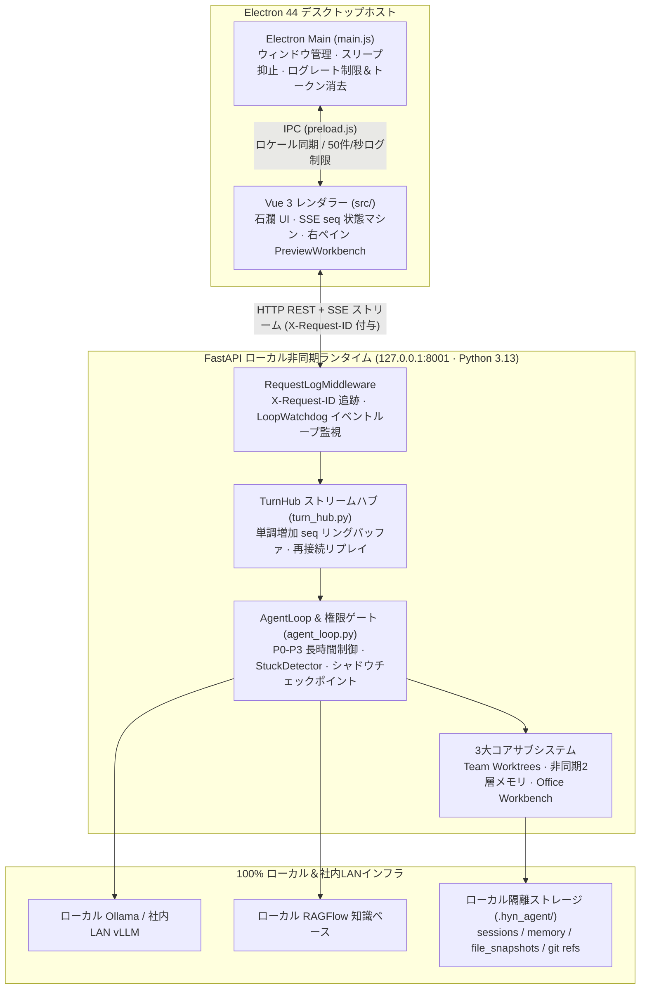

# 1. 全体設計とデュアルプロセス構造

> [!NOTE] 技術白書ガイド（エンジニア面接官・テックリードの方へ）
> 本シリーズ（全5章）では、**HYN Agent** の内部モジュール構成、状態マシン、およびエッジケースに対するエンジニアリング判断をソースコードレベルで詳述します。本章はフロントエンド `hyn_agent_frontend/main.js`、`src/i18n.js` およびバックエンド `hyn_agent_backend/app/main.py`、`app/core/*` に対応しています。

## 1.1 プロセス分離トポロジー（3層アーキテクチャ）

HYN Agent は **「Electron メインプロセス（OSブリッジ） + Vue 3 レンダラープロセス（石瀾ワークベンチ） + ローカル FastAPI 非同期プロセス（Agent ランタイム）」** の3層分離構造を採用しています。



### なぜエージェントロジックを Electron メインプロセスから分離したのか？
1. **UIスレッドの非ブロッキング化**：Electron メインプロセス（`main.js`）はネイティブウィンドウ制御、長時間実行時のOSスリープ抑止（`powerSaveBlocker`）、OS通知、およびセキュアログ出力のみに専念します。SSE ストリーム通信はレンダラーから `127.0.0.1:8001` へ直接接続し、IPC シリアライズによるメインプロセス詰まりを排除しています。
2. **Python エコシステムとコンテナ展開への適合**：`python-docx`、`openpyxl`、`python-pptx`、`pypdfium2`、公式 `mcp` SDK などの成熟した Python ライブラリをフル活用でき、同時にバックエンド + Vue 3 フロントエンドをそのまま**社内LANサーバー向け Docker コンテナ**として展開することも可能な設計です。

---

## 1.2 フルスタック観測性とセキュリティ・バイ・デザイン

### 1. `X-Request-ID` によるプロセス横断トレーサビリティ（`app/core/request_log.py`）
- FastAPI の `RequestLogMiddleware` を `CORSMiddleware` の外側に配置し、`expose_headers=["X-Request-ID"]` によって Electron レンダラー側からもリクエストIDを参照可能にしています。
- 未捕捉の例外が発生した場合でも、グローバルハンドラ（`_unhandled_exception_handler`）が `request_id` 付きでトレースバックを構造化ログへ記録し、日・英・中3言語対応のエラーレスポンスを返します。

### 2. 非同期イベントループ・ウォッチドッグ（`app/core/loop_watchdog.py`）
- ローカルファイル処理などで `asyncio` イベントループがブロックされるのを検知するため、`start_watchdog(loop)` と `loop.set_exception_handler` を導入し、バックグラウンドタスクのサイレント失敗を防止しています。

### 3. 書込前の認証情報サニタイズと IPC レート制限（`hyn_agent_frontend/main.js`）
- **`sanitizeLogMessage` フック**：ログファイル（`main.log` / `renderer.log`）への書込前に、`sk-*`、`AIza*`、`Bearer *`、`api_key`、`authorization`、`secret` 等の文字列を正規表現で検出し、強制的に `***` へ置換します。
- **ログフラッド防止**：レンダラーからの IPC ログに対し、**1フィールド最大 4KB 切り詰め（`truncate4KB`）** と **毎秒最大50件のレート制限** を設けています。

---

## 1.3 決定論的グレースフルシャットダウン（Graceful Shutdown Sequence）

ウィンドウ終了時にプロセスを強制終了すると、実行中のターンや非同期メモリ抽出が破損する恐れがあります。`app/main.py` の `_lifespan` では、以下の **6段階のシャットダウン順序** を厳格に保証しています：

```python
# hyn_agent_backend/app/main.py (_lifespan finally ブロックより抜粋)
# 1. 実行中のセッションターンを最終チェックポイントへフラッシュし interrupted として記録
await turn_hub.shutdown()
# 2. バックグラウンドの非同期メモリ抽出キューをドレイン（最大10秒待機）
await memory_queue.shutdown(timeout=10)
# 3. 常駐チームメイトを停止し Git Worktree リースを解放
await shutdown_teams()
# 4. Cron スケジューラを停止
await stop_cron_runtime()
# 5. バックグラウンドコマンドのサブプロセスを終了
shutdown_background_tasks()
# 6. 起動済みの MCP クライアント接続とウォッチドッグを終了
await shutdown_mcp()
stop_watchdog()
```
