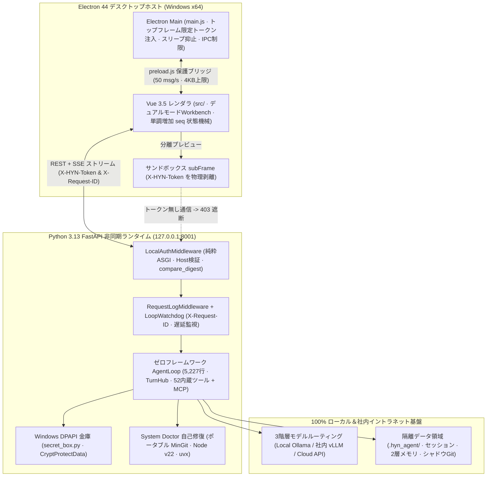
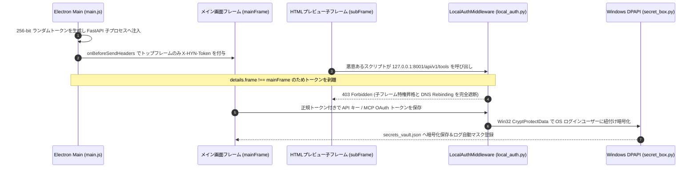
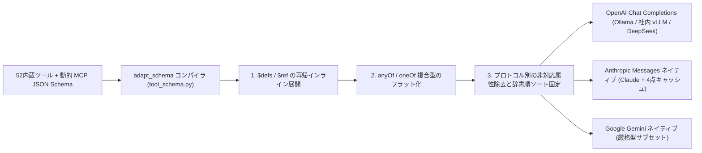

# 1. 全体設計・ゼロトラスト認証＆自己修復型デュアルプロセス基盤

> [!NOTE] エンジニアリングアーキテクチャ白書（全 6 巻）
> 本シリーズ（全6巻）では、**Helm**（バックエンド `167` モジュール / `70,223` 行 / 自動テスト `502` 件、フロントエンド `69` モジュール / `42,326` 行）の状態機械・境界設計・実測データを完全公開します。第1巻は `hyn_agent_frontend/main.js`、`app/main.py`、`app/core/*`、`tool_schema.py`、`system_doctor.py` を解説します。

## 1.1 3層分離デスクトップトポロジと責務境界

Helm は重い I/O 処理を Electron メインプロセスに詰め込んだり外部クラウドコンテナへ依存したりせず、**「Electron 44 ホスト（システム境界） + Vue 3.5 レンダラ（デュアルモード画面） + ローカル Python 3.13 FastAPI 非同期エンジン（ゼロフレームワーク Agent ランタイム）」** に厳密分離しています。

> [!TIP] アーキテクチャ上のトレードオフ：なぜ純粋 Node.js ではなく Electron + 独立 Python サブプロセスなのか？
> - **技術的課題**：60FPS のマルチタブ文書 UI を維持しながら、AST 解析・OpenXML（`docx/xlsx/pptx`）の局所バイナリ編集・並列 Worktree 制御を同時に回す必要があります。
> - **従来手法の限界**：Node.js 単一プロセスでは大容量文書解析で画面がフリーズし、LangChain 等の厚い抽象化はプロンプトのバイト配列をブラックボックス化して KV キャッシュ効率を損ないます。
> - **Helm の解決策**：Electron Main を最小限に保ち、同梱された公式 Python 3.13 上の純粋 `asyncio + httpx` エンジンへローカル直結します。
> - **定量的成果**：**`502` 件の `pytest` 自動テスト**に守護され、**外部への意図せぬデータ送信 0 バイト**と社内 Docker への無改修展開を両立しています。

---

## 1.2 ゼロトラスト認証と Windows DPAPI ハードウェア連携金庫

1. **純粋 ASGI ストリーミング認証（`local_auth.py`）**：SSE をバッファリングしない純粋 ASGI 実装により、ループバック `Host` 検証と `secrets.compare_digest` 定数時間比較を実行します。
2. **Windows DPAPI 資格情報金庫（`secret_box.py`）**：API キーや OAuth トークンを平文保存せず、Windows ネイティブ `CryptProtectData` で暗号化。ログ出力前には秘密文字列を強制的に `***` へ置換します。

---

## 1.3 3階層計算ルーティングと適応型 Schema コンパイラ

| 配備階層 | 対応ゲートウェイ（`8` プロバイダ / `18` 厳選モデル） | 通信境界 | 主な特徴 |
| :--- | :--- | :--- | :--- |
| **`local`（完全オフライン）** | ローカル `Ollama` (`127.0.0.1:11434/v1`) | **外部通信 0 バイト** | APIキー不要の自動検出・VRAM再確保リトライ |
| **`lan`（社内イントラ）** | 社内 `vLLM` / `SGLang` / `OneAPI` | **社内ファイアウォール内完結** | 社内GPUクラスタ＆社内RAGFlow直結 |
| **`cloud`（公式API直結）** | `DeepSeek` / `Qwen` / `GLM` / `Claude` / `Gemini` / `OpenAI` | 公式エンドポイントへ TLS 直結 | 中継サーバ無し・プレフィックスキャッシュ最適化 |

---

## 1.4 管理者権限不要の `System Doctor` と 8段階グレースフルシャットダウン

- **ポータブル環境自己修復（`system_doctor.py`）**：管理者権限（UAC）のない企業貸与 PC でも、`git`・`node`/`npx`・`uv`/`uvx` の欠損を検知すると公式ポータブル版 **MinGit**・**Node.js v22**・**`uv`** を `DATA_DIR/toolchains/` へ自動展開し、システム環境変数を汚さずに修復します。
- **6段階起動復旧＆8段階シャットダウン（`app/main.py`）**：終了時は実行中ターンを `interrupted` としてチェックポイント保存し、非同期メモリキューの書き出し（最大 `10秒`）、常駐チームの `24時間` リース保護スリープ、Cron・子プロセス・MCP 切断を順序通りに完了させます。