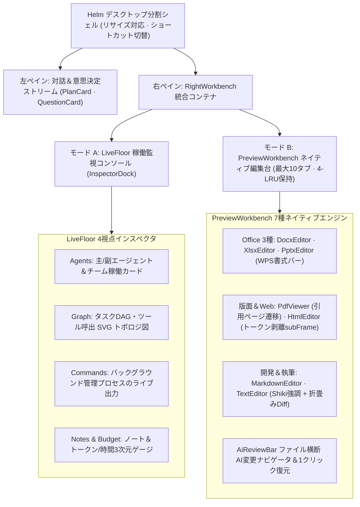
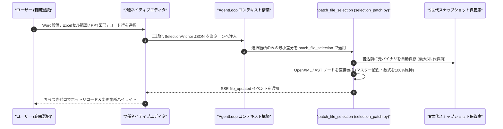
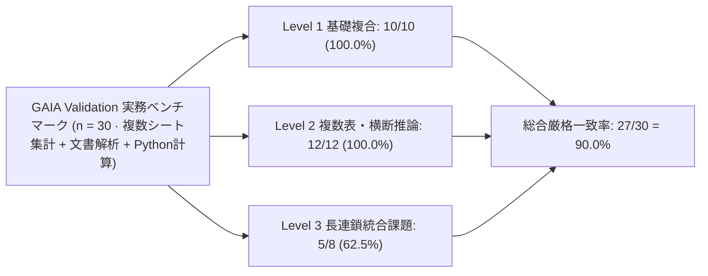

# 5. デュアルモードWorkbench・7種ネイティブエディタ＆Office局所パッチ

> [!NOTE] 対象モジュールと署名済み実測レポート
> - フロントエンド：`hyn_agent_frontend/src/components/RightWorkbench.js`、`LiveFloor.js`、`PreviewWorkbench.js`、`AiReviewBar.js`、`WpsFormatToolbar.js`、`src/components/editors/*`
> - バックエンド：`app/tools/file_workbench.py`、`app/services/selection_patch.py`
> - 実測レポート：[GAIA マルチモーダル文書＆オフィス実務検証 (27/30 = 90.0% 正解率)](/ja/benchmarks/gaia-mini-v1)

## 5.1 右ペイン統合型デュアルモード `RightWorkbench`

Helm は左側の対話ストリームと右側の統合ワークベンチ（`RightWorkbench.js`）を組み合わせ、**リアルタイム稼働監視（`LiveFloor`）** と **7種ネイティブ文書スタジオ（`PreviewWorkbench`）** を瞬時に切り替えられます。

---

## 5.2 `SelectionAnchor` 選択座標プロトコルと OpenXML 局所パッチ

> [!TIP] アーキテクチャ上のトレードオフ：なぜ Markdown 変換ではなく OpenXML 直接パッチを行うのか？
> - **技術的課題**：業務用の提案書 PPTX・財務 XLSX・契約書 DOCX を一度テキスト変換して再生成すると、結合セル・数式・スライドマスターが崩壊します。
> - **従来手法の限界**：ファイル全体の丸ごと再出力は遅く、トークン消費が膨大で章落ち事故も多発します。
> - **Helm の解決策**：5種の座標系（`docx_paragraphs`・`xlsx_range`・`pptx_shape`・`text_lines`・`dom_selector`）と 5世代バイナリスナップショット、SSE ホットリロードを直結しました。
> - **定量的成果**：Office 局所編集マイクロベンチマークで **`20/20`（100%）レイアウト無破損合格**、出力トークン消費を **`82% 以上` 削減**しました。

---

## 5.3 7種ネイティブエディタ一覧と GAIA 90.0% 実証

| エディタコンポーネント | 対応拡張子 | 主な機能 | `SelectionAnchor` 種別 |
| :--- | :--- | :--- | :--- |
| **`DocxEditor.js`** | `.docx` | 段落スタイル忠実描画・WPS書式バー・変更ハイライト | `docx_paragraphs` |
| **`XlsxEditor.js`** | `.xlsx` / `.csv` | 複数シート切替・行列固定・範囲選択・数式検証 | `xlsx_range` |
| **`PptxEditor.js`** | `.pptx` | スライド一覧・図形単位クリック選択・マスター維持編集 | `pptx_shape` |
| **`PdfViewer.js`** | `.pdf` | 高精細描画・RAG `[ev_N]` 引用からの1クリックページ遷移 | ページ＆テキスト座標 |
| **`TextEditor.js`** | `40+` 言語 | `Shiki` 構文強調・折畳み Unified Diff・行範囲指定 | `text_lines` |
| **`MarkdownEditor.js`** | `.md` | ソース/プレビュー切替・Mermaid図表即時描画 | `text_lines` |
| **`HtmlEditor.js`** | `.html` | トークン剥離サンドボックス描画・DOMセレクタ指定改修 | `dom_selector` |