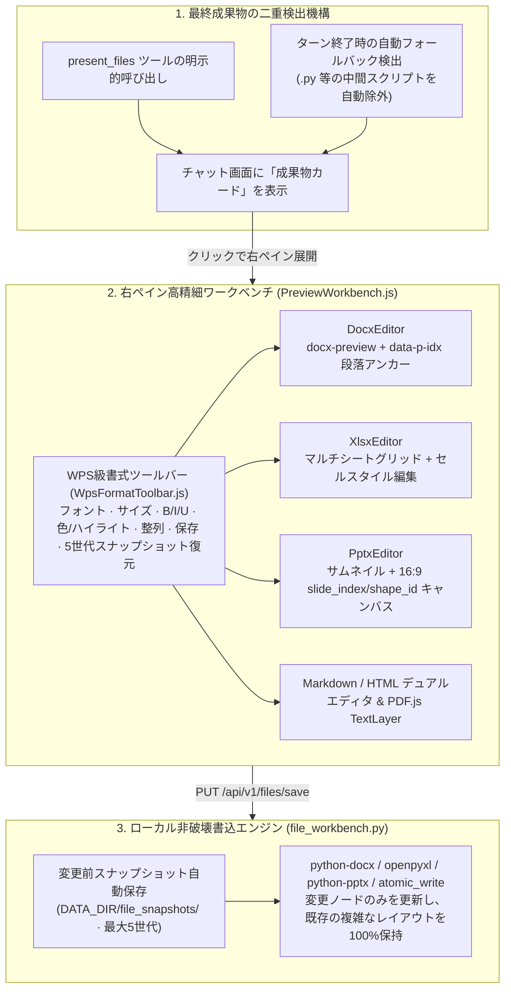
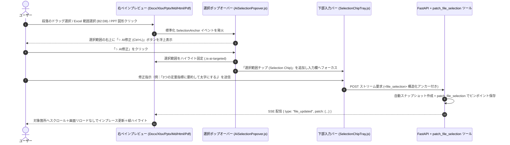

# 5. 高精細ドキュメントワークベンチと部分AIホットパッチ

> [!NOTE] 対応ソースコード・設計書
> - フロントエンド：`src/components/preview/PreviewWorkbench.js`、`WpsFormatToolbar.js`、`AiSelectionPopover.js`、`editors/{DocxEditor,XlsxEditor,PptxEditor,MarkdownEditor,HtmlEditor,PdfViewer,TextEditor}.js`
> - バックエンド：`app/services/file_workbench.py`、`app/services/tools/selection_patch.py`、`app/services/tools/office.py`
> - 設計書：`docs/file_preview_phase1_plan.md`、`docs/file_ai_edit_phase2_plan.md`

## 5.1 なぜコーディングエージェントに Office ワークベンチを統合したのか？

日本の開発現場（SIer・事業会社問わず）では、コード実装だけでなく**アーキテクチャ審査資料（`.pptx`）、基本設計書・詳細設計書（`.docx`）、テスト仕様書（`.xlsx`）** の作成・更新に膨大な工数が割かれています。
従来のエージェントで Office 文書を扱う際の2大課題を解決しました：
1. **中間スクリプトの排除**：PPT生成用の一時 `.py` スクリプト等を除外し、最終成果物のみを「成果物カード（Artifact Card）」として提示。
2. **ピンポイント部分修正（In-Place Patching）**：スライド1枚やExcelの特定セル範囲だけを修正したい時、ファイル全体を再生成して既存レイアウトを壊すのではなく、選択箇所だけを構造的に書き換えて即座にプレビューへ反映します。

---

## 5.2 フェーズ1：高精細インプレース描画＆WPS級ツールバー編集

---

## 5.3 フェーズ2：マウス選択「✨ AI修正」と SSE インプレース更新

Cursor の `Add Selection to Chat` と OpenAI Canvas の体験を、Word / Excel / PowerPoint を含む全フォーマットへ拡張しました：

### フォーマット横断の `SelectionContext` アンカー仕様

| フォーマット | `locator.type` | 構造化アンカー座標 | バックエンド部分書込の仕組み |
| :--- | :--- | :--- | :--- |
| **PowerPoint (`.pptx`)** | `pptx_shape` | `slide_index` + `shape_id` + `paragraph_indices` | `python-pptx` で対象スライド・図形を特定し、該当段落のテキスト・書式のみを更新 |
| **Word (`.docx`)** | `docx_paragraphs` | `paragraph_start` 〜 `paragraph_end` (`data-p-idx`) | `python-docx` で対象段落のみを更新し、ヘッダーや表・他章のスタイルを完全保持 |
| **Excel (`.xlsx`)** | `xlsx_range` | `sheet_name` + `cell_range` (例: `Sheet1!B2:D8`) | `openpyxl` で指定セル範囲の値・数式・書式のみを一括更新 |
| **コード / MD / HTML** | `text_lines` / `dom_selector` | `line_start` 〜 `line_end` または CSS セレクタ | 行範囲のアトミック置換と差分パッチ返却 |
