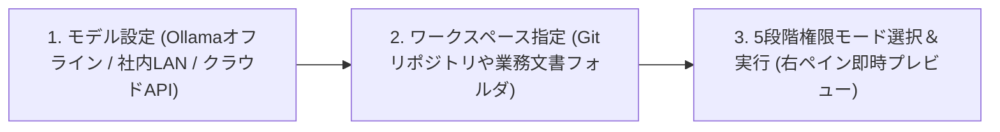

# クイックスタート・導入手順

Helm は **Electron 44 + Vue 3.5 フロントエンド + 同梱 Python 3.13 FastAPI ローカルバックエンド** を一体化したデスクトップアプリです。追加の環境構築は一切不要で、`git`・`node`・`uvx` が未導入の企業貸与PCでも **System Doctor** が管理者権限なしでポータブル環境を自動構築します。

## 1. クライアントの起動

[ダウンロード・安全性検証](/ja/download) ページより Windows インストーラーを取得して起動してください：
- **[無料ダウンロード Windows版 (.exe)](https://github.com/HelmAgent/Helm_website/releases/latest/download/Helm.Setup.1.0.0.exe)**：任意のドライブへの導入および隔離 `.hyn_agent` データ保存に対応。
- **100% ローカル完結＆DPAPI 暗号化** · [VirusTotal セキュリティ検査レポート (0/57)](https://www.virustotal.com/gui/file/c93002b281b848c534538236819c135139aa78e9ae85e88a04e67ba9536ccf0f?nocache=1) · `SHA-256: c93002b2...536ccf0f`

| ファイル名 | SHA-256 チェックサム | 第三者セキュリティ検査 |
| :--- | :--- | :--- |
| `Helm Setup 1.0.0.exe` | `c93002b281b848c534538236819c135139aa78e9ae85e88a04e67ba9536ccf0f` | [VirusTotal レポートを確認 (0/57)](https://www.virustotal.com/gui/file/c93002b281b848c534538236819c135139aa78e9ae85e88a04e67ba9536ccf0f?nocache=1) |

> [!TIP] Cドライブを圧迫しない隔離設計＆Windows DPAPI 保護
> 会話履歴・2層メモリ・スナップショットは `.hyn_agent` フォルダに隔離保存され、APIキーや OAuth トークンはすべて **Windows DPAPI (`CryptProtectData`)** で暗号化保護されます。

## 2. 最初のタスクを実行する3ステップ

### Step 1：モデルプロバイダーの選択（100% オフライン対応）
左サイドバー下部の **「設定 (Settings) → モデル (Models)」** を開きます：
- **完全オフライン・機密環境の場合**：標準搭載の **「Ollama（ローカルオフライン）」** または **「社内LANモデル（企業内ネットワーク）」** を有効化します（APIキー不要）。
- **クラウドモデル利用時**：DeepSeek、Qwen、GLM、Kimi、Claude、Gemini、OpenAI 等に対応。APIキーは OS レベルの DPAPI で暗号化され、ログ出力前に自動マスクされます。

### Step 2：ローカルワークスペース（Workspace）の紐付け
左上の **「Helm」** ロゴ下のパスをクリックし、対象のリポジトリまたは文書フォルダを選択します。Git リポジトリでは `HEAD` や `git status` を一切汚さない **シャドウGitチェックポイント** が自動稼働します。

### Step 3：5段階の権限モード（Permission Mode）の選択
下部入力バー右側の権限ボタンから、キャッシュを壊さず実行中でも即座に切り替えられます：

| 権限モード | 推奨シーン | 動作仕様 |
| :--- | :--- | :--- |
| **`plan`（読取・計画）** | 大規模コード調査・事前設計レビュー | 読取専用ツールのみ許可し書込・コマンドを物理遮断。`PlanCard` で承認後に実装開始 |
| **`ask_all`（全件確認）** | 機密コード監査・本番設定調査 | 読取専用は自動許可。ファイル書込・コマンド実行はすべて事前確認 |
| **`default`（標準推奨）** | 日常の開発・オフィス文書作成 | 通常の編集確認と安全な読取コマンドを許可し、破壊的コマンドのみ確認を要求 |
| **`auto_edit`（自動編集）** | 高速な開発反復・文書ブラッシュアップ | ワークスペース内の編集（5世代バックアップ付）と読取コマンドを自動許可 |
| **`full_auto`（完全自動）** | **数時間の無人改修・チーム並列実行** | ワークスペース内の操作・MCP・チーム協働を自動承認（**保護パス `.git/hooks`・`.env*` 等は強制人間承認を維持**） |

## 3. コミュニティ・お問い合わせ・カスタム開発

- **Helm Discord 交流サーバー**：[https://discord.gg/AsU9Xqd6g](https://discord.gg/AsU9Xqd6g)
- **QQ 交流グループ番号**：`1129820733`
- **交流・提携メールアドレス**：`785430621@qq.com`

> [!IMPORTANT] ベータ感謝と「課題提案・無償開発」共創計画
> 現在ベータテスト段階にあり、皆様のご支援とご利用に感謝申し上げます。不具合やご要望はぜひお知らせください。正式版および今後のアップデートでは皆様の声を募集し、3つの客観基準（業界の共通課題・入出力例の明確化・標準機能としての公開＆投票順）を満たす課題を無償で新機能として開発します。緊急・非公開のプライベートカスタム機能開発はメール（`785430621@qq.com`）にて個別にご連絡ください。