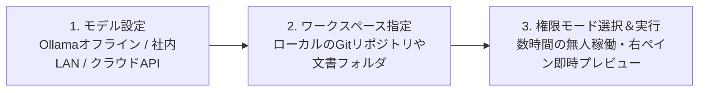

# クイックスタート・導入手順

Helm は **Electron + Vue 3 フロントエンド + Python 3.13 FastAPI ローカルバックエンド** を一体化したデスクトップアプリケーションです。外部サーバーや追加の Python 環境構築は一切不要で、インストール（またはZIP解凍）後すぐに利用できます。

## 1. クライアントの起動

利用環境に合わせて2つの配布形式から選択できます（詳細は[ダウンロード・安全性検証](/ja/download)を参照）：
- **標準インストーラー版 (`Helm-Setup.exe`)**：デスクトップショートカットを自動作成します。
- **ポータブル版 (`Helm-Portable.zip`)**：管理者権限不要・レジストリ変更なし。任意のフォルダに解凍して起動できます。

> [!TIP] Cドライブを圧迫しないデータ隔離設計
> 会話履歴・2層メモリ・ファイル変更スナップショット・ログはデフォルトで親階層の `.hyn_agent` フォルダに保存されます（設定画面から任意のドライブへいつでも移行可能です）。

## 2. 最初のタスクを実行する3ステップ

### Step 1：モデルプロバイダーの選択（100% オフライン対応）
左サイドバー下部の **「設定 (Settings) → モデル (Models)」** を開きます：
- **完全オフライン・機密環境の場合**：標準搭載の **「Ollama（ローカルオフライン）」** または **「社内LANモデル（企業内ネットワーク）」** を有効化します（APIキー不要）。
- **クラウドモデル利用時**：DeepSeek、Kimi、Anthropic Claude、Google Gemini、および OpenAI 互換 API に対応。APIキーはローカルにのみ保存され、ログ出力時には自動マスクされます。

### Step 2：ローカルワークスペース（Workspace）の紐付け
左上の **「Helm」** ロゴ下のパスをクリックし、対象のソースコードリポジトリまたはドキュメントフォルダを選択します。
- Git リポジトリの場合、**非侵襲シャドウGitチェックポイント（Shadow Git Checkpoints）** が自動で有効になり、作業中の `HEAD` や `git status` を一切汚さずに自動スナップショットを記録します。

### Step 3：4段階の権限モード（Permission Mode）の選択
下部入力バー右側の権限ボタンから、実行中でも即座にモードを切り替えられます：

| 権限モード | 推奨シーン | 動作仕様 |
| :--- | :--- | :--- |
| **🔒 すべて確認 (`ask_all`)** | 機密コード監査・初めての検証 | 読取専用ツールは自動許可。ファイル書込・コマンド実行はすべて事前確認 |
| **✏️ 自動編集 (`auto_edit`)** | 対話型の開発・ドキュメント作成 | ワークスペース内のファイル編集と読取専用コマンド（`git diff` 等）を自動許可 |
| **🛡️ スマート確認 (`default`)** | 標準推奨モード | 通常の編集・テスト実行は自動許可し、破壊的コマンドのみ確認を要求 |
| **⚡ 完全自動 (`full_auto`)** | **数時間の無人自律タスク** | ワークスペース内の操作・MCP・チーム協働を自動承認（**ワークスペース外へのアクセスやOS破壊コマンドは100%強制遮断**） |
